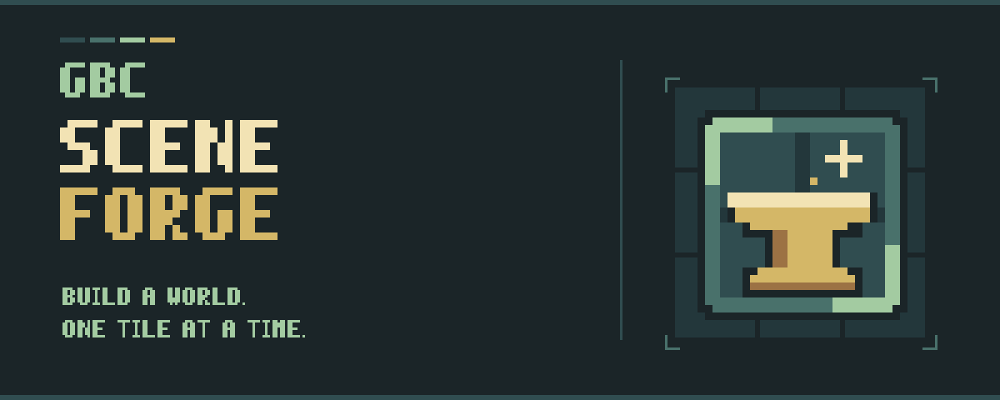
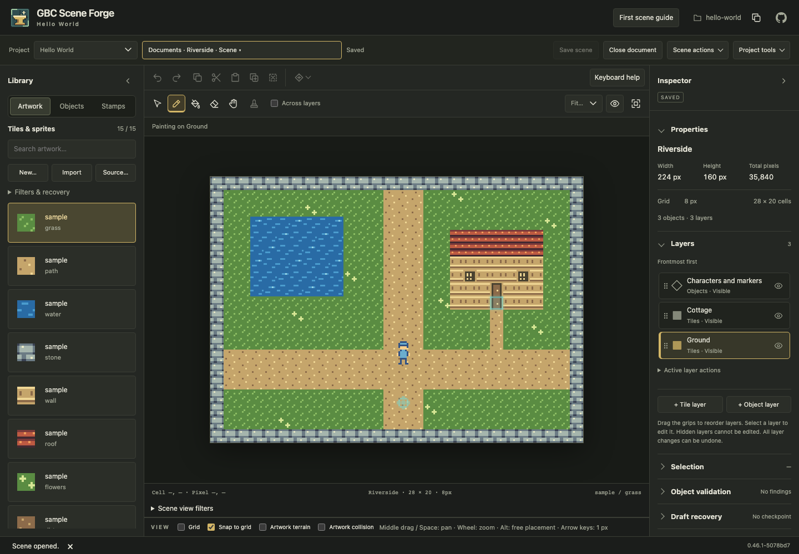
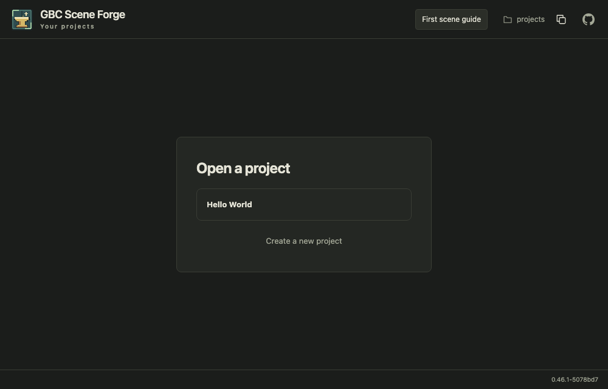
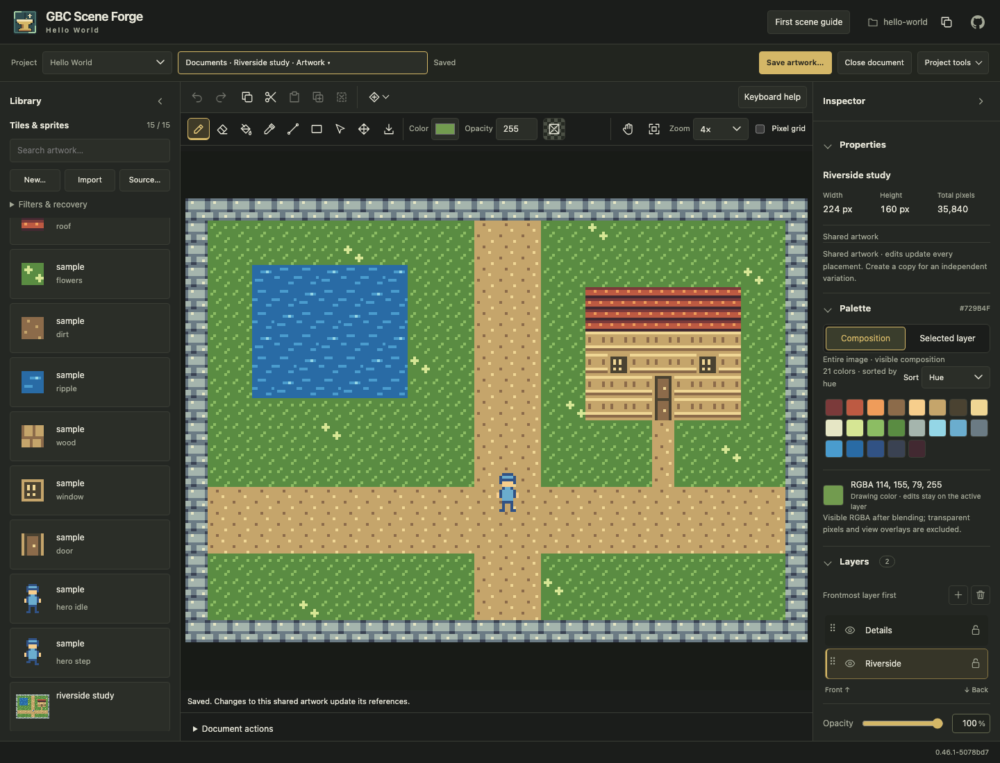

# GBC Scene Forge

[](https://github.com/cliffom/gbc-scene-forge/actions/workflows/ci.yml)
[](https://github.com/cliffom/gbc-scene-forge/actions/workflows/publish.yml)



Scene Forge is a local browser workspace for pixel artwork and tile-based worlds.
Draw tiles, sprites and illustrations, animate native sheets, build scenes from
your artwork, or plan a level before drawing a single pixel. Keep artwork and
scenes together in portable projects, and export maps for Tiled.

Your projects stay on your computer. The installed editor works offline, needs
no account, and has no additional Python runtime dependencies. An optional local
MCP server lets agents author and review the same project alongside the browser.



## Start editing

Install with **Python 3.10 or newer**:

```sh
python -m pip install --upgrade gbc-scene-forge==0.46.1
gbc-scene-forge
```

Forge opens your default browser at **http://127.0.0.1:8765/**. Keep the terminal
running while editing; stop the server with **Ctrl+C**. If no browser opens, use
the address printed in the terminal. Use `--no-browser` to open it yourself, or
`--port 0` to choose an available port.

You need a current desktop browser: Chrome, Edge, Firefox or Safari. Node,
Poetry, Tiled and [gbc-atlas](https://github.com/cliffom/gbc-atlas) are not required
to use the installed editor. Installation needs access to the package index or a
downloaded wheel; the editor, sample and first-scene guide work offline afterward.
Chrome acceptance runs on macOS and Linux; package CI checks Python 3.13 and 3.14
on Linux. Other browsers and Windows are outside the automated browser matrix.

Working from this repository? Follow [Development](#development), then run:

```sh
make setup PYTHON=python3.13
make run
```

### Create your first project

1. Enter a project name. If projects already exist, choose **Create a new project**.
2. Choose a starting goal: **Sample artwork and scenes**, **Create pixel artwork**,
   **Import artwork or maps**, **Blockout — no artwork needed**, or **Empty project**.
3. Choose **Create project**. The sample gives you an editable copy of two scenes
   and original MIT-licensed artwork, with no external artwork tools needed.



For a first scene, start with the sample, then choose **Open scene…** and select
**Riverside**. Choose a tile in the Library and paint on a tile layer. **Save** or
**Ctrl/⌘ S** saves the active document; **Documents** lets you open saved scenes
and return to retained artwork. **Scene actions → Create scene…** starts your own map.

The optional **First scene guide** in the header walks through painting,
save/reopen, sprite preview and export. You can close it while editing and reopen
to continue. For the full controls and recovery behavior, see the
[editor guide](docs/STANDALONE.md).

## Create artwork and build worlds

### Draw and animate in the same workspace

Choose **New…** in the Artwork Library to create a tile, sprite, illustration or
multi-frame sheet. Artwork opens in the same workbench as scenes, with its own
history and recoverable draft. Switch documents without losing retained edits.

- Draw with Pencil, Eraser, Fill, Line and Rectangle; select, move and transform pixels.
- Work with named layers, visibility, locking and opacity. Inspect colors for the
  whole composition or the selected layer.
- Edit named frames, use onion skins, and preview animation with frame timing.
- Edit shared artwork or make an independent copy. Selected-placement variations
  let you replace only the captured tiles or sprites after review.
- Review artwork changes before saving. Download the whole image/sheet or selected
  frame as a native-size PNG, including unsaved edits and transparency.



The example above uses the repository's demo reference image in a native artwork
document. See [Create and edit pixel artwork](docs/user/pixel-artwork.md) for
setup, drawing, animation, copies, layers and save review.

### Compose scenes from your artwork

Import [ordinary PNG tilesheets or supported Tiled JSON maps](docs/user/import-artwork.md),
bring in a gbc-atlas folder, or use your native artwork directly from the Library.

- Paint tiles and stamps; place sprites, spawn points, trigger rectangles and typed objects.
- Organize named tile and object layers, reorder them, and control visibility.
- Copy, duplicate and transform selections; save [reusable stamps](docs/STANDALONE.md#clipboard-and-reusable-stamps).
- Paint connected roads, walls and shorelines with [terrain brushes](docs/user/terrain-brushes.md).
- Resize or crop scenes with an anchored preview and Undo, including
  [wide and tall maps](docs/user/scene-dimensions.md).
- Preview sprite animation and movement; save sequence mappings and preview preferences.
- Arrange scenes in [World view](docs/STANDALONE.md#world-view-and-scene-connections)
  and connect object endpoints between them.

Collapse the Library or Inspector with its header arrow to reclaim canvas space.
[Review scene](docs/user/review-mode.md) gives you a larger canvas with pan, zoom
and Fit scene. Share a [scene link](docs/user/scene-links.md) to reopen its saved state.

### Plan a level before adding artwork

Start with **Blockout — no artwork needed**, or choose **Scene actions → Create
blockout scene…** in an existing project. Draw labeled ground, platforms, hazards
and climb regions, place encounter/progression markers, and review the route
through a configurable gameplay camera. The plan stays as native objects when
you add artwork or export to Tiled.

Follow the [blockout tutorial](docs/user/blockout-tutorial.md) for a complete
first session, or use the [blockout reference](docs/BLOCKOUT.md).

### Check and export your project

[Project diagnostics](docs/STANDALONE.md#project-diagnostics) finds content errors,
unused assets and movement findings under explicitly selected assumptions.
[Reusable object definitions](docs/STANDALONE.md#reusable-object-definitions)
provide typed fields, shared defaults, instance overrides and navigable validation.

Optional [GBC target budgets](docs/user/gbc-budgets.md) estimate static source tiles
and OAM alongside [palette requirements](docs/PALETTE-BUDGETS.md). These are authoring
checks with explicit runtime limits; generic editing and Tiled export do not
require a target profile.

Choose **Project tools → Export** for a scene or whole-project ZIP. Either scope can include unsaved edits from the open scene when you
choose that option; other scenes use their saved versions. Open the maps in Tiled, or extract a whole-project export and open it in
Forge with `--project`. See the [editor guide](docs/STANDALONE.md) for the supported
Tiled subset and export boundaries.

### Work with a local agent

The optional [MCP server](docs/MCP.md) exposes scene and native artwork authoring,
blockout planning, bounded atlas import/reimport, rendering and review through the
same project services as the browser.

```sh
python -m pip install --upgrade 'gbc-scene-forge[mcp]==0.46.1'
gbc-scene-forge-mcp --project-root /absolute/path/to/projects
```

Configure a local stdio-capable MCP client to launch that command. Open the same
project in the browser to inspect saved changes. Agents can also prepare
unpublished artwork drafts for browser preview and adoption; publishing requires
review and current revisions. See the [browser/MCP outcome matrix](docs/AUTHORING-OUTCOMES.md)
for supported workflows and boundaries.

Clean open documents can follow external saves. Refresh pauses during local edits
and interactions; [external refresh](docs/user/external-refresh.md) explains the
controls and conflict recovery. The ordinary editor needs no MCP dependencies.

## Your files and saved work

Forge keeps projects in `.forge_project/` under the directory where you launch it.
Each project has its own folder; **Hello World** becomes `hello-world`.

```text
.forge_project/
└── hello-world/
    ├── forge.project.json    # Project identity and declared content
    ├── assets/               # Imported/native artwork and generated Tiled tilesets
    ├── scenes/               # Saved Tiled maps
    └── .forge/               # Recovery records and project-local working data
```

Back up or move the **entire project folder**, including its hidden `.forge`
directory. The selector discovers projects in the root's immediate child folders;
there is no separate registry. To bring in an existing project, stop Forge and
move its whole directory under your project root, or open it directly.

```sh
# Browse projects stored elsewhere:
gbc-scene-forge --project-root "$HOME/Scene Forge Projects"

# Open one project, including an extracted whole-project export:
gbc-scene-forge --project /path/to/my-world
```

Use the same root on later launches to find your projects again. Direct mode
opens just one project and has no selector. Invalid or unsupported manifests are
reported without being rewritten. Native artwork extensions may require a newer
Forge version; see the [editable artwork contract](docs/EDITABLE-ARTWORK.md).

Use **Project → Choose or create project…** to return to the selector. Unsaved
scene edits offer save, discard or keep editing before switching. Separate tabs
can work on different projects, and revision checks protect against overwriting
another writer's saved work.

Scene and artwork drafts support recovery after interruptions, with explicit
restore, download and discard choices. **Close document** can keep a draft without
deleting saved content. Reloading or opening another project resets in-memory
Undo history. See [scene recovery](docs/STANDALONE.md) and
[artwork recovery](docs/user/pixel-artwork.md) for the separate workflows.

The terminal shows the editor address, project root and recent client/failure
counts. Request details go to rotating logs in `.forge-logs/` under the launch
directory. See the [editor guide](docs/STANDALONE.md) for additional launch options.

## Try the sample from a checkout

After development setup:

```sh
make demo
```

Choose **Open scene…**, then **Riverside** or **Courtyard**. Select the character
on its object layer to try animation and movement previews.

The canonical sample lives in [assets/demo/](assets/demo/README.md), with editable
Aseprite sources, exported PNGs, a gbc-atlas manifest and the portable Forge project.
It is included in the installed package and covered by this project's MIT license.

**Every `make demo` launch resets its working copy** in `.demo/`. To preserve edits,
use `make run PROJECT=.demo` on later launches or export to another folder.
`make demo DEMO_ROOT=/path/to/demo` chooses a different resettable working copy.
The sample created through the browser is your own project and is never reset
by these commands.

## Development

Install **Python 3.13**, **Poetry 2.4–2.x**, **Node 24 (24.12+)**, **npm** and **Make**
on your `PATH`. Run commands from the repository root. See the
[Poetry installation guide](https://python-poetry.org/docs/#installation) if needed.

```sh
make setup PYTHON=python3.13
make run
```

Setup checks tools, creates a Poetry-managed `.venv`, installs locked dependencies
and bundles the browser UI. It does not install Poetry itself. `.python-version`
selects Python 3.13.13 with pyenv; `.nvmrc` and `.node-version` select Node 24.
The installed package continues to support Python 3.10+.

| Command | What it does |
| --- | --- |
| `make run [PROJECT_ROOT=/path]` | Rebuild the UI and browse projects |
| `make run PROJECT=/path` | Rebuild and open one project directly |
| `make demo [DEMO_ROOT=/path]` | Reset a working copy of the tracked sample and open it |
| `make run PORT=8777` | Choose another port; also works with `make demo` |
| `make check-deps` | Check tools and the Python dependency lock |
| `make frontend` | Type-check and rebuild the browser UI |
| `make lint` / `make format` | Check style and scoped Python types, or apply formatting |
| `make docs-check` | Check documentation links and record structure |
| `make typecheck-python` / `make typecheck` | Run scoped Python or strict TypeScript checks |
| `make test` | Run Python and TypeScript tests |
| `make test-frontend-<suite>` | Run one TypeScript suite, such as `drafts` or `model` |
| `make test-browser [CHROME=/path]` | Run Chrome acceptance in disposable workspaces |
| `make check` | Run lint, tests and Chrome acceptance |
| `make build` | Bundle the UI, build wheel/source distributions and check metadata |
| `make check-dist` | Install the built wheel in an isolated environment and smoke-test it |

`make help` lists all commands. Install the test browser once with
`npx playwright install chromium` after setup. See [browser testing](docs/BROWSER-TESTING.md)
for suite selection, traces, installed-wheel checks and optional MCP runs.
Optional official Tiled checks use
`make test-tiled TILED=/path/to/Tiled RASTERIZER=/path/to/tmxrasterizer`.

Edit TypeScript in [frontend/](frontend/) and Python in
[src/gbc_scene_forge/](src/gbc_scene_forge/). Generated JavaScript is Git-ignored;
launch, demo, browser-test and build commands rebuild it. Release packages include
the prebuilt UI. See the [backend architecture](docs/ARCHITECTURE.md),
[frontend architecture](docs/FRONTEND-ARCHITECTURE.md) and [test organization](tests/README.md)
for ownership and contracts.

Use the [documentation index](docs/README.md) and [documentation policy](docs/DOCUMENTATION.md).
Run `make docs-check` for every change. See the [0.46.1 release notes](docs/RELEASE-0.46.1.md)
and [building and releasing](docs/RELEASING.md) for release procedures.

## License

[MIT](LICENSE). Copyright (c) 2026 Michael Clifford.
