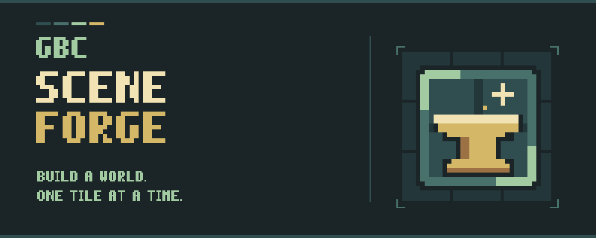
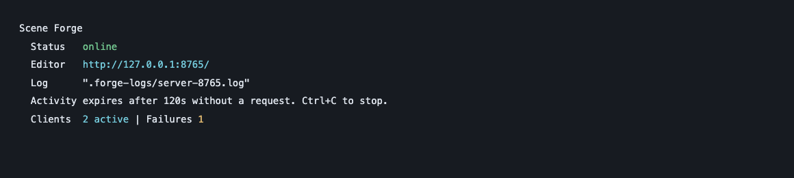
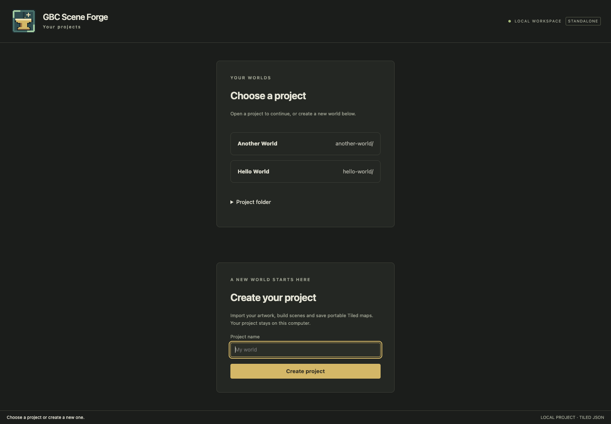
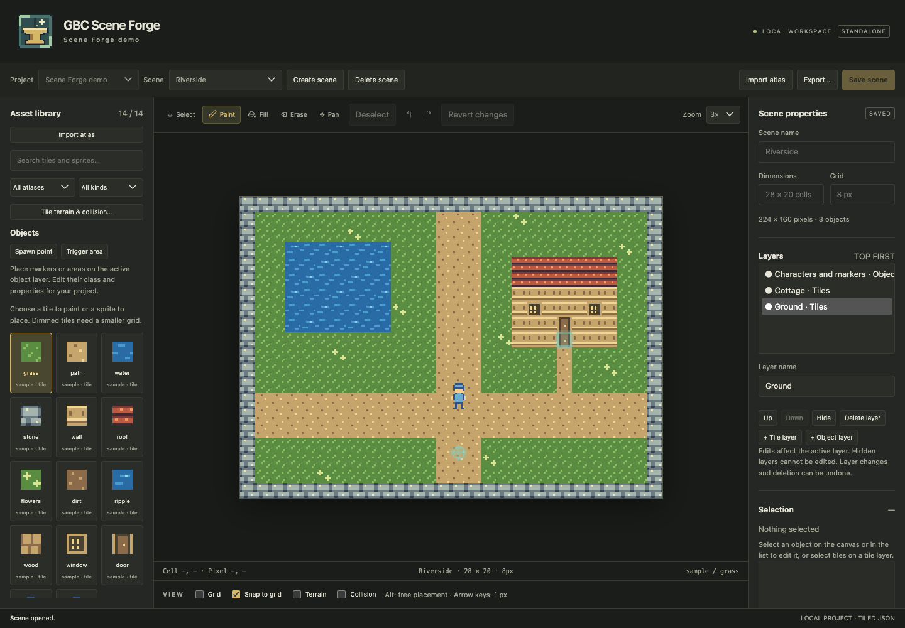

# GBC Scene Forge

[](https://github.com/cliffom/gbc-scene-forge/actions/workflows/ci.yml)
[](https://github.com/cliffom/gbc-scene-forge/actions/workflows/publish.yml)



Scene Forge is a local browser editor for building tile-based scenes from imported
[gbc-atlas](https://github.com/cliffom/gbc-atlas) artwork. Organize your work into
projects, paint maps, place sprites and markers, and export portable Tiled files.
Your projects stay on your computer.

## Start editing

Install the release with Python 3.10 or newer:

```sh
python -m pip install gbc-scene-forge==0.3.3
gbc-scene-forge
```

Open **http://127.0.0.1:8765/** in your browser. The terminal prints the address;
you can stop the server with **Ctrl+C**. The installed editor needs no Node or
additional Python runtime dependencies.

The console shows server status, the editor URL, the absolute Project Root path,
the log location and a live
Clients / Failures field. Request and client activity goes to
`.forge-logs/server-PORT.log` under the directory where you launch Forge, keeping the terminal
compact. Logs include timestamps, all HTTP requests, failures, and client arrivals
and expirations with IP and User-Agent. They append across launches and rotate at
1 MiB, retaining three backups (for example, `server-8765.log.1` through
`server-8765.log.3`). A client
is one IP address + User-Agent combination, so multiple tabs in the same browser
count once; different browsers at the same address count separately. Each HTTP
request refreshes that client's activity. After **120 seconds without a request**,
the client expires, even if its tab is still open; its next request counts it as
active again. This is recent activity, not a count of open browser connections.
The live failure count points to details in the log. Colors appear only in
interactive terminals and can be disabled with `NO_COLOR` (or `TERM=dumb`).
Redirected output prints only startup and shutdown summaries without ANSI escapes;
activity logs always use plain text.



Working from this repository? Install the development tools described below, then run:

```sh
make setup PYTHON=python3.13
make run
```

### Create your first project

1. On the project selector, enter **Hello World** and choose **Create project**.
   If projects already exist, choose **Create a new project** first.
2. Choose **Import atlas**, then **Browse folder…**. Select your atlas folder,
   choose a `*.atlas.json` manifest if needed, and confirm the import. Forge copies
   the artwork into the project, so you can move the original import folder later.
3. Choose **Create scene**. Give it a name, dimensions in cells, and an 8, 16 or
   32 pixel grid.
4. Pick a tile in the asset library and paint. Choose **Save scene** or press
   **Ctrl/⌘ S** to save your work.

Choose a scene from the scene dropdown to open it. If the current scene has
unsaved edits, choose whether to save, discard, or keep editing before switching.

### Open another project

Use the **Project** dropdown beside the scene selector to open another project.
Choose **Choose or create project…** to return to the project selector, then open
an existing project or choose **Create a new project**, without restarting Forge.
If your scene has unsaved edits, choose **Save and switch**, **Discard and switch**,
or **Keep editing**. If saving fails, your edits stay in the current workspace.

Opening a project loads a fresh workspace. Choose a saved scene to continue;
brushes, selections, undo history, and running previews start fresh. Separate
browser tabs can work on different projects. If two tabs edit the same scene,
revision checks protect against overwriting each other's saved work.



### Where your projects live

By default, Forge keeps projects in `.forge_project/` under the directory where
you start it. Each project gets its own folder: **Hello World** becomes
`hello-world`. Names are normalized to lowercase letters, numbers and hyphens;
accents are simplified. Choose another name if its folder already exists.

```text
.forge_project/
├── hello-world/
│   ├── forge.project.json    # Project name, identity and format version
│   ├── assets/               # Imported artwork and generated Tiled tilesets
│   ├── scenes/               # Saved Tiled maps
│   └── .forge/history/       # Recovery records
└── another-world/
    └── …
```

Asset and scene folders appear when you import artwork or create scenes. Back up
or move the **entire project folder**, including its hidden `.forge` directory.
The project selector finds manifests in the root's immediate child directories;
there is no separate project registry to maintain.

Choose a different location for your projects:

```sh
gbc-scene-forge --project-root "$HOME/Scene Forge Projects"
# From the repository:
make run PROJECT_ROOT="$HOME/Scene Forge Projects"
```

Use the same location on later launches to see those projects again. Unsupported
or damaged manifests are reported in the selector so you can identify the folder
that needs attention. Version 0.3.3 continues to use manifest format version 1.

### Bring an existing project into 0.3.3

Existing 0.2.0 projects keep their artwork, scene IDs and manifest format. To add
one to the selector, stop Forge and move the whole project folder into your
project root. For the old default location, run these commands from the repository:

```sh
mkdir -p .forge_project
# Choose a destination name that does not already exist:
mv .forge-project .forge_project/my-world
make run
```

You can also open a project directly, including an extracted whole-project export:

```sh
gbc-scene-forge --project /path/to/my-world
# From the repository:
make run PROJECT=/path/to/my-world
```

Direct mode opens just that directory; it has no project selector. The old
`.forge-project/` directory is never moved or deleted automatically. In 0.3.0, a
positional directory argument means a **project root**; use `--project` for a
single project. Passing a project as a root produces instructions instead of
silently nesting new projects inside it. The old `--create` option is replaced by
project creation in the browser.

## Explore the editor

- Paint tile regions as stamps; place sprites at their native size and atlas origin.
- Use named tile and object layers, change their order and visibility, and undo edits.
- Place spawn points and trigger rectangles with names, classes and typed properties.
- Add shared terrain and collision metadata, then inspect it with canvas overlays.
- Select a sprite to try animation and movement previews. Save sequence mappings
  and preview preferences separately with **Save preview settings**.
- Choose **Export…** for a scene or whole-project ZIP. You can include unsaved
  canvas edits in an export. Open the maps in Tiled, or extract a whole-project
  export and open it in Forge with `--project`.

See [the editor guide](docs/STANDALONE.md) for controls, atlas reimport, preview
settings, supported Tiled features and recovery behavior.

## Try the sample

From a development checkout after setup:

```sh
make demo
```

Open the printed address and select **Riverside** or **Courtyard** from the scene
dropdown. The sample includes original pixel artwork, layers, markers,
collision metadata and an animated character. Select the character on its object
layer to try animation and movement previews.



The canonical sample lives in [`assets/demo/`](assets/demo/README.md): editable
Aseprite artwork, exported PNGs and a gbc-atlas manifest, and the portable Forge
project built from that atlas. `make demo` copies the project into `.demo/` and
restores its scenes and assets on **every launch**. No artwork tools are needed
to run it. The installed wheel includes the same project.

To keep editing without a reset, use `make run PROJECT=.demo` or export the project
to another folder. `make demo DEMO_ROOT=/path/to/demo` chooses another working
directory with the same reset behavior; unrelated projects are refused. Resets
retain transaction recovery history and unrelated files. The sample artwork is
covered by this project's MIT license.

## Development

Install **Python 3.13**, **Poetry 2.4–2.x**, **Node 24 (24.12+)**, **npm**, and **Make**
on your `PATH`. See the [Poetry installation guide](https://python-poetry.org/docs/#installation)
if needed. Run commands from the repository root.

`.python-version` selects Python 3.13.13 with pyenv; `.nvmrc` and `.node-version`
select Node 24 with nvm and nodenv respectively. Run `pyenv install -s` and
`nvm install && nvm use` when using those managers. `.npmrc` makes npm reject
Node versions outside the supported Node 24 range. After switching Python,
rerun `make setup PYTHON=python3.13` to select the development interpreter.
The installed package continues to support Python 3.10+.

`make setup` checks tools, creates a Poetry-managed `.venv`, installs locked
dependencies and builds the browser UI. It does not install Poetry itself.
`make help` lists the available commands.

| Command | What it does |
| --- | --- |
| `make run` | Rebuild the UI and open the project selector for `.forge_project/` |
| `make run PROJECT_ROOT="/path/to/projects"` | Browse projects in another root |
| `make run PROJECT="/path/to/world"` | Open one project directly |
| `make demo [DEMO_ROOT=/path]` | Restore the checked-in sample into a working copy and open it |
| `make run PORT=8777` | Use another local port; also works with `make demo` |
| `make check-deps` | Check tools and the Python dependency lock without installing |
| `make frontend` | Type-check and rebuild the browser UI |
| `make lint` / `make format` | Check code style or apply formatting |
| `make typecheck` | Run strict TypeScript checks |
| `make test` | Run Python and TypeScript tests |
| `make test-python` / `make test-frontend` | Run one test suite |
| `make test-browser [CHROME=/path]` | Run Chrome acceptance in disposable directories |
| `make check` | Run lint, tests and Chrome acceptance |
| `make build` | Rebuild the UI, build wheel/source distributions and check metadata |
| `make check-dist` | Install the built wheel in an isolated environment and smoke-test it |
| `make clean` | Remove build outputs and `node_modules`; keep your projects |
| `make clean-demo` | Delete the default `.demo/`, including saved sample edits |

Stop the sample server before `make clean-demo`. Custom demo directories are never
removed by that command. Default project and sample directories are Git-ignored.
Override tool paths with `PYTHON`, `POETRY`, or `NPM` when needed.

Chrome defaults to its macOS application path; pass `CHROME=/path/to/chrome` on
other systems. Optional official Tiled interoperability checks run with
`make test-tiled TILED=/path/to/Tiled RASTERIZER=/path/to/tmxrasterizer`.

Edit TypeScript in `frontend/` and Python in `src/gbc_scene_forge/`.
Generated JavaScript is Git-ignored. After frontend edits, run `make frontend`
and reload the page; launch, demo, browser-test and build commands rebuild it for
you. Release packages include the prebuilt UI.

Optional [GBC palette checks](docs/PALETTE-BUDGETS.md) report scene requirements
across atlases, with separate background/window and sprite budgets, explicit
runtime reservations and navigable contributors. Generic editing and Tiled
export remain available without a target profile.

See [the 0.3.3 release notes](docs/RELEASE-0.3.3.md) and
[building and releasing](docs/RELEASING.md) for release validation and publication.

## License

[MIT](LICENSE). Copyright (c) 2026 Michael Clifford.
