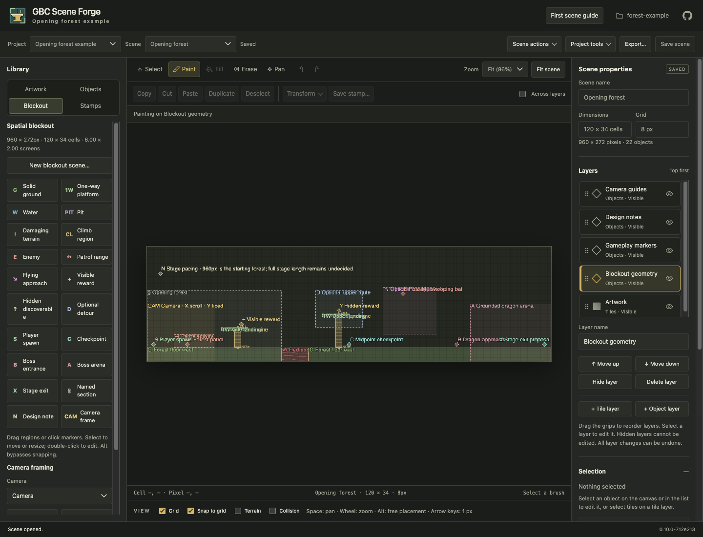
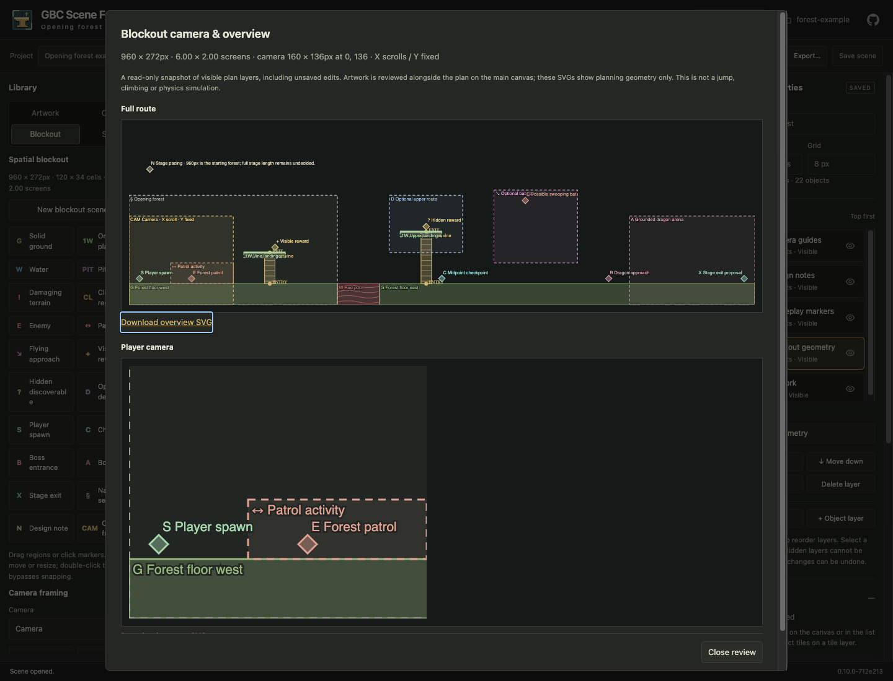

# Artwork-free level blockouts

Start with a spatial plan before preparing artwork. Blockout objects are ordinary
point/rectangle objects on normal layers, with reusable typed definitions. Later
artwork can be painted on separate tile/object layers without replacing the plan.

For a guided first session, follow [Create your first level blockout](user/blockout-tutorial.md).

## Start a plan

1. Create a project and choose **Blockout — no artwork needed**. The dimension
   dialog opens automatically. Existing projects can use **Scene actions → Create
   blockout scene…**; this adds presets if the project has no blockout definitions.
2. Enter dimensions in pixels or cells and choose an 8, 16 or 32px grid. Pixel
   dimensions must divide evenly by that grid. Each axis supports 1–256 cells:
   up to 2048px at an 8px grid or 8192px at 32px. This is the same bounded native
   scene model used by the rest of Forge.
3. Configure the gameplay camera width/height and intended scrolling axes. The
   live summary shows pixels, cells, and horizontal/vertical screen measurements.
   The initial 960×272px scene and 160×136px camera are editable planning defaults,
   not a required full-stage size or a hardcoded runtime profile. The camera must
   fit inside the scene.
4. Use the **Blockout** library. Choose a preset, drag to draw a rectangle or click
   to place a marker. Grid snapping applies; hold Alt or turn off Snap for whole-
   pixel placement. A click without dragging uses the preset's size, clipped to
   the remaining space at the scene edge.

The scene starts with **Artwork**, **Blockout geometry**, **Gameplay markers**,
**Design notes** and **Camera guides** layers. Presets choose a matching visible
layer when available; normal layer selection, reordering and visibility work.
The complete route fits below 1× zoom when necessary, and 25%/50% zoom choices
are available. The normal scene canvas remains scrollable at editing zooms.

## Geometry, markers and design intent

The default library includes solid ground, one-way platforms, water, pits,
damaging terrain, climb regions, enemies, patrol ranges, flying approach areas,
visible rewards, hidden discoverables, optional detours, player spawn,
checkpoints, boss entrances/arenas, exits, named sections and design notes.

Colors supplement labels, symbols and patterns. One-way platforms have a strong
upper surface, unsafe regions have distinct patterns, climbs have ladder marks
and labeled ENTRY/EXIT positions, and markers have symbols and names. Select an object and choose **Edit selected object** in the inspector to change
its name, class and typed fields. Design-note text is retained in full and shown
in the Selection inspector. Canvas captions stay at display resolution and use
names rather than expanding notes across the plan. Selected objects receive
first placement; crowded captions are shortened or suppressed. See
[Reading labels in a dense plan](user/blockout-tutorial.md#reading-labels-in-a-dense-plan)
for the placement hierarchy and complete text access. Activity bounds can name
their intended `actor`; reward types and
notes are project data, with no runtime behavior inferred from those names.

Climb entry/exit intent uses an edge (`top`, `bottom`, `left`, `right`) and an
offset from 0 to 1 along that edge. Those positions follow the region when it
resizes. Use the inspector to override the defaults for an individual climb.

Select a rectangle and drag its bottom-right square to resize it. Drag the body
to move it. The object inspector provides exact keyboard-accessible positions and
dimensions. Drawing, moving, resizing and inspector edits use normal scene
Undo/Redo; a continuous drag is one undo step. Copy, duplicate, transform and
reusable stamps work with the same objects and preserve typed properties.

**Customize presets…** opens the existing definition library. Change labels,
rectangle sizes, field defaults, colors, symbols, notes and camera defaults, or
create project-specific definitions. Existing definitions are not overwritten by
creating another blockout scene. Name, shape and rectangle-size defaults apply to
new placements; typed field defaults apply to instances without overrides. The
conventions below identify planning objects:

| Typed property | Meaning |
| --- | --- |
| `blockout_role` (string) | Category, such as `solid`, `one_way`, `climb`, `enemy`, `section`, `camera` |
| `blockout_color` (string) | Six-digit `#RRGGBB`; invalid display colors use a safe fallback |
| `blockout_symbol` (string) | Short label symbol, displayed up to six characters |
| `blockout_pattern` (string) | `solid`, `one-way`, `waves`, `cross`, `ladder`, or `outline` |
| `design_note` (string) | Author's planning note |
| `entry_edge` / `exit_edge`, `entry_offset` / `exit_offset` | Relative climb endpoints |
| `scroll_x` / `scroll_y` (bool) | Camera scrolling intent, independently per axis |

Definitions and instances use the existing inheritance/override rules. Saving a
definition changes shared defaults immediately, outside scene Undo. Unknown or
mismatched overrides retain the ordinary definition diagnostics and remain
editable. A category does not require game-specific editor code.

## Camera and full-route review

The camera frame is a native rectangle object. In the Blockout panel, choose a
camera and use **Select / move**, then drag its body or resize its bottom-right
handle. **Settings…** opens its position, dimensions and scrolling properties.
Fixed/scrolling axes express design intent (invalid retained overrides are shown
as unverified); they do not restrict authoring moves
or implement an engine camera. Multiple named camera frames are supported.

**Camera & overview…** generates a read-only snapshot of visible plan layers,
including current unsaved edits. It shows the full route, the selected gameplay
frame, screen measurements, camera position and fixed/scrolling axes. Download
both as standalone SVGs. Review does not save the scene or change placements.
Hide/show layers to control the reviewed plan; show a camera guide to review it.
The SVG review deliberately shows planning geometry only. Use the main canvas to
review imported artwork alongside the plan.

Reviews validate project and saved-scene revisions before and after rendering;
responses also identify the exact authored snapshot, including unsaved edits.
SVG text is escaped and previews contain no external artwork dependencies.
Reviews support up to 4096 visible objects, at most 16 pattern marks per object,
up to 160 nonoverlapping vector captions per view, and a 2MiB SVG body per view.
Full names and notes remain in SVG object titles when captions are omitted. Larger reviews report a limit error and leave the
project unchanged; hide layers to inspect a subset.

## Persistence and limits

Save/reopen, recovery checkpoints, scene duplication and portable project export
retain ordinary object IDs, definition links, typed values, geometry and camera
objects. Tiled scenes contain native point/rectangle objects and effective custom
properties, including camera settings; Forge's existing definition/override
metadata retains editable inheritance on reopening a full project. Scene-only
exports retain materialized effective values through the normal exporter.

Adding artwork does not convert or discard the plan. Keep it on separate layers,
use visibility controls for comparison, and export both through the existing
portable bundle workflow. No new project or scene schema version is introduced.

Planning categories do not automatically author tile collision shapes, implement
one-way physics, establish jump/climb reachability, drive enemy AI or certify GBC
hardware fit. Applicable object/world diagnostics and opt-in artwork checks retain
their existing scope. Runtime game feel and integration with a narrower game
compiler require separate work.

## Opening-forest acceptance example

`tests/blockout_fixture.py` describes the independent 960px opening-forest proposal:
ground, a red pool, short vines and landings, patrol activity, an optional bat
approach, visible/hidden rewards, a midpoint checkpoint, and a grounded dragon
arena/approach. A 160×136px camera excludes the intended HUD area. The note states
that the full stage length is still undecided. All of this is fixture data passed
through public authoring services, with no game-specific branches in the editor.

`make test-blockout-browser` creates this example in a disposable project and also
exercises the fresh-project workflow, unit conversion, drawing/resizing/Undo,
camera movement/settings, unsaved review, save/reopen, export and later artwork.
Python service tests check validation, conflicts, bounds and portable round trips;
TypeScript tests check geometry, typed appearance and history.

## Shared service boundary for MCP (#51)

The browser does not own a separate planning format. `gbc_scene_forge.planning.blockout`
provides preset initialization, option normalization, native scene construction,
validated object placement, appearance/relative climb geometry and standalone SVG
review. `Project.planning.create_blockout()` commits the scene and any initial
presets together; `Project.planning.review_blockout()` guards a read-only saved or supplied
snapshot. The loopback endpoints `POST /api/create-blockout-scene` and
`POST /api/blockout-review` retain the existing mutation token and workspace scope.

An MCP adapter can discover the ordinary definition/layer IDs, load a scene,
call `blockout.place()` to obtain a validated candidate and allocated identity,
and commit through `Project.scenes.save()` with expected project/scene revisions.
Placement accepts an explicit visible object-layer ID; otherwise it prefers the
same role-based layer names used by the browser, then a visible object layer.
Input scenes are not mutated by placement. Keep current browser drafts separate
and handle revision conflicts using the existing recovery behavior.

Review responses include `scene_id`, `project_revision`, `scene_revision` and
`snapshot_revision`, SVGs and camera/screen metadata. The snapshot hash covers the
canonical supplied scene data so unsaved candidates are distinguishable. The
[local MCP server](MCP.md) exposes these services through revision-guarded tools
and includes a reproducible real-client forest example.
