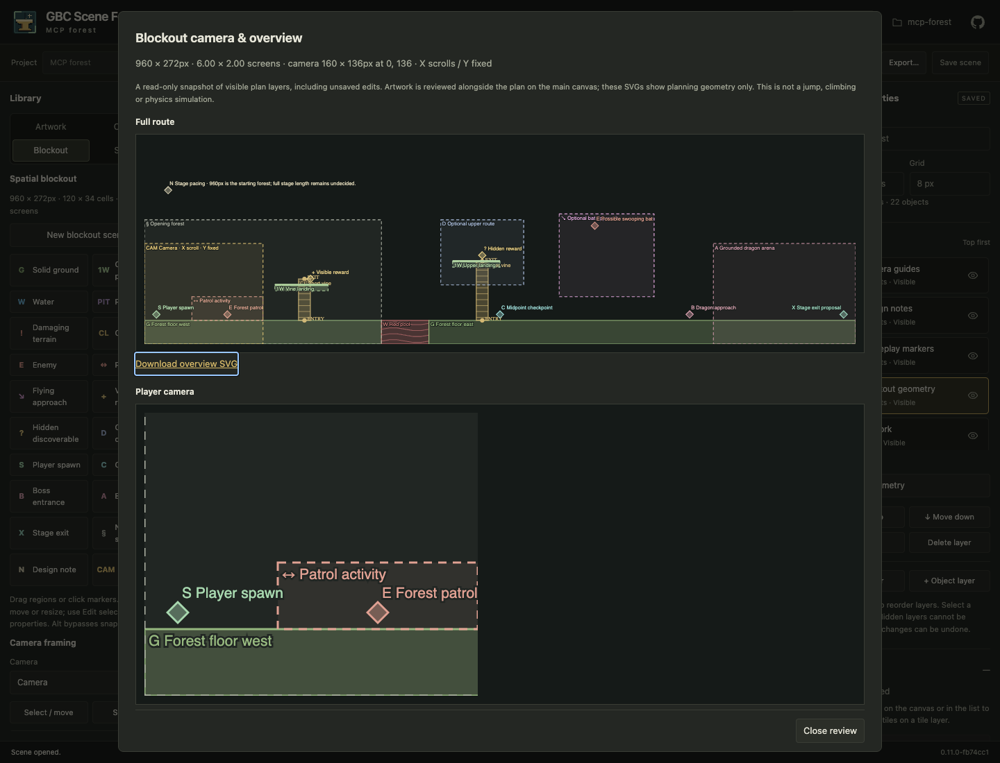

# Local MCP authoring

Forge's optional Model Context Protocol (MCP) server exposes saved standalone
projects to a local agent. The normal offline browser editor needs no MCP package,
server, network service or account. MCP uses the same project services, native
scene validation, typed definitions, rendering, Tiled serialization and durable
transactions as browser authoring. There is no connector or game compiler.

## Install and connect

Milestone 25 also provides an experimental [self-contained runtime](RUNTIME-BUNDLES.md)
whose `forge mcp` mode includes the SDK and Python. Its explicit project selection
and platform limits are documented separately; the optional wheel install below
remains supported.

The [Codex plugin feasibility probe](evaluations/plugin-feasibility.md) compares
self-contained macOS arm64 runtimes using the existing MCP server. It is an
experimental milestone 25 investigation; the installation below remains the
supported MCP setup.

Install the release with Python 3.10 or newer:

```sh
python -m pip install --upgrade 'gbc-scene-forge[mcp]==0.31.0'
gbc-scene-forge-mcp --project-root /absolute/path/to/projects
```

Version 0.30.1 is published on [PyPI](https://pypi.org/project/gbc-scene-forge/0.30.1/)
and [GitHub](https://github.com/cliffom/gbc-scene-forge/releases/tag/v0.30.1).
For checkout development after the normal setup, enable the optional SDK:

```sh
poetry install --extras mcp
poetry run gbc-scene-forge-mcp --project-root /absolute/path/to/projects
```

Or install this checkout into a separate Python 3.10+ environment with
`pip install '.[mcp]'`. This extra installs the official Python MCP SDK
(`mcp>=1.30,<2`) and its dependencies. A plain `pip install .` retains zero runtime
Python dependencies. The entry point reports an installation hint if MCP is absent.

Configure a local stdio-capable MCP client to launch the executable from that
Python environment. For clients using a `mcpServers` configuration:

```json
{
  "mcpServers": {
    "scene-forge": {
      "command": "/absolute/path/to/environment/bin/gbc-scene-forge-mcp",
      "args": ["--project-root", "/absolute/path/to/projects"]
    }
  }
}
```

Use `--project /absolute/path/to/existing-project` instead to grant access to one
existing project. Its tool-facing name is always `project`; a root grants access
to its immediate project directories by their names. `list_projects` discovers
them. Project creation is available only with `--project-root` and exclusively
reserves a new directory using the normal project-name rules.

The client owns the subprocess/session. Closing stdin ends the session; Ctrl-C
also stops it. Responses go only to stdout, diagnostics to stderr. Nothing binds
a socket. Authorization is the user's choice to launch the subprocess with a
declared directory and OS permissions; there is no network bearer token or remote
MCP mode. Browser HTTP remains independently loopback-bound and mutation-token
protected. Launch the browser against the same root/project to inspect saves:

```sh
gbc-scene-forge --project /absolute/path/to/projects/mcp-forest
```

The official SDK handles JSON-RPC, initialization, schema validation, cancellation,
and stdio framing. Its supported protocol revisions are `2024-11-05`, `2025-03-26`,
`2025-06-18` and `2025-11-25`; the recorded SDK-client proof uses `2025-11-25`.
The server advertises tools and session artifact resources, with no subscriptions,
prompts, tasks, sampling, elicitation or HTTP transport. `tools/list` is the
machine-readable schema inventory; `capabilities` describes limits and deferrals.
See the [MCP lifecycle](https://modelcontextprotocol.io/specification/2025-11-25/basic/lifecycle)
and [official Python SDK](https://github.com/modelcontextprotocol/python-sdk/tree/v1.x).

## Supported surface

Use the maintained [outcome matrix](AUTHORING-OUTCOMES.md) for browser/MCP routes,
saved/candidate boundaries, limits and classified differences. Broad scene and
native-artwork coverage does not imply parity for imports, terrain semantics,
project metadata/preferences or recovery interfaces. Browser checkpoints and
unpublished MCP handles are separate; mixed work hands off through reviewed saved
content and fresh revision reads.

| Area | Tools and behavior | Deferred |
| --- | --- | --- |
| Discovery | `list_projects`, `get_project`, `get_scene`, `capabilities`. Canonical scenes, ordered layers/cells/objects, imported asset inventories, definitions, stamps, world data and revisions. | File browsing outside declared inventories; live subscriptions. |
| Creation | `create_project` (empty or blockout), `create_scene` (cell dimensions), `create_blockout_scene` (pixel/cell settings and camera). | Sample-project creation through MCP. |
| Scene editing | `edit_scene`: atomic object, tile painting/erasing and layer creation/update/reorder/deletion batches. `place_stamp`: saved composition placement with layer mapping, fresh IDs and dry-run candidates. `save_scene`: validated full canonical layers, tiles, sprites and objects. `rename_scene`, `duplicate_scene`, `delete_scene`: guarded saved lifecycle with deletion consequences. | Semantic terrain brushes; use canonical `save_scene` or browser.  |
| Project editing | `save_object_definition`, `save_world`, `save_stamp`, `delete_object_definition`, `delete_stamp` reuse native validators and transaction services; deletion previews identify references and retained overrides. | Palette profile/metadata and animation preference editing use browser. No arbitrary import paths. |
| Artwork | Atlas/PNG intake; native static/sheet and layered candidates; exact writes, raster operations and color counts; reviewed commits; guarded whole-atlas deletion. Tools and limits are described below. | Arbitrary filesystem paths and automatic approval. |
| Review | `review_artwork`: saved/candidate PNG camera and bounded/paged overview. `review_blockout`: full overview and chosen camera frame SVG resources, exact saved/candidate revisions, pixel dimensions and camera intent. | Animated playback and runtime/physics simulation. |
| Verification | `diagnostics` checks the saved project; `palette_report` checks a guarded saved scene with the existing opt-in profile. | Missing metadata stays unverified; no reachability or hardware-fit certification. |
| Portability | `export_bundle` returns existing project/scene Tiled ZIP exports as immutable resources. | Arbitrary output paths; exports over 16 MiB use browser. |

Tiled intake, terrain brush commands and profile editing remain
browser operations. Browser selection, playback and Undo are browser interactions,
not claimed MCP capabilities. The initial agent workflow is inspect/create/edit/
review/diagnostics/export; the project tools extend that surface through existing
service contracts without exposing a shell or unrestricted filesystem operations.

## Schemas and a safe editing sequence

All tools have strict top-level JSON schemas. Use `get_project` and `get_scene`
for canonical content before constructing edits. IDs and revisions are opaque:
project/definition/scene IDs are UUIDs, object/layer IDs are native integers, and
revisions are SHA-256 strings. Coordinates and rectangle sizes use whole pixels.
A scene's `width`/`height` are **cells**, with `grid` pixels per cell. Empty tile
cells are `""`; painted references come from the imported atlas inventory.

1. `get_project({"project":"plan"})` returns `{project, revision}`. The project
   includes `scenes`, `atlases`, `object_definitions`, optional `stamps` and `world`.
2. `create_blockout_scene` requires `project`, `project_revision`, `name` and
   optional `options`. Options are `units` (`pixels`/`cells`), `width`, `height`,
   `grid` (8/16/32), `camera_width`, `camera_height` (pixels), `scroll_x`, `scroll_y`.
   Defaults are 960×272px, grid 8, camera 160×136px. Scenes support at most 65,536 cells and 8,192 pixels per axis;
   cameras must fit. Native preset definitions are initialized once.
3. Discover a preset definition's UUID in `object_definitions.definitions` using
   its typed `blockout_role` default. `get_scene` returns
   `{id, name, scene, revision, project_revision}`.
4. Call `edit_scene` with `project`, `scene_id`, `project_revision`,
   `scene_revision`, `dry_run:true` and `operations`, for example:

   ```json
   [
     {"op":"place","definition_id":"<solid preset UUID>","x":0,"y":240,"width":320,"height":32,"name":"West floor"},
     {"op":"update","object_id":1,"changes":{"y":136}},
     {"op":"duplicate","object_id":2,"changes":{"x":384}},
     {"op":"delete","object_id":3}
   ]
   ```

   Operations are sequential on a private candidate, never partial disk writes.
   IDs allocated by placement/duplication appear in `allocated_object_ids`. Existing
   identities remain stable. Omit `dry_run` to save the entire valid batch once.
   `place` uses a point/rectangle blockout definition and optional `layer_id`,
   name, dimensions and explicit `properties`. `update`/`duplicate` accept x/y,
   width/height, name/class, properties and sprite origin; IDs/kinds/definition
   links are immutable in these patch operations. Use `save_scene` for other
   validated native edits. Deleting linked endpoints retains normal broken-link
   protection; repair world connections before removing their objects.
5. Typed properties are arrays of `{name,type,value}`, where type is string,
   int, float or bool. Supplying `properties` replaces the **complete explicit
   override list**; omitting it preserves overrides. Inherited fields remain in
   the definition. Retained unknown/mismatched overrides follow browser behavior.
6. `review_blockout` accepts the same guards plus optional `scene` (the candidate)
   and `camera_id`. It returns `scene_id`, `project_revision`, `scene_revision`,
   `snapshot_revision`, dimensions, camera/framing intent and `overview_resource`/
   `camera_resource`. `snapshot_revision` hashes the exact canonical candidate.
   A candidate view does not save or move the starting camera.
7. Commit a reviewed candidate with `save_scene`, using its original guards and
   `scene`. Reinspect after writes. Object summaries contain before/after values,
   changed layer IDs and snapshot hashes; full-scene summaries cap detailed object
   and tile changes at 128 each and explicitly report truncation. Layer metadata
   before/after and stored layer order are also included. The returned canonical scene
   is the serialized round-trip result.

## Tile and layer batches

`edit_scene` accepts the following operations alongside object edits. All operations
run sequentially against a private candidate and save once. A batch contains
1..128 operations, at most 4,096 cell writes total (including repeated writes to
the same coordinate), and at most 4 MiB of input. `dry_run:true` returns a canonical
candidate without writing. Both project and scene revisions are required, including
for dry runs. The same operations work on the original flat Ground/Sprites scenes;
responses retain the normal canonical flat or layered representation. An explicitly
created empty `Sprites` object layer stays layered so its ID and allocation
counter survive saves and reopening.

| Operation | Fields and behavior |
| --- | --- |
| `paint_tiles` | `layer_id`, `cells:[{x,y,tile}]`. Coordinates are zero-based **cell** indices, not pixels. `tile` is an imported tile reference for the scene grid, with optional native `#1`..`#7` transform suffix; `""` clears a cell. |
| `erase_tiles` | `layer_id`, `cells:[{x,y}]`. Clears the specified cells to `""`. |
| `create_layer` | `name`, `type` (`tilelayer`/`objectgroup`), optional `visible` (default true) and `index` (default append). Allocates an empty native layer. |
| `update_layer` | `layer_id`, nonempty `changes` containing `name` and/or `visible`. Identity and type cannot be changed. |
| `move_layer` | `layer_id`, `index`. Index is the zero-based final position in stored order, bottom to top; the browser displays its layer list in reverse. |
| `delete_layer` | `layer_id`. Removes the layer and its tiles/objects. At least one layer must remain; normal linked-object removal guards apply when saving. |

Layer creation allows an insertion index from zero through the existing layer
count; moving requires an index within the existing list. Native limits remain
128 layers and IDs below 2,147,483,647. Existing layer/object IDs and allocation
counters are retained; deletion does not recycle IDs. `allocated_layer_ids` lists
new layers retained in the returned candidate, in its stored order. To target a
layer created earlier in the same batch, use the inspected `next_layer_id` (or
max existing layer ID plus one for a flat scene).

For example, after inspecting the scene and its tile layer ID:

```json
[
  {"op":"paint_tiles","layer_id":1,"cells":[{"x":2,"y":3,"tile":"terrain/earth/0/0"}]},
  {"op":"update_layer","layer_id":1,"changes":{"name":"Forest floor"}},
  {"op":"create_layer","name":"Decoration","type":"tilelayer"}
]
```

Out-of-bounds coordinates, unknown/wrong-grid tile references, non-tile target
layers and malformed operations reject the complete batch. Hidden layers may be
explicitly edited. Repeated coordinates are applied in order; the last valid write
wins. Direct cell edits do not infer terrain connections or alter neighboring
cells. Semantic terrain brushes remain deferred; use `place_stamp` for saved compositions.

The summary reports net `tile_change_count`, up to 128 `tile_changes` with
`layer_id`, cell `x`/`y` and before/after references, plus
`tile_changes_truncated`. Added/deleted tile layers compare their cells against
empty cells. `layer_changes` reports before/after name, type, visibility and index;
`before_layer_order`/`after_layer_order` and `changed_layer_ids` also report moves.
Review a dry-run candidate with `review_blockout` or `review_artwork` and optional
`scene`, or save it with `save_scene` using the original revision guards.

## Place reusable stamps

Inspect `get_project` for a saved stamp's `id`, canonical `scene` and `slots`, and
`get_scene` for the target scene and both revisions. Call `place_stamp` with:

```json
{
  "project": "project",
  "project_revision": "<saved project revision>",
  "scene_id": "<target scene UUID>",
  "scene_revision": "<saved scene revision>",
  "stamp_id": "<saved stamp UUID>",
  "x": 2,
  "y": 3,
  "dry_run": true
}
```

`x` and `y` are zero-based whole **cell** indices for the stamp's top-left corner.
Its grid must equal the target grid and its whole rectangular extent must fit;
there is no clipping. Each source layer maps to the target layer with the same
type and exact name at its zero-based occurrence slot, counting hidden layers
in stored order. That target must exist and be visible. Create missing layers or
show hidden targets with `edit_scene` first, then inspect fresh revisions.

Placement overwrites every covered tile cell, including empty cells and native
transform suffixes. It appends point, rectangle and sprite objects in source order,
offsetting their pixel positions by `x*grid`/`y*grid`. Definitions, explicit typed
properties, sprite assets and origins are retained. Objects receive fresh IDs
from the target scene's allocation counter, independent of source IDs and every
existing object's layer; IDs are never recycled. Unrelated scene content, layer
identities/order and the saved stamp remain intact.

`placement` reports the stamp identity/name, cell position/extent, total
`tile_write_count`, `object_count` and `layer_mapping`. Each mapping identifies
`source_layer_id`, `target_layer_id`, `slot`, and tile writes or source-to-allocated
`object_ids`. `allocated_object_ids` and the normal net before/after `changes`
summary accompany the canonical scene. Tile-write counts include empty and
unchanged cells; net tile changes count only differences.

Both revision guards apply to dry runs and commits. A dry run saves nothing and
reserves no IDs or locks. Review its `scene` using `review_artwork` and/or
`review_blockout` with the original guards; the review's `snapshot_revision`
matches `changes.after_snapshot`. Save the reviewed candidate with `save_scene`,
or repeat `place_stamp` without `dry_run` against the same saved base. Reinspect
after each save before placing again. Conflicts require inspection, never a
fabricated revision or automatic replay.

The request remains bounded to 4 MiB; native stamp/scene limits apply: 128 layers,
65,536 cells per layer, 8,192 pixels per axis and 4,096 objects per target layer.
Unknown stamps/assets, wrong grids, missing/hidden targets, invalid geometry,
exhausted IDs and stale revisions reject the entire operation. Review retains
its existing camera, output, source-image and compositing limits. Browser drafts,
selection, playback and Undo are independent; transform stamps in the browser
before saving them when needed.

[Stamp regression and SDK workflow](../tests/backend/adapters/test_mcp_stamps.py)
covers repeated multi-slot placements, tile clearing/transforms, sprites, exact
candidate PNG/SVG review, canonical saves, portable export, invalid inputs and
concurrent writes. Run it through `make test-mcp` against an installed MCP wheel.

## Project library and world edits

`save_world` accepts the native `world` document and the complete
`scene_revisions` map (available from diagnostics). `save_object_definition`
accepts a native definition; omit its ID to create one, retain ID to update.
`save_stamp` accepts `name`, a validated native `scene`, and a `slots` array with
one 0..127 occurrence slot per layer in order (same type/name slots increase).
Use `get_project` to inspect existing examples of these native schemas.

## Organize and clean up saved content

`rename_scene` and `duplicate_scene` require `project`, `project_revision`,
`scene_id`, `scene_revision` and `name`. Rename changes the catalog name while
preserving the scene UUID and saved bytes. Duplication copies saved native content
with a new scene UUID, preserving layer/object identities, allocation counters,
typed overrides, artwork and visibility. It leaves the source, world positions
and connections unchanged; connections are not cloned. Responses include the
updated `{project, revision}` catalog plus `renamed` or `duplicated`,
`scene_revision`, and `source_scene_id` for duplication.

Before deleting a scene, inspect its exact consequences:

```json
{
  "project": "project",
  "project_revision": "<saved project revision>",
  "scene_id": "<scene UUID>",
  "scene_revision": "<saved scene revision>",
  "dry_run": true
}
```

`delete_scene` returns `consequences.connections` with each complete native
connection (UUID, name, direction and both scene/object endpoints), plus
`world_position`. The preview writes nothing. Omit `dry_run` to delete at the
same guards. Linked deletion is rejected unless `confirm_broken_links:true`
explicitly acknowledges those inspected links. The saved scene and its world
position are removed; connections remain in the world document and diagnostics
report their missing-scene endpoints. Repair connections with `save_world` first
when broken links are unwanted. Changing the world changes the project revision
and invalidates the earlier acknowledgment. The commit returns `deleted`, the
same consequences and updated catalog. Unrelated scenes remain intact.

`delete_object_definition` takes `project`, `project_revision`, `definition_id`
and optional `dry_run`. Its preview reports `consequences.scene_references`
(scene UUID/name/revision, layer and object IDs) and `stamp_references` (stamp
UUID/name, layer and object IDs), including hidden layers. Deleting a referenced
definition is allowed, matching browser semantics. Saved instances and stamps
retain their definition UUIDs and complete explicit overrides, including unknown
fields and type mismatches; no objects are rewritten. Inherited defaults cease
to resolve and diagnostics report `missing-definition`. Inspect those consequences
before committing with the same project revision. Scene revisions discovered by
the service are also guarded at commit so the reported references cannot silently
change during preparation. Missing or invalid saved scenes prevent a complete
reference report and reject definition deletion.

`delete_stamp` takes `project`, `project_revision`, `stamp_id` and optional
`dry_run`. Placements are native copies with no live stamp dependency, so deleting
a stamp leaves every existing placement intact. Definition/stamp deletion returns
`deleted_definition_id`/`deleted_stamp_id`, consequences and updated `{project,
revision}`. The manifest revision guards both libraries; there is no separate
library revision. Unknown identities, stale guards, undeclared project paths and
malformed arguments reject the whole operation. Dry runs reserve no lock for a
later commit. Conflicts require fresh inspection.

Lifecycle acknowledgments describe the exact committed catalog and revisions;
a later writer's state is never substituted. Browser drafts, selection, playback
and Undo remain independent. Reconnect clients that cache tool schemas to discover
the five new tools. The [lifecycle regression and installed-SDK workflow](../tests/backend/adapters/test_mcp_lifecycle.py)
exercises rename/copy/delete, linked-scene acknowledgment, referenced definitions,
retained overrides, actual stamp placements, strict schemas and concurrent writes.

## Import and review saved artwork

1. Read `get_project` and retain its revision. Call `import_atlas` with `project`,
   `project_revision`, `bundle` and `dry_run:true`. The bundle has exactly
   `name` (a basename ending `.atlas.json`), `manifest` (the JSON file as text),
   and `png` (base64 image bytes). This upload contract uses the same gbc-atlas
   validation as the browser; it accepts no server filesystem path. The whole
   JSON request must fit 4 MiB, including base64 expansion; manifests additionally
   cap at 1 MiB and decoded PNGs at 4 MiB. Normal atlas dimensions, cell count,
   RGB5 palette, transparency and region rules apply.
2. Inspect `added`, `changed`, `removed`, image dimensions and `regions` in the
   preflight report. Repeat the same payload with `dry_run:false` to commit.
   Import is atomic and guards every rewritten saved scene and declared asset.
   Reimport requires `reimport:true` and the same atlas ID, retains region
   identities/dimensions/kinds and applicable Forge metadata, and reports
   `artwork_changed` and `metadata_changed`. Invalid/stale imports change nothing.
   Preflight validates full serialization/persistence limits but reserves no lock
   for a future commit. An updated payload needs a new preflight.
3. Reinspect inventory and scenes after import; acknowledgments also include the
   exact committed `project_revision` and `scene_revisions`. Scene IDs, typed
   blockout objects and their properties remain intact. Tile identities are
   `atlas/region/x/y`; grid inventories are keyed by editor pixel grid. For a
   **16px editor grid with 8px palette cells**, declare tile regions whose width
   and height are divisible by 16. Each 16px tile includes four palette cells;
   8px-only regions do not become 16px tiles. No scene-grid limit changes.
4. Use `save_scene` with the returned canonical scene, preserving existing
   geometry/IDs and adding ordered tile/object layers. Tile transform suffixes
   `#1`..`#7` encode horizontal, vertical and diagonal combinations. Sprite
   objects use `{id,asset,x,y}` and optional `origin`; omit `kind` for sprites.
   Reopen with `get_scene` to inspect the serialized result.
5. Call `review_artwork` with exact `project_revision`, `scene_revision` and
   `scene_id`, plus optional visible typed `camera_id` and canonical candidate
   `scene`. Candidates retain the original saved guards and are validated and
   round-tripped before rendering; review never saves them. `overview_resource`
   works without a camera. `camera_resource` is present when a valid camera is
   selected or available; an explicit camera ID must still be valid. Each output is native scale (one pixel
   per authored pixel), transparent, with ordered visible artwork layers,
   canonical grid slicing, tile transforms and static sprite origins. Planning
   geometry/labels, selections, background and playback are excluded; use
   `review_blockout` alongside it for geometry and camera intent.
6. Views cap at **1024 pixels per axis / 1,048,576 output pixels**, and
   16,777,216 composited pixels and 4,194,304 decoded source pixels per view. An oversized camera fails explicitly.
   The default overview starts at `(0,0)` and crops each axis to 1024.
   `overview_complete` states whether it covers the whole scene. Pass
   `overview:{x,y,width,height}` to review another native-scale rectangle; the
   returned `overview` and full scene dimensions make coverage explicit. There
   is no silent scaling. Outside artwork stays transparent.
7. Run diagnostics/palette review and `export_bundle` at fresh revisions. The
   portable ZIP retains tile images, sprites, layer ordering, semantic references
   and typed geometry. Runtime compatibility remains a downstream concern.

The regression proof in `tests/backend/adapters/test_mcp_artwork.py` follows this
sequence with a generic 16px-grid fixture, 8px palette cells, transformed tiles,
sprite placement, metadata-preserving reimport and portable export. Real SDK
protocol checks exercise upload and PNG resource reads; browser MCP acceptance
checks import/reimport inventory adoption and preserved saved placements alongside
existing dirty-edit/recovery protection.

## Revisions, drafts and review artifacts

All updates require the expected project revision; scene edits/reviews additionally
require the expected scene revision. Invalid/stale requests do not overwrite later
work. Scene saves use durable transactions with existing interrupted-write
recovery. Project creation reserves a new name rather than replacing contents.
`edit_scene` bounds batches to 128 operations and authoring tool input to 4 MiB;
normal scene, property, object and layer limits still apply.

MCP writes saved files. It does **not** see or overwrite a browser's unsaved canvas,
checkpoint files or Undo stack. A browser with unsaved edits will get a conflict
when trying to save over an MCP-modified scene. Keep the tab open to inspect it;
automatic checkpoints also remain recoverable after losing the tab. After reload,
use recovery to download the stale draft; restore is blocked until its base matches.
Do not discard the draft until its changes have been reconciled.

A clean, visible browser automatically checks saved revisions every two seconds
and loads external changes. Checks pause while there are unsaved edits, open forms,
active gestures, or a hidden tab; focus/reconnect and finishing a save or revert
trigger another check when safe. Adoption preserves valid selection, active layer,
zoom and viewport, and clears the previous Undo/Redo history. Browser Undo never
undoes another author's transaction. Project tools contains an automatic-refresh
toggle and a manual check; no permanent refresh button is added. See
[external refresh](user/external-refresh.md) for conflicts, recovery and limitations.
Coordinate saved edits or use separate scenes while a human is editing.

Tool failures have `isError:true`. Native errors also include
`structuredContent.error` with `code:conflict` or `invalid_request` and a message;
native artwork tools additionally distinguish `busy` lock contention.
SDK schema failures are text errors with `isError:true`. Unknown tools/capabilities
fail explicitly. Reinspect after a conflict; never retry with fabricated revisions.

### Startup contention and retry boundaries

With `--project`, the server opens and recovers the declared project before starting
the MCP session. Explicit transaction-lock contention retries that opening at most
21 times, with 100 ms between attempts (two seconds of retry delays, plus opening
time). The first busy attempt writes a diagnostic to stderr; stdout remains MCP
protocol data. Releasing the lock within this bound permits normal initialization
with the same `project` alias. Exhaustion exits with a clear startup error: stop
the competing operation and reconnect. No tool has been submitted at that point.
Other opening errors, including missing/invalid projects and path validation
failures, fail immediately. `--project-root` opening does not use this retry loop.
Native transaction locks remain nonblocking, including after initialization.

The server does not retry tool calls or initialization/transport failures. Test
fixtures retry only the exact structured busy response described in
[test organization](../tests/README.md), retaining every original argument and
revision. Conflicts and other errors remain errors. After a transport failure or
lost write acknowledgment, inspect saved state before deciding what to submit;
never automatically replay an ambiguous mutation or rebase its revision fences.

Previews/exports return MCP resource links. `resources/read` retrieves UTF-8 SVG
text or base64 PNG/ZIP blobs. URIs are content-addressed `forge-artifact://snapshot/…`,
immutable and accessible only in their server session. The cache holds up to
24 MiB; old artifacts may expire. Save desired artifacts on the client before
ending the session; regenerate expired ones. Arbitrary file/HTTP URIs are refused.
SVG rendering retains its 4096-visible-object and 2 MiB-per-view limits. Large
native exports retain the existing export computation limits and must fit the
16 MiB MCP artifact cap; use browser downloads for larger bundles. The SDK parses
protocol messages before tool input limits apply.

## Reproduce the opening-forest proof

Run this in an environment with this checkout and the MCP extra installed:

```sh
python examples/mcp/opening_forest.py \
  --root /tmp/forge-mcp-projects \
  --output /tmp/forge-mcp-review
gbc-scene-forge --project /tmp/forge-mcp-projects/mcp-forest
```

Use a fresh root or a new directory each time; the example refuses to overwrite
an existing `mcp-forest`. This is a real official SDK `ClientSession` over stdio,
not a direct adapter call. Project-supplied data in
[`examples/mcp/opening-forest.json`](../examples/mcp/opening-forest.json) describes
21 planning objects plus the camera: ground/landings, red pool, climb endpoints,
enemy/patrol/approach, visible/hidden rewards, spawn/checkpoint, exit and arena.
There are no game-specific code branches or imported assets.

The client discovers definitions, creates a 960×272px starting section, configures
a 160×136px camera, then widens the landing, moves the patrol, and lengthens the
climb. It reviews the unsaved candidate before saving, verifies exact snapshot
hashes, reopens content, reviews a second camera position without saving it, runs
diagnostics and exports. IDs remain stable. The output contains `before.svg`,
`after.svg`, `camera.svg`, `camera-landing.svg`, `changes.json`, `diagnostics.json`,
`session.json` (complete structured request/results including negotiated protocol)
and `forest.zip` (portable project).

Open the saved scene in Forge, use **Blockout → Camera & overview…**, or select
objects and use **Edit selected object**. Later artwork belongs on separate tile/
object layers. It preserves the plan's identities, geometry and typed fields.
Follow the [blockout tutorial](user/blockout-tutorial.md) for normal browser editing.



The forest is a starting section, not a required complete stage. Planning and
palette reports (disabled without an opt-in profile) do not establish jump/climb reachability, runtime game feel or
hardware fit. Blockout SVGs show planning geometry; use `review_scene` for combined artwork and planning.

## Validation

```sh
make lint test build check-dist
FORGE_MCP_PYTHON=/path/to/mcp-environment/bin/python make test-mcp test-mcp-browser
```

The ordinary suite runs dependency-free service tests and skips the SDK test if
the extra is absent. `test-mcp` requires the SDK. The dedicated browser test runs
the real-client example, opens that saved scene in Chrome, edits/saves/reopens it,
and checks simultaneous MCP saves against an unsaved browser draft, conflict
protection and draft download. Existing blockout acceptance covers native artwork
placement and export; service tests check that importing later artwork preserves
the MCP-edited plan. CI also tests the optional protocol against installed wheels
on Python 3.13/3.14 after verifying the plain offline installation.

## Native artwork authoring

### Direct PNG intake and structured iteration

`import_artwork_png(project,project_revision,atlas_id,name,png,compact=true)` accepts
uploaded canonical base64 PNG bytes, at most 17 MiB decoded. Supported variants
are non-interlaced RGB/RGBA8 and indexed 1/2/4/8-bit with transparency. It rejects
unsupported/corrupt input, dimensions and collisions. Axes are 1..4,096 and area
≤4,194,304 pixels. It allocates a new static sprite/document UUID with origin
`[0,0]`, no project-atlas provenance relationship (`provenance:null`), and exact
decoded straight RGBA including hidden RGB. PNG container metadata is not retained.
It does not resize, quantize, publish, overwrite an atlas or accept arbitrary paths
or output-artifact URIs as input. Use `review_artwork_candidate` then `commit_artwork`.

`edit_artwork_raster(candidate,operations,layer_id?)` replaces custom per-pixel
orchestration with an atomic sequential batch. The tool schema enumerates fields:

| `op` | Fields and semantics |
| --- | --- |
| `fill` | `at:[x,y]`, `rgba`, optional `rectangle`; four-connected exact RGBA match, clipped by the explicit in-bounds region |
| `line` | `from:[x,y]`, `to:[x,y]`, `rgba`; inclusive integer Bresenham endpoints |
| `rectangle`, `ellipse` | `rectangle:{x,y,width,height}`, `rgba`, optional `filled` (default false); ellipse tests pixel centers, outline excludes interior with four inside neighbors |
| `copy`, `move` | Source `rectangle`, destination `to:[x,y]`; snapshot source makes overlap safe; move clears source to transparent black before replacement |
| `flip` | `rectangle`, `axis:"horizontal"` or `"vertical"` |
| `resize` | Source `rectangle`, destination `to`, `width`, `height`; nearest-neighbor region resampling; canvas geometry stays fixed |
| `replace` | Exact source `from:[r,g,b,a]`, target `rgba`, optional `rectangle` |
| `remap` | `colors:[[[source RGBA],[target RGBA]],…]`, optional `rectangle`; simultaneous within this operation, unmatched colors unchanged |

Coordinates are top-left integers. Explicit rectangles must fit; omitted regions
for fill/replace/remap cover the whole canvas. Drawing replaces straight RGBA,
including alpha, without blending. Each batch allows 1..128 operations, ≤1 MiB
operation JSON and ≤16,777,216 visited pixels (source and destination both count
for transforms). A failure returns no retained prefix. A new immutable candidate
keeps its original saved base; every changed revision requires a fresh review.

`artwork_colors(candidate,rectangle?,offset?,layer_id?)` returns exact counts,
ordered by decreasing use then RGBA, 256/page with `next_offset`. Up to 65,536
distinct colors are counted; narrow the rectangle if exceeded. Matching includes
alpha and hidden RGB. Remaps allow 1..1,024 unique source-color pairs; targets may
collide. These literal operations do not impose a palette profile. Opt-in
[island cleanup](#selective-pixel-cleanup) is separate; near-duplicate-color and
texture diagnostics remain deferred.

`edit_artwork_layers(candidate,layers)` sets an explicit bottom-to-top list of
`{id:<UUID>,name,visible,opacity:0..255,locked}`. First migration preserves flat
pixels in the first item; new IDs are transparent. Target a layer explicitly for
reads/writes/raster/counts. Unlock before changing its pixels or structure. An empty
list explicitly flattens unlocked sources. Eight layers and 4,194,304 aggregate
pixels including the composite are the maximum. Exact source data, deterministic
compositing, saving and compatibility follow the [native contract](EDITABLE-ARTWORK.md#named-raster-layer-extension-version-1).

Reviews return text/structured receipts, resource links and at most **two PNG
ImageContent blocks / 4 MiB decoded total** (base64 ≤5,592,408 characters). Enlarged
views are preferred; oversized images remain resource-only. Resource limits and
session expiration still apply; regenerate review with the retained candidate
after reconnecting. Native candidate overview/crops and before/after resources
already existed; inline transport is additional. Explicit contact inspection and
cleanup previews offer change maps; exact reads/counts reveal hidden RGB that
visible previews cannot.

### Unpublished exchange and saved cleanup

Use the browser's **Artwork → From agent → Refresh** to browse retained drafts.
Select a thumbnail for read-only preview; **Download PNG** and **Draft details →
Download snapshot JSON** are separate actions. Choose **Edit a copy** to adopt a
specific revision. Adoption requires
a current saved base and creates a separate owner UUID and local Undo history.
Existing documents/history/checkpoints remain retained. **Return candidate to agent**
checkpoints and retains an immutable handle with project/document identity, candidate
revision, true saved base and browser owner. Use `list_artwork_candidates` and
`export_artwork_candidate` to resume that exact revision. Editing invalidates old
review; publishing remains a separate reviewed commit. No live synchronization or
Undo transfer occurs. Saved handoff still uses fresh `list_artwork`/`open_artwork`.

Stale candidates remain inspectable/exportable but cannot be adopted or committed
against newer saved content. Failed transfers/checkpoints retain local work and
report errors; uncertain acknowledgments must be inspected before retrying. Candidate
copies have no expiration and share the 256-record/64 MiB quota; drafts share their
separate 64-record/128 MiB quota. Owners must export/release superseded handles and
explicitly clean abandoned copies. Saved project export excludes these sidecars.

`delete_artwork(project,project_revision,atlas_id,dry_run=true)` previews whole-atlas
deletion: document/files, artwork base, blockers, affected saved scene revisions
and retained-work policy. Submit the same exact `plan` with `dry_run=false` to bind
that preview. Saved tile/sprite, definition or stamp references block deletion;
there is no cascade or individual-frame deletion. The shared artwork service
removes declared sources/derived files and re-encodes other scene GID ranges
atomically, returning exact committed project/scene revisions. Stale bases, drift
and failed writes do not authorize a partial deletion. Candidates/checkpoints are
retained with original bases; inspection/export remains available and stale saves
fail. `release_artwork_candidate` only removes the addressed retained copy.

Native artwork tools use the shared [native artwork services](EDITABLE-ARTWORK.md).
Install the optional extra described above and reconnect clients that cache tool
schemas. No active browser selection or editor is used. See the
[outcome matrix](AUTHORING-OUTCOMES.md) for sheet, timing and recovery boundaries.

For a selected-placement variation, pass `placements` to `duplicate_artwork`:

```json
[
  {"scene_id": "<saved scene UUID>", "scene_revision": "<exact map digest>", "layer_id": 1, "x": 3, "y": 4},
  {"scene_id": "<another saved scene UUID>", "scene_revision": "<exact map digest>", "layer_id": 1, "x": 0, "y": 2}
]
```

Use `object_id` instead of `x`,`y` for a static sprite. All 1..256 locations must
match the copied source asset and, for tiles, its grid. The candidate binds the
selection; edits preserve it. Review returns the exact `replacements` and original
source `references`; scene context must use `scene:null` to compare saved before
with selected replacements after. A matching receipt is mandatory for atomic
commit of artwork and reference changes. The acknowledgment includes
`replaced_scenes` and exact rewritten scene revisions. Omitting `placements`
creates artwork alone; opening a native document edits the shared original.

The runnable [artwork workshop](../examples/mcp/artwork_workshop.py) seeds a moss
tile and two lanterns, reviews new pixels in temporary scenes, commits and places
them. Keep the same root/output for later invocations:

```sh
python examples/mcp/artwork_workshop.py --root /tmp/workshop/projects --output /tmp/workshop/review
# After hand edits, request exact pixel changes from a fresh saved base.
python examples/mcp/artwork_workshop.py --root /tmp/workshop/projects --output /tmp/workshop/review --asset moss --writes /tmp/moss-writes.json
# Revise one placed lantern, retaining the original on the other placement.
python examples/mcp/artwork_workshop.py --root /tmp/workshop/projects --output /tmp/workshop/review --asset lantern --variation cool_lantern --object 1 --writes /tmp/lantern-writes.json
```

Write files contain a JSON list such as `[{"x":7,"y":7,"rgba":[100,210,220,255]}]`.
The example saves PNG resources and call transcripts. Read-only artwork review
retries explicit busy responses at most 20 times with 50 ms delays, keeping the
same candidate and scene bases. Conflicts, transport errors and saved writes are
never retried. Initial placement retains the reviewed scene base, advancing
guards only to the artwork commit's acknowledged revisions; a competing scene
save or external map edit causes a conflict instead of being overwritten.
Inspect the previews before deciding the next revision. It is
a scripted SDK client, not an embedded agent. The
[workflow evaluation](evaluations/artwork-workflows.md) distinguishes those checks
from agent visual inspection and outstanding human/platform work.

| Tool | Inputs and result |
| --- | --- |
| `list_artwork` | Project/base revision → `documents` with native targets, descriptors and artwork revisions; `sources` with imported/native atlas IDs, regions and exact artwork revisions for duplication. |
| `create_artwork` | Project/base revision, fresh `atlas_id`, name, kind, width/height, optional origin/region → transparent unsaved candidate. |
| `duplicate_artwork` | Project/base revision, fresh atlas/name, explicit `source:{atlas_id,region,grid,cell,artwork_revision}`, optional `placements` → unsaved copy retaining source metadata/origin. Tile cell is `[x,y]`; sprite grid/cell are both null. |
| `open_artwork` | Project/base revision, `target:{document_id,atlas_id,region}`, artwork revision → saved native pixels as an unsaved edit candidate. |
| `read_artwork_pixels` | Project and complete candidate, optional in-bounds `rectangle:{x,y,width,height}` → exact base64 RGBA bytes, rectangle, target and revisions. |
| `edit_artwork_pixels` | Project, complete candidate and `writes:[{x,y,rgba:[r,g,b,a]}]` → new candidate; original is unchanged. |
| `review_artwork_candidate` | Project, complete candidate, optional scale/offset/scene context → before/after PNG resource links, paginated references and review receipt. |
| `commit_artwork` | Project, exact reviewed candidate and required receipt → atomic save acknowledgment with candidate/review, project/artwork revisions, source PNG digest and rewritten scene revisions. |

Only `commit_artwork` writes saved artwork; explicit conversion commits update
selected scene placements. Creation, duplication and edits produce immutable
candidates without saving artwork or placements. The default returns a full
client-held envelope; optional compact output persists a recoverable project-local
sidecar, so these tools advertise a possible non-destructive write. Preserve the
entire envelope or compact handle and receipt JSON. They carry explicit
project/document/atlas identity and base/content revisions. See the
[sheet and compact workflow](#native-sheets-animation-and-compact-candidates) for
sidecar limits and recovery. Imported artwork must be copied to a fresh native
identity before pixel editing.

Pixels are row-major, top-left straight RGBA8 bytes in sRGB, with literal channels
0..255. Alpha may be partial; exact reads preserve RGB under alpha zero. No GBC
palette, quantization or color conversion is implicit. Tiles are one 8/16/32-pixel
square. Static sprite axes are integer pixels within 1..4,096, with at most 4,194,304 total pixels; origins are integer
pixels inside the image. Pixel edits cannot resize or change origins/metadata.
Batches reject duplicate coordinates, invalid channels, booleans, unknown fields
and out-of-bounds writes as a whole; no clipping or valid-prefix application.
They cap at 65,536 writes and 1 MiB batch JSON. Alternatively supply
`patch:{rectangle:{x,y,width,height},rgba}` with at most 65,536 pixels of canonical
base64 straight RGBA8; choose writes or patch, never both. Artwork tool input
caps at 26 MiB; candidates cap at 24 MiB. Other authoring tools retain their
4 MiB input budget. Exact reads cap at 65,536 pixels; larger documents require
explicit rectangles. `capabilities.artwork` reports these bounds.

Review defaults to a whole-document overview, sampled with integer nearest-neighbor
steps when needed. Optional `rectangle:{x,y,width,height}` selects a detail view
up to 1,024 pixels per axis. `sample_step`, `rectangle` and effective `scale`
accompany each image pair. Requested scale 1..16 is fitted to the 1,024-pixel
output-axis budget; a receipt continues to identify the complete candidate.
Use several detail rectangles to inspect the whole artwork at native resolution. `before` is null for new/copied artwork
unless selected placements are being replaced, when it shows the source pixels.
`after` and non-null `before` contain `native_resource` and `enlarged_resource`;
optional `scene` contains `before_resource` and `after_resource`. The flat
`resources` list also appears as MCP resource-link content. Read them with
`resources/read`; they use the same bounded session cache as existing previews.

Reference scans cover at most 64 saved scenes and 16 MiB map input. Reports include
all affected scene identities/revisions, total reference count and up to 256 exact
scene/stamp/definition locations per page. Pass `offset:references.next_offset`
for the next page; inspect `locations_complete` instead of assuming one page is
complete. Scenes use canonical transforms, origins and layer ordering. A context
has exactly `{scene_id,scene_revision,scene,viewport}`; set `scene:null` for saved
placements, or provide an unsaved canonical scene referencing new artwork.
`viewport:{x,y,width,height}` uses pixels, starts inside the scene and retains
existing source/compositing bounds. Reviewing that scene does not save it.

For example, inside an initialized official SDK `ClientSession` named `client`,
this creates, inspects, revises, reviews, commits and places a tile into an
existing 8-pixel-grid scene. Use a fresh atlas ID and a visible tile layer in your
project. The helper deliberately does not retry failed calls:

```python
import base64
import copy

async def call(tool, **arguments):
    result = await client.call_tool(tool, arguments)
    if result.isError:
        raise RuntimeError(result.content)
    return result.structuredContent

project = "project"  # --project alias; use the directory with --project-root
catalog = await call("get_project", project=project)
loaded = await call("get_scene", project=project,
                    scene_id=catalog["project"]["scenes"][0]["id"])
candidate = await call("create_artwork", project=project,
                       project_revision=loaded["project_revision"],
                       atlas_id="moss_tile", name="Moss tile", kind="tile",
                       width=8, height=8)
candidate = await call("edit_artwork_pixels", project=project, candidate=candidate,
                       writes=[{"x": 1, "y": 1, "rgba": [77, 160, 81, 255]}])
exact = await call("read_artwork_pixels", project=project, candidate=candidate,
                   rectangle={"x": 1, "y": 1, "width": 1, "height": 1})
assert base64.b64decode(exact["rgba"]) == bytes([77, 160, 81, 255])
# Revise after inspecting the exact pixels; this returns a new candidate revision.
candidate = await call("edit_artwork_pixels", project=project, candidate=candidate,
                       writes=[{"x": 2, "y": 1, "rgba": [31, 90, 43, 128]}])
scene = copy.deepcopy(loaded["scene"])
# Scenes may use the compact single-layer form or explicit layers.
layer = next(layer for layer in scene["layers"]
             if layer["type"] == "tilelayer" and layer["visible"]) if "layers" in scene else scene
layer["cells"][0][0] = "moss_tile/artwork/0/0"
review = await call("review_artwork_candidate", project=project, candidate=candidate,
                    scene={"scene_id": loaded["id"], "scene_revision": loaded["revision"],
                           "scene": scene,
                           "viewport": {"x": 0, "y": 0, "width": 32, "height": 32}})
art_image = await client.read_resource(review["after"]["enlarged_resource"]["uri"])
scene_image = await client.read_resource(review["scene"]["after_resource"]["uri"])
# Inspect these images in the client before choosing to commit.
saved = await call("commit_artwork", project=project, candidate=candidate,
                   receipt=review["receipt"])
assert saved["candidate_revision"] == candidate["revision"]
assert saved["review_revision"] == review["receipt"]["revision"]
# Adding artwork may re-encode saved maps. Only save over the expected scene base.
current = await call("get_scene", project=project, scene_id=loaded["id"])
expected_scene_revision = saved["scene_revisions"].get(loaded["id"], loaded["revision"])
if current["revision"] != expected_scene_revision:
    raise RuntimeError("Scene changed since review; inspect and review the placement again")
placed = await call("save_scene", project=project, scene_id=current["id"],
                    project_revision=current["project_revision"],
                    scene_revision=current["revision"], scene=scene)
```

A receipt binds the candidate, saved project/artwork, declared inventory and every
scanned scene revision. Changing pixels after review requires a new review. A
stale base, changed source or competing save rejects the commit and retains your
client-held candidate. Native tools return structured `invalid_request`, `busy`
or `conflict` errors; SDK schema errors remain text errors. Busy means a cooperating
writer owns the lock; wait for it to finish and inspect state before explicitly
submitting again. Do not retry transport failures or lost acknowledgments: inspect
`list_artwork`, reopen the exact saved document, and compare bytes/revisions first.
No automatic rebasing, ambiguous write replay or browser draft mutation occurs.

For an intentional shared edit, discover/open the native target, inspect the
review's affected references and commit against its exact base. All placements
continue referring to that asset. For a variation, duplicate an explicit source
cell/static sprite and commit the reviewed copy. Ordinary duplication replaces no existing
placements; explicit selected-placement variations use the reviewed replacement workflow.
The [browser pixel editor](user/pixel-artwork.md) adds hand editing and owned drafts
using the same candidates and guarded services. Named raster layers and explicit
unpublished exchange are supported as described below; native sheet/frame/sequence
authoring and timed APNG review retain their existing shared services.
The [native MCP regression/SDK workflow](../tests/backend/adapters/test_mcp_native_artwork.py)
checks the full new-tile loop, strict nested schemas, exact transparency, resources,
stale receipts, contention, atomic conflict and save/export/reopen. These scripted
checks do not establish agent art quality or mixed human/agent usability.

## Combined scene review

`review_scene` is an explicit read-only counterpart to artwork-only
`review_artwork` and planning-only `review_blockout`; their existing PNG/SVG
contracts remain unchanged. It takes the same project/scene revision guards,
optional canonical `scene` candidate, `camera_id` and bounded `overview` pixel
rectangle as `review_artwork`, plus optional `filters`:

```json
{"tiles": true, "sprites": true, "geometry": true, "gameplay": true, "guides": false}
```

Omitted keys default to true. Classification follows the browser's
[portable property rules](user/review-mode.md#inspect-one-mixed-scene), independently
of layer names. Authored hidden layers stay hidden. The camera is selected from
an authored visible typed camera before applying filters, so turning off guides
does not remove the review viewport. Display preferences do not change the scene
or downstream interpretation of its data.

The result identifies `scene_id`, `project_revision`, original saved
`scene_revision`, exact canonical candidate `snapshot_revision`, normalized
`filters`, camera, overview, `overview_complete`, `units:"pixels"` and `scale:1`.
`camera_resource` and `overview_resource` are self-contained SVGs: ordered static
artwork is embedded as a PNG, then planning geometry and readable vector captions
are overlaid above it. Camera frames remain visible when guides are enabled.
Unclassified non-art points/rectangles use a generic outline; full names remain
in SVG titles even when crowded captions are suppressed. Browser playback,
selection, grid and artwork metadata overlays are excluded. This shows authored
positions/bounds, with no simulation or inferred actor sprites.

Each artwork viewport retains native pixels and the existing 1024-pixel axis,
1,048,576 output-pixel, 4,194,304 decoded-source-pixel and 16,777,216 compositing
budgets. Planning rendering permits at most 4096 filtered visible objects and
8 MiB per combined SVG, including its embedded PNG; the existing artifact/cache
limits still apply. The overview defaults to the top-left bounded rectangle,
never a silently scaled whole scene. Request another rectangle for larger scenes.
Both resources are produced under the shared verified saved-read service and
revalidated before returning. A stale candidate base, changed artwork or concurrent
scene save rejects the review without changing the client-held candidate or project.

## Native sheets, animation and compact candidates

The [sheet contract](UNIFIED-EDITOR-DESIGN.md) defines bounds and portable storage.
`create_artwork_sheet` takes explicit `frames` and `sequences`; use
`duplicate_artwork_sheet` with an exact source revision and null grid/cell to copy
a complete existing sheet. `edit_artwork_layout` replaces frame/sequence arrays
as a pure immutable candidate edit. Existing frame IDs/geometry/origins cannot
change; rename/reorder and append are supported. Sequences declare literal frame
order, duration in milliseconds and looping. All referenced frames share geometry.

Create/open/duplicate/edit calls accept `compact=true`, returning only
`{handle, project_id, project_revision, revision}`. Candidate arguments accept
that exact handle or the full original envelope. Handle-based edits return a new
handle; old handles remain immutable. `read_artwork_pixels` still returns exact
bounded RGBA, including hidden RGB under alpha zero.
Browser transfer handles additionally carry an `owner` UUID. Preserve that field
when exporting, editing or releasing a listed browser handle: each owner has a
separate copy, so automatic browser cleanup cannot remove another client's copy.

`review_artwork_frame(candidate, frame_id, scale)` returns isolated native/enlarged
PNG resources; `review_artwork_animation(candidate, sequence_id, scale)` returns a
self-contained timed `image/apng` resource. Both include a commit review receipt
for the exact complete candidate and saved bases. APNG scale is 1..16, bounded to
1,024 pixels per axis and 4,194,304 total output frame pixels. Non-looping review
plays once; looping review repeats. Editing pixels or timing invalidates review.

```python
# Continue using the guarded call helper above. No browser interaction is needed.
frame = lambda key, x: dict(id=key, name=key.title(), kind="sprite", x=x, y=0,
                            width=8, height=16, origin=[3,12])
catalog = await call("get_project", project=project)
candidate = await call("create_artwork_sheet", project=project,
    project_revision=catalog["revision"], atlas_id="player", name="Player",
    kind="sprite", width=16, height=16,
    frames=[frame("idle", 0), frame("step", 8)],
    sequences=[dict(id="walk", name="Walk", loop=True, frames=[
        dict(frame_id="idle", duration_ms=120),
        dict(frame_id="step", duration_ms=240)])], compact=True)
candidate = await call("edit_artwork_pixels", project=project, candidate=candidate,
    writes=[dict(x=1,y=2,rgba=[77,160,81,255])])
review = await call("review_artwork_animation", project=project,
                    candidate=candidate, sequence_id="walk", scale=4)
# Inspect review.animation_resource through resources/read before committing.
saved = await call("commit_artwork", project=project, candidate=candidate,
                   receipt=review["receipt"])
```

Handles are scoped to one declared project root. Canonical full envelopes persist
in `.forge/artwork-candidates/` through server restarts, bounded to 256 records and
64 MiB per project across all owners, with no expiry or automatic eviction. Quota errors leave old
records intact. `list_artwork_candidates` recovers handles;
`export_artwork_candidate` returns the full envelope even against a stale saved
base; `retain_artwork_candidate` restores an exported envelope;
`release_artwork_candidate` explicitly deletes one sidecar. Missing, corrupt or
wrong-project handles fail without changing saved artwork. Export before release
or moving projects: sidecars are excluded from project ZIPs. Artifact resources
retain the existing session-cache lifetime. Candidate recovery is independent.
No automatic rebase or replay of an ambiguous save is permitted.

For shared sprite/tile pixels, append an overlapping tile frame with a new ID and
origin `[0,0]` using layout editing, then review and save it. For explicit placement
replacement, `review_sprite_tile_conversion` takes `request` with project/scene
revisions, scene ID, layer ID, 1..64 object IDs, saved target `tile_asset` in
`atlas/frame` form, and `acknowledge_static=true`, plus a bounded `viewport`.
It returns exact mapping, before/after PNG resources and a hash-bound `plan`.
`commit_sprite_tile_conversion(plan)` recomputes the mapping and writes only the
selected scene atomically. Source pixels/dimensions must match exactly;
origin-adjusted placement must fit and align to the scene grid. Gameplay metadata
rejects conversion. Source animation definitions and unselected placements remain;
selected poses explicitly become static scenery. Layer splitting preserves overlap
order. Conversion reads at most 16 MiB of map input and produces at most
1,048,576 tile cells across output layers, within the existing scene limits.
The browser uses these same services.

## Static illustration production

The optional MCP tools support native preparation and delivery without an external
image editor. See the executable [SDK example](../examples/mcp/illustration_workflow.py)
and [technical evaluation](evaluations/illustration-production.md). The example
creates a fresh disposable project under its output, publishes its deterministic
fixture, exports artwork and verifies exact saved layers; an interactive client
should inspect the review artifacts before choosing to commit.

```sh
python examples/mcp/illustration_workflow.py --output /tmp/forge-illustration
```

### Storage and explicit cleanup

`list_artwork_candidates` reports `used_count`, `used_bytes`, `remaining_count`,
`remaining_bytes`, limits and each candidate's `bytes`, original project revision,
owner and `stale_project_base`. `saved_content.matches` means the current saved
native document has the same document ID, descriptor, tile metadata, composite
and every exact layer source. Its evidence names the candidate, current project
and artwork revisions. It is current-content evidence, not a historical commit
receipt or proof that selected placements were committed. Same-looking flattened
artwork with different editable layers does not match. Evidence read failures are
reported instead of implying a match. Stale project bases cannot be edited or
committed; full-envelope/bundle export and archive remain available for recovery.

A listing item contains descriptive fields as well as a handle. Pass only
`handle`, `project_id`, `project_revision`, `revision`, and `owner` if present as
a candidate handle. Retain the owner when continuing or cleaning up browser work.
Quota errors include requested bytes, existing usage and cleanup instructions;
no draft is silently evicted and quotas remain 256 records/64 MiB per project.

`plan_artwork_candidate_archive` is read-only. Its groups use owner, document UUID
and atlas ID, never display name alone. Each entry includes an exact `candidate`
handle, owner through the group/handle, native saved-match evidence, retained
`bytes`, estimated reclaimable bytes, recommendation and reason. Only exact saved
matches receive `archive_saved_match`; other records say `retain_or_review`.
Content hashes do not establish age or ancestry: possible supersession is only a
manual-review hint, including when another revision matches saved content.
Unpublished branches and hidden-layer differences remain distinguishable. Errors
appear in `unavailable` without being recommended. Reclaim estimates count retained
JSON bytes after explicit release, excluding the new archive's disk usage.

Explicitly select up to 32 entry handles and pass the unchanged response as optional
`plan` to `archive_artwork_candidates`. The service revalidates the entire plan and
selected identities under the archive read lock before writing anything. Project,
retention, saved evidence or capacity changes reject a stale plan; regenerate it
and select again. A plan selects nothing automatically. Calls without `plan` keep
the existing explicit archive behavior and still resolve exact selected handles.

`archive_artwork_candidates(candidates:[handles],release:false)` explicitly
archives 1..32 selected records, at most 64 MiB input, into
`.forge/artwork-archives/<sha256>.zip`. Each entry is an unchanged full native
candidate envelope, with its original sidecar filename identifying any owner.
Set `release:true` to release those exact records only after the archive is
atomically written and verified. Invalid selections reject before any release;
a later release failure appears in that record's `error` and leaves the archive
recoverable. Interruption can leave extra retained records, never an intentionally
released record without a verified archive. Saved artwork and unrelated candidates
remain untouched.

Archives survive process restart and appear in `list_artwork_candidates.archives`.
Download using `read_artwork_archive(archive,offset:0)`, concatenate decoded `data`
chunks in offset order until `next_offset:null`, then verify the assembled
`sha256`. Chunks cap at 1 MiB. Extract an envelope and call
`retain_artwork_candidate(candidate:<full envelope>,owner:<original owner>)`;
omit owner for shared records. Restored stale bases stay stale and retain the same
identity; no automatic rebase or commit replay occurs. Archives are independent
recovery files outside candidate quotas, accumulate only on explicit requests,
and are excluded from project ZIPs. Copy/download them before moving a project;
remove an archive manually only after preserving any desired recovery copies.

### Document geometry and palette preparation

`prepare_artwork_document` accepts a candidate, fresh `atlas_id`/`name`, output
`width`/`height`, `mode:"nearest"|"canvas"` and
`anchor:"top-left"|"center"|"bottom-right"`. It returns `{candidate,report}`.
The output is a new independent static sprite, with the original project base,
new document/atlas identity and no copied saved placement replacements. Original
saved artwork, references and scenes are preserved. Native axis/area and layer
aggregate bounds still apply. All source layers must be explicitly unlocked.

- `nearest` scales the complete document and every layer using
  `source_x=floor(x*old_width/new_width)` and the corresponding y rule. The
  origin uses the same floor scaling. Anchor has no effect in this mode.
- `canvas` translates unchanged pixels by `[0,0]`, floor-half the dimension
  difference, or the full difference for the selected anchor. With an odd center
  difference, floor division puts extra padding on the right/bottom and extra
  cropping on the left/top. Pixels outside the new
  extent are cropped; exposed pixels are transparent black. The origin translates
  by the same offset; a crop removing it rejects instead of silently clamping it.
- Layer UUIDs, order, names, visibility, opacity and locks are retained. Source
  RGBA is exact except for explicitly selected crop/resampling; transparent RGB
  survives retained pixels. Frame/sequence and tile metadata do not carry to a
  static sprite. Sheet candidates require `flatten_sheet:true`, explicitly
  discarding frame slicing and timing while retaining the complete sheet canvas
  and source layers. The original sheet remains unchanged.

`convert_artwork_palette` returns `{candidate,report}` and requires exactly one
of `palette:[[r,g,b],...]` (1..256 RGB8 colors) or `budget:N` (1..256 exact RGBA
colors). Conversion applies to all unlocked sources. Target palettes use nearest
squared distance in encoded sRGB, with lexicographic ties. Quantization uses a
weighted median-cut RGB histogram (up to 65,536 distinct nontransparent source RGB
colors), stable axis/tie order, weighted RGB means and the same nearest mapping.
It never dithers. An already-satisfied budget leaves the candidate unchanged.
Alpha and RGB under alpha zero remain exact. Alpha variants and
transparent colors consume budget slots; incompatible budgets reject. Layer
compositing can create additional colors; budget mode rejects if the composite
exceeds the declared budget. A supplied RGB palette does not imply a bound on
RGBA colors in the layered composite. Use explicit flattening if that is desired.
These are literal source conversions; no hardware palette profile is inferred.
Reports disclose before/after dimensions and source/composite color counts,
selected palette, method and transparency/loss boundaries. Quantization is never
implicit in import, resize, review or save. Both preparation calls accept compact
output and invalidate earlier receipts when the resulting content changes.

### Layer intake, atomic editing and artwork output

`import_artwork_layers` creates one unpublished sprite from 1..8 PNG entries in
bottom-to-top order. Declare output dimensions and for each entry
`{layer:{id,name,visible,opacity,locked},png:<base64>,offset:[x,y]}`. Layer UUIDs
must be unique. Offsets are nonnegative; images must fit completely, with
transparent black padding and no clipping. PNG uploads retain exact RGBA,
including hidden RGB. Offsets are baked into full-canvas source pixels rather
than becoming a new metadata format. Existing 26 MiB input, native layer aggregate
and candidate limits apply; invalid intake publishes/retains nothing.

`edit_artwork_batch` takes 1..128 sequential operations, at most 1 MiB JSON and
16,777,216 estimated pixel work. Declare stable layer UUIDs in a `layers`
operation; later operations target those exact IDs without a name lookup or an
intermediate response. A minimal shape is:

```json
[
  {
    "op": "layers",
    "layers": [
      {
        "id": "00000000-0000-0000-0000-000000000001",
        "name": "Ink",
        "visible": true,
        "opacity": 255,
        "locked": false
      }
    ]
  },
  {
    "op": "pixels",
    "layer_id": "00000000-0000-0000-0000-000000000001",
    "writes": [{ "x": 1, "y": 1, "rgba": [240, 224, 160, 255] }]
  },
  {
    "op": "layers",
    "layers": [
      {
        "id": "00000000-0000-0000-0000-000000000001",
        "name": "Ink",
        "visible": true,
        "opacity": 255,
        "locked": true
      }
    ]
  }
]
```

Also supported: `{op:"patch",layer_id,patch}` and
`{op:"raster",layer_id,operations}` using the existing pixel-patch/raster shapes.
Flat documents use `layer_id:null`. Existing locks and bounds apply at each step;
unlock explicitly before writes. The first layer migration retains flat pixels
in the first layer. Invalid operations discard the whole result, including a
successful prefix. One resulting candidate is returned; handle input or
`compact:true` retains only that final result. Original handles stay immutable.
A new review and separate receipt-guarded commit still control publication.

`export_artwork_bundle` returns an artwork ZIP resource containing the unchanged
`candidate.json`, `document.json`, `composite.png`, individual full-canvas
`layers/<uuid>.png` files (or `layers/composite.png` for flat artwork), and
`palette.json` with exact composite RGBA counts. The envelope is the authoritative
lossless round trip: extract and retain it to recover descriptor, layers, timing,
metadata, ownership context from the original handle and stale bases. PNG-only
reimport creates a new document and cannot reconstruct those identities. The
bundle is a view of the existing native format, not a competing document format.
It caps at the 16 MiB session-artifact limit and 65,536 composite palette entries;
use durable candidate archives for larger recoverable transfers. Resource cache
lifetime and project scoping remain unchanged.

### Contact-sheet inspection

`inspect_artwork_candidate` takes 1..8 explicit in-bounds `rectangles`, optional
`scale:1..8`, `changed_overlay:true|false`, `format:"svg"|"png"` (SVG default),
and `before_candidate` as a full envelope or retained handle. It returns a resource,
exact candidate/project/artwork revisions, the ordinary complete commit review
receipt, and per-rectangle sampling/scale information. Cells label top-left pixel
coordinates, dimensions, scale and before/after meaning. Output embeds integer
nearest-neighbor artwork: no view is silently rescaled. PNG sheets use built-in
bitmap labels without a font or rasterizer dependency. Both artifacts embed exact
revision, rectangle, scale, receipt and completeness metadata (SVG metadata or PNG
Description text); revisions are also visibly labelled. PNG resources participate
in the existing server inline ImageContent policy: at most two PNGs and 4 MiB of
encoded PNG data per response. Larger PNGs remain resource links. Each artifact
caps at 16 MiB within the 24 MiB session cache; failure publishes no partial sheet. Each cell caps at 512 pixels
per axis; total image pixels cap at 4,194,304 and total layout at 8,388,608.
`complete` reports whether the union of native rectangles covers the full canvas;
overlapping rectangles do not inflate coverage. Before is the saved original or
selected replacement source, and transparent for a new independent document.
An explicit before-candidate overrides only that visual baseline. Its project must
match and its width/height must equal the after-candidate; stale before-candidates
can still be viewed without rebasing. Owner-bearing handles resolve exactly; no
ownership is transferred. `before_candidate_revision` identifies the explicit
baseline, or is null for the default saved/transparent baseline. The receipt always
binds the after-candidate to its authoritative saved base, independently of this
visual comparison. Neither candidate nor saved artwork is mutated. The existing
26 MiB aggregate tool-input cap remains; retain one or both envelopes and pass
handles when a pair would exceed it.

The optional overlay paints exact RGBA changes magenta over the after image,
including hidden transparent RGB differences; changed counts are local to each
rectangle. This compares composite RGBA, so edits confined to invisible layer
sources do not highlight pixels; inspect native sources for those differences.
Magenta is an inspection marker, not a pixel mutation. The contact artifact is
bound to the same exact receipt as ordinary review; stale bases/receipts reject.
Contact inspection does not alter pixels. Use the separate opt-in cleanup
workflow below for selected small-island suggestions. Fragmented-plane and
near-color consolidation remain deferred.

### Selective pixel cleanup

`analyze_artwork_cleanup(candidate,profile,layer_id?,offset?)` returns read-only
small-color-island findings, a normalized profile-bound `proposal`, and current
constraint validation. Layered artwork requires an explicit source `layer_id`;
flat artwork omits it. Findings have stable IDs within that exact candidate,
profile, layer and algorithm version, native coordinates, original/replacement
RGBA, squared RGB distance, matching/total boundary edges and a reason. Pages
contain at most 256 of at most 4,096 findings; follow `next_offset`. Each page
recomputes the same bounded analysis. Excess findings reject; narrow the region.

`profile:{}` selects these defaults. Unknown rules and out-of-range values reject.

| Field | Default / contract |
| --- | --- |
| `rectangle` | Whole canvas; explicit in-bounds `{x,y,width,height}` limits editable cells and the scan |
| `protected_pixels` | `[]`; at most 4,096 explicit `[x,y]` points |
| `protected_rectangles` | `[]`; at most 128 in-bounds rectangles; union with protected points |
| `max_island_size` | 4; integer 1..16 pixels |
| `connectivity` | 8; either 4 edge neighbors or 8 edge/diagonal neighbors |
| `max_color_distance` | 48; integer 0..441 Euclidean distance in encoded sRGB |
| `min_boundary_percent` | 75; integer 50..100, tested without rounding |
| `allowed_palette` | Optional 1..256 exact RGBA8 colors, checked on the full target source **and** full composite |
| `color_budget` | Optional 1..256 distinct exact RGBA colors on each of the full target source and full composite, including hidden transparent colors |

Findings are exact-RGBA connected components, considered in row-major seed order.
Components touching the scan boundary or any protected pixel are excluded in
their entirety, so cropped line fragments are never treated as complete islands.
Transparent components are excluded. The replacement is the most frequent
different color along four-neighbor boundary **edges**, with ties resolved by
smallest squared RGB distance then lexicographic RGBA. Same-color diagonal
connections join components but do not add boundary votes. The winning color
must have the same alpha, meet the distance threshold and receive the required
fraction of all boundary votes. Hidden transparent RGB and every source alpha
remain exact. This is one simultaneous pass over unchanged source pixels, with
no dithering, palette generation, smoothing or implicit iteration.

`preview_artwork_cleanup(candidate,proposal,selected,compact?)` recomputes findings
against the exact source and applies **only** the caller's explicit list of up to
256 distinct finding IDs. `selected:[]` previews no edits. Stale/mismatched plans,
unknown IDs, locked targets or unsatisfied output constraints reject before
retaining a candidate or publishing previews. Changing a profile or source
requires new analysis. A returned candidate preserves its original saved base;
compact input/output uses existing recoverable sidecars. No saved artwork changes.

The result includes `changes` (at most 4,096 native pixels, each with coordinates,
before/after RGBA and finding ID), `changed_pixels`, selected IDs and validation.
Three PNG resources show the **target source** before, after and magenta edits,
including edits to invisible layers. Whole-source previews use nearest-floor
overview sampling with a ceiling of 1,024 per axis. Each change-map overview
block is marked if it contains any changed cell, even when the edited pixel was
not sampled for the image. `changes` remains the authoritative exact map. The
normal inline limit includes the first two PNGs; the map stays resource-readable.
Review the composite with `review_artwork_candidate` before `commit_artwork`.

`validate_artwork_cleanup(candidate,before_candidate,proposal)` independently
checks actual before/after content. It returns `passed`, `hard_checks`, artistic
`warnings`, `unsupported_checks`, exact candidate revisions and proposal revision.
Hard checks cover identity/geometry/metadata/base, editable region, protected
pixels, alpha/hidden RGB, target locks, other layers and optional source/composite
palette/count constraints. A geometry/base mismatch returns a failed check
without pretending remaining checks ran. Analysis can report existing palette
violations; preview succeeds only when the selected output satisfies all checks.
Validation issues no commit receipt and does not change ordinary save semantics:
profiles constrain this cleanup operation, not future unrelated edits or exports.

Scan area is at most 1,048,576 pixels. Profile JSON is at most 128 KiB. Admission
work units are `9 × scan area + aggregate source/composite area + sum(protected
rectangle areas)` ≤16,777,216; duplicate protection coverage still counts. This
bounds scan neighbor visits and protection painting, not total interpreter/codec
work or process memory. Visited/scan-stack storage is linear in scan area, the
protection mask in canvas area, and finding storage is capped at 4,096 ×16 cells.
Existing native aggregate/candidate limits, 26 MiB tool inputs, resource cache and
review budgets still apply; use handles for large before/after pairs.

Small islands can be intentional glints, stars or texture. Diagonal connectivity
helps retain thin lines but does not recognize features. Outline repair,
silhouette scoring, semantic protection and color-plane consolidation are
explicitly unsupported. Use protected regions and inspect edits; counts are
suggestions, not detected-defect or artistic-quality scores.

Run the [official-SDK example](../examples/mcp/pixel_cleanup.py) from a source
checkout with the MCP extra to exercise selected edits, PNG resource reads,
validation, stale-receipt rejection, fresh review/commit and exact layer reopen:

```sh
python examples/mcp/pixel_cleanup.py --output /tmp/forge-pixel-cleanup
```

It uses an original MIT [synthetic motif](../tests/fixtures/pixel-cleanup/motif.json)
and requires a fresh output directory. See the [bounded evaluation](evaluations/pixel-cleanup.md)
for results, intentional-detail failures and measurement limits.
