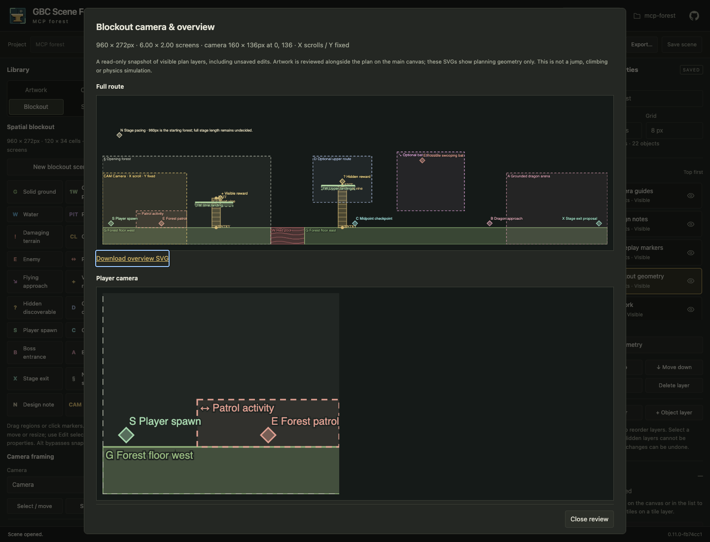

# Local MCP authoring

Forge's optional Model Context Protocol (MCP) server exposes saved standalone
projects to a local agent. The normal offline browser editor needs no MCP package,
server, network service or account. MCP uses the same project services, native
scene validation, typed definitions, rendering, Tiled serialization and durable
transactions as browser authoring. There is no connector or game compiler.

## Install and connect

Install the release with Python 3.10 or newer:

```sh
python -m pip install --upgrade 'gbc-scene-forge[mcp]==0.15.0'
gbc-scene-forge-mcp --project-root /absolute/path/to/projects
```

From this checkout, after the normal development setup:

```sh
poetry install --extras mcp
poetry run gbc-scene-forge-mcp --project-root /absolute/path/to/projects
```

Or install this checkout into a separate Python 3.10+ environment with
`pip install '.[mcp]'`. This extra installs the official Python MCP SDK
(`mcp>=1.30,<2`) and its dependencies. A plain `pip install .` retains zero runtime
Python dependencies. The entry point reports an installation hint if MCP is absent.

Configure a local stdio-capable MCP client to launch the executable from that
Python environment. For clients using a `mcpServers` configuration:

```json
{
  "mcpServers": {
    "scene-forge": {
      "command": "/absolute/path/to/environment/bin/gbc-scene-forge-mcp",
      "args": ["--project-root", "/absolute/path/to/projects"]
    }
  }
}
```

Use `--project /absolute/path/to/existing-project` instead to grant access to one
existing project. Its tool-facing name is always `project`; a root grants access
to its immediate project directories by their names. `list_projects` discovers
them. Project creation is available only with `--project-root` and exclusively
reserves a new directory using the normal project-name rules.

The client owns the subprocess/session. Closing stdin ends the session; Ctrl-C
also stops it. Responses go only to stdout, diagnostics to stderr. Nothing binds
a socket. Authorization is the user's choice to launch the subprocess with a
declared directory and OS permissions; there is no network bearer token or remote
MCP mode. Browser HTTP remains independently loopback-bound and mutation-token
protected. Launch the browser against the same root/project to inspect saves:

```sh
gbc-scene-forge --project /absolute/path/to/projects/mcp-forest
```

The official SDK handles JSON-RPC, initialization, schema validation, cancellation,
and stdio framing. Its supported protocol revisions are `2024-11-05`, `2025-03-26`,
`2025-06-18` and `2025-11-25`; the recorded SDK-client proof uses `2025-11-25`.
The server advertises tools and session artifact resources, with no subscriptions,
prompts, tasks, sampling, elicitation or HTTP transport. `tools/list` is the
machine-readable schema inventory; `capabilities` describes limits and deferrals.
See the [MCP lifecycle](https://modelcontextprotocol.io/specification/2025-11-25/basic/lifecycle)
and [official Python SDK](https://github.com/modelcontextprotocol/python-sdk/tree/v1.x).

## Supported surface

| Area | Tools and behavior | Deferred |
| --- | --- | --- |
| Discovery | `list_projects`, `get_project`, `get_scene`, `capabilities`. Canonical scenes, ordered layers/cells/objects, imported asset inventories, definitions, stamps, world data and revisions. | File browsing outside declared inventories; live subscriptions. |
| Creation | `create_project` (empty or blockout), `create_scene` (cell dimensions), `create_blockout_scene` (pixel/cell settings and camera). | Sample-project creation through MCP. |
| Scene editing | `edit_scene`: atomic place/update/duplicate/delete object batches, dry-run candidates and before/after summaries. `save_scene`: validated full canonical layers, tile cells, sprites and objects, including typed properties. | Semantic tile brushes, layer operations and stamp placement; use canonical `save_scene` or browser. Scene rename/duplicate/delete use browser. |
| Project editing | `save_object_definition`, `save_world`, `save_stamp` reuse native validators and transaction services. | Artwork import/reimport, definition/stamp deletion, palette profile/metadata and animation preference editing use browser. No arbitrary import paths. |
| Review | `review_blockout`: full overview and chosen camera frame SVG resources, exact saved/candidate revisions, pixel dimensions and camera intent. | Artwork-inclusive raster previews and runtime/physics simulation. |
| Verification | `diagnostics` checks the saved project; `palette_report` checks a guarded saved scene with the existing opt-in profile. | Missing metadata stays unverified; no reachability or hardware-fit certification. |
| Portability | `export_bundle` returns existing project/scene Tiled ZIP exports as immutable resources. | Arbitrary output paths; exports over 16 MiB use browser. |

PNG/Tiled import (#25), autotiling (#23) and broader hardware profiles (#29) remain
separate features. Browser selection, playback and Undo are browser interactions,
not claimed MCP capabilities. The initial agent workflow is inspect/create/edit/
review/diagnostics/export; the project tools extend that surface through existing
service contracts without exposing a shell or unrestricted filesystem operations.

## Schemas and a safe editing sequence

All tools have strict top-level JSON schemas. Use `get_project` and `get_scene`
for canonical content before constructing edits. IDs and revisions are opaque:
project/definition/scene IDs are UUIDs, object/layer IDs are native integers, and
revisions are SHA-256 strings. Coordinates and rectangle sizes use whole pixels.
A scene's `width`/`height` are **cells**, with `grid` pixels per cell. Empty tile
cells are `""`; painted references come from the imported atlas inventory.

1. `get_project({"project":"plan"})` returns `{project, revision}`. The project
   includes `scenes`, `atlases`, `object_definitions`, optional `stamps` and `world`.
2. `create_blockout_scene` requires `project`, `project_revision`, `name` and
   optional `options`. Options are `units` (`pixels`/`cells`), `width`, `height`,
   `grid` (8/16/32), `camera_width`, `camera_height` (pixels), `scroll_x`, `scroll_y`.
   Defaults are 960×272px, grid 8, camera 160×136px. Axes support 1..256 cells;
   cameras must fit. Native preset definitions are initialized once.
3. Discover a preset definition's UUID in `object_definitions.definitions` using
   its typed `blockout_role` default. `get_scene` returns
   `{id, name, scene, revision, project_revision}`.
4. Call `edit_scene` with `project`, `scene_id`, `project_revision`,
   `scene_revision`, `dry_run:true` and `operations`, for example:

   ```json
   [
     {"op":"place","definition_id":"<solid preset UUID>","x":0,"y":240,"width":320,"height":32,"name":"West floor"},
     {"op":"update","object_id":1,"changes":{"y":136}},
     {"op":"duplicate","object_id":2,"changes":{"x":384}},
     {"op":"delete","object_id":3}
   ]
   ```

   Operations are sequential on a private candidate, never partial disk writes.
   IDs allocated by placement/duplication appear in `allocated_object_ids`. Existing
   identities remain stable. Omit `dry_run` to save the entire valid batch once.
   `place` uses a point/rectangle blockout definition and optional `layer_id`,
   name, dimensions and explicit `properties`. `update`/`duplicate` accept x/y,
   width/height, name/class, properties and sprite origin; IDs/kinds/definition
   links are immutable in these patch operations. Use `save_scene` for other
   validated native edits. Deleting linked endpoints retains normal broken-link
   protection; repair world connections before removing their objects.
5. Typed properties are arrays of `{name,type,value}`, where type is string,
   int, float or bool. Supplying `properties` replaces the **complete explicit
   override list**; omitting it preserves overrides. Inherited fields remain in
   the definition. Retained unknown/mismatched overrides follow browser behavior.
6. `review_blockout` accepts the same guards plus optional `scene` (the candidate)
   and `camera_id`. It returns `scene_id`, `project_revision`, `scene_revision`,
   `snapshot_revision`, dimensions, camera/framing intent and `overview_resource`/
   `camera_resource`. `snapshot_revision` hashes the exact canonical candidate.
   A candidate view does not save or move the starting camera.
7. Commit a reviewed candidate with `save_scene`, using its original guards and
   `scene`. Reinspect after writes. Object summaries contain before/after values,
   changed layer IDs and snapshot hashes; full-scene summaries cap detailed object
   changes at 128 and explicitly report truncation. The returned canonical scene
   is the serialized round-trip result.

`save_world` accepts the native `world` document and the complete
`scene_revisions` map (available from diagnostics). `save_object_definition`
accepts a native definition; omit its ID to create one, retain ID to update.
`save_stamp` accepts `name`, a validated native `scene`, and a `slots` array with
one 0..127 occurrence slot per layer in order (same type/name slots increase).
Use `get_project` to inspect existing examples of these native schemas.

## Revisions, drafts and review artifacts

All updates require the expected project revision; scene edits/reviews additionally
require the expected scene revision. Invalid/stale requests do not overwrite later
work. Scene saves use durable transactions with existing interrupted-write
recovery. Project creation reserves a new name rather than replacing contents.
`edit_scene` bounds batches to 128 operations and authoring tool input to 4 MiB;
normal scene, property, object and layer limits still apply.

MCP writes saved files. It does **not** see or overwrite a browser's unsaved canvas,
checkpoint files or Undo stack. A browser with unsaved edits will get a conflict
when trying to save over an MCP-modified scene. Keep the tab open to inspect it;
automatic checkpoints also remain recoverable after losing the tab. After reload,
use recovery to download the stale draft; restore is blocked until its base matches.
Do not discard the draft until its changes have been reconciled.

A clean, visible browser automatically checks saved revisions every two seconds
and loads external changes. Checks pause while there are unsaved edits, open forms,
active gestures, or a hidden tab; focus/reconnect and finishing a save or revert
trigger another check when safe. Adoption preserves valid selection, active layer,
zoom and viewport, and clears the previous Undo/Redo history. Browser Undo never
undoes another author's transaction. Project tools contains an automatic-refresh
toggle and a manual check; no permanent refresh button is added. See
[external refresh](user/external-refresh.md) for conflicts, recovery and limitations.
Coordinate saved edits or use separate scenes while a human is editing.

Tool failures have `isError:true`. Native errors also include
`structuredContent.error` with `code:conflict` or `invalid_request` and a message.
SDK schema failures are text errors with `isError:true`. Unknown tools/capabilities
fail explicitly. Reinspect after a conflict; never retry with fabricated revisions.

Previews/exports return MCP resource links. `resources/read` retrieves UTF-8 SVG
text or base64 ZIP blobs. URIs are content-addressed `forge-artifact://snapshot/…`,
immutable and accessible only in their server session. The cache holds up to
24 MiB; old artifacts may expire. Save desired artifacts on the client before
ending the session; regenerate expired ones. Arbitrary file/HTTP URIs are refused.
SVG rendering retains its 4096-visible-object and 2 MiB-per-view limits. Large
native exports retain the existing export computation limits and must fit the
16 MiB MCP artifact cap; use browser downloads for larger bundles. The SDK parses
protocol messages before tool input limits apply.

## Reproduce the opening-forest proof

Run this in an environment with this checkout and the MCP extra installed:

```sh
python examples/mcp/opening_forest.py \
  --root /tmp/forge-mcp-projects \
  --output /tmp/forge-mcp-review
gbc-scene-forge --project /tmp/forge-mcp-projects/mcp-forest
```

Use a fresh root or a new directory each time; the example refuses to overwrite
an existing `mcp-forest`. This is a real official SDK `ClientSession` over stdio,
not a direct adapter call. Project-supplied data in
[`examples/mcp/opening-forest.json`](../examples/mcp/opening-forest.json) describes
21 planning objects plus the camera: ground/landings, red pool, climb endpoints,
enemy/patrol/approach, visible/hidden rewards, spawn/checkpoint, exit and arena.
There are no game-specific code branches or imported assets.

The client discovers definitions, creates a 960×272px starting section, configures
a 160×136px camera, then widens the landing, moves the patrol, and lengthens the
climb. It reviews the unsaved candidate before saving, verifies exact snapshot
hashes, reopens content, reviews a second camera position without saving it, runs
diagnostics and exports. IDs remain stable. The output contains `before.svg`,
`after.svg`, `camera.svg`, `camera-landing.svg`, `changes.json`, `diagnostics.json`,
`session.json` (complete structured request/results including negotiated protocol)
and `forest.zip` (portable project).

Open the saved scene in Forge, use **Blockout → Camera & overview…**, or select
objects and use **Edit selected object**. Later artwork belongs on separate tile/
object layers. It preserves the plan's identities, geometry and typed fields.
Follow the [blockout tutorial](user/blockout-tutorial.md) for normal browser editing.



The forest is a starting section, not a required complete stage. Planning and
palette reports (disabled without an opt-in profile) do not establish jump/climb reachability, runtime game feel or
hardware fit. SVGs show planning geometry; use the main browser canvas for artwork.

## Validation

```sh
make lint test build check-dist
FORGE_MCP_PYTHON=/path/to/mcp-environment/bin/python make test-mcp test-mcp-browser
```

The ordinary suite runs dependency-free service tests and skips the SDK test if
the extra is absent. `test-mcp` requires the SDK. The dedicated browser test runs
the real-client example, opens that saved scene in Chrome, edits/saves/reopens it,
and checks simultaneous MCP saves against an unsaved browser draft, conflict
protection and draft download. Existing blockout acceptance covers native artwork
placement and export; service tests check that importing later artwork preserves
the MCP-edited plan. CI also tests the optional protocol against installed wheels
on Python 3.10–3.14 after verifying the plain offline installation.
