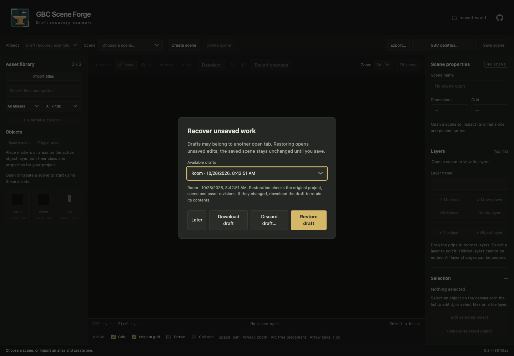
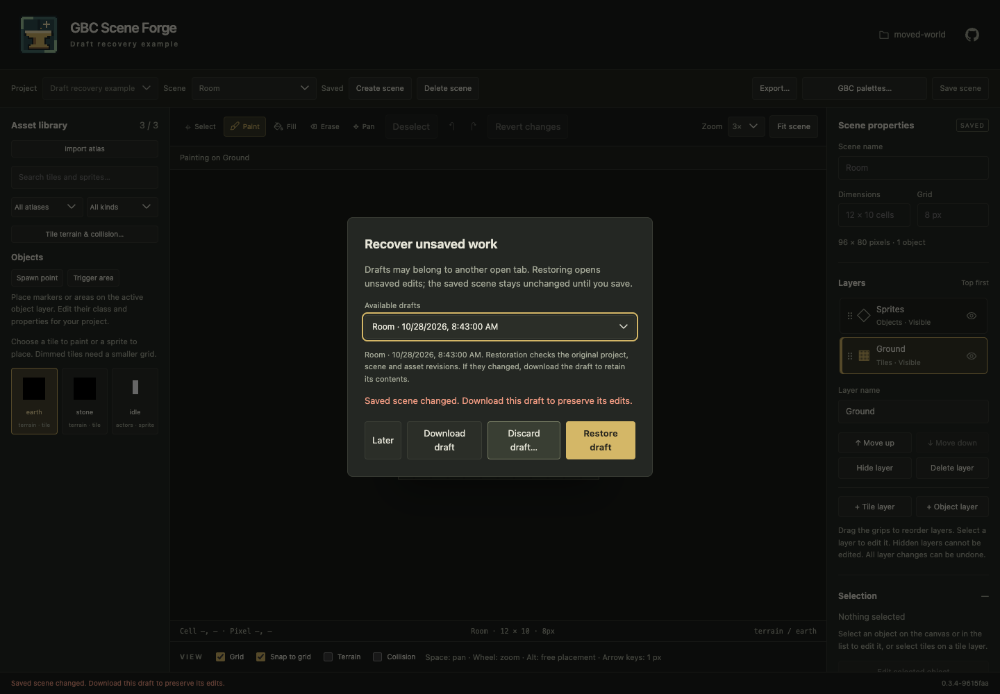

# Standalone Scene Forge

Start the project selector with `gbc-scene-forge` or, from a configured checkout,
`make run`. The default project root is `.forge_project/` in the current directory.
Create **Hello World** to store a self-contained project in
`.forge_project/hello-world/`, or open an existing project from the list.

```sh
gbc-scene-forge --project-root /path/to/projects --port 8777
# From a development checkout:
make run PROJECT_ROOT=/path/to/projects PORT=8777
```

Open the printed local URL. Use the **Project** dropdown beside the scene selector
to change projects, or choose **Choose or create project…** to return to the
selector. Unsaved scene edits offer **Save and switch**, **Discard and switch**,
or **Keep editing**.
Failed saves keep the current workspace and edits. Opening a project reloads the
workspace, clears undo/redo and selections, and resets previews. Requests are
scoped to the project's URL, so another tab cannot change their destination.

Each immediate child directory with a valid manifest appears in the selector.
Invalid or unsupported manifests appear as errors, without being rewritten.
New project folders use lowercase ASCII slugs with hyphens; accented characters
are simplified, separators and empty slugs are rejected, and existing directories
are never overwritten. The display name and project UUID are independent of the
folder name. Renaming a display name does not imply moving its directory.

To bring an existing project into the selector, move the entire directory under
the project root while Forge is stopped. Or open it directly:

```sh
gbc-scene-forge --project /path/to/world
make run PROJECT=/path/to/world
```

Direct mode serves one directory and has no selector. `make demo` uses this mode
for the sample in `.demo/`; `DEMO_ROOT` chooses another directory. All Make launch
targets rebuild the UI first. A positional CLI directory is now a project root;
use `--project` for the old single-directory behavior. Project creation happens
in the browser rather than through the removed `--create` option.

Manifest schema version remains 1. Existing 0.2.0 projects require no migration.
Unsupported schema versions are rejected before recovery writes. Future schema
changes must provide explicit migrations; transaction history is not a schema
version or a migration mechanism.

The folder button beside the GitHub link shows the current directory name.
Open it to see the full, selectable path and **Copy path**. It is labeled
**Projects folder** in the chooser and **Project folder** inside a project.
Long names are truncated in the header; full paths wrap inside the popover.

## Import and edit

1. Choose **Import atlas**, then **Browse folder…** to select an atlas folder.
   Choose a manifest if the folder contains several, then confirm with **Import
   atlas**. Its declared PNG is included automatically.
2. Choose **Create scene**, then enter a scene name, width and height (1–256 cells)
   and an 8, 16 or 32 pixel grid in the dialog.
3. Choose **Create scene**, select a tile region to paint or a sprite to place.
4. Use Erase, one-cell Fill, or Select. Drag a selection, then use arrow keys to
   move it or Delete to erase it. Undo/Redo retain up to 100 completed edits.
5. Choose **Save** or press Ctrl/⌘ S. Select another saved scene from the dropdown
   to switch. Unsaved changes prompt before being discarded. **Revert** restores
   the last opened/saved canvas. Ctrl/⌘ Z undoes; Ctrl/⌘ Shift Z or Ctrl/⌘ Y redoes.

Search the asset library or filter by atlas and kind. Drag an asset onto the
canvas to place it directly. Use S, P, F, E and H to switch Select, Paint, Fill,
Erase and Pan while editing the canvas. Pan drags the view without editing the
scene. Hold Space and drag anywhere in the workspace to pan temporarily; release
Space to return to the selected tool. The cursor changes to a hand while panning.
This shortcut stays inactive in fields, buttons and dialogs. Mouse-operated tools,
layer controls and editor dropdowns return focus to the canvas. Keyboard-operated
controls keep focus for navigation. Enter finishes editing a layer name or search
and returns to the canvas; Escape leaves the field and cancels a pending layer rename. The inspector shows scene dimensions, selection details and project
atlases; its **Update** action opens the atlas reimport dialog. Detailed import
results remain under **Last import** in the inspector.

**Fit scene**, beside Zoom, centers the whole map in the workspace and adjusts
when the workspace is resized. Zoom always uses whole-number multiples from
1× to 8×, including Fit mode. Maps too large to fit at 1× remain scrollable.
Choose a numeric zoom to leave Fit mode. The mouse wheel zooms around the pointer
over the workspace; wheel zoom also leaves Fit mode when the zoom level changes.
Ctrl/⌘ wheel keeps the browser’s normal behavior.
The message below the tools names the active layer; a hidden layer offers
**Show layer** there. View changes do not mark the scene as unsaved.

**Unsaved changes** appears beside the scene selector, and **Save scene** gains
an accent when edits need saving. The asset library contains **Import atlas**.
Selecting an object or tiles brings the Selection section to the top of the
inspector; object edit and remove controls appear before animation settings.

Hovering over the canvas outlines the active grid cell (or a tile stamp's full
footprint). The footer shows `Cell column, row` and `Pixel X, Y`, both starting at
zero. A stamp extending beyond the scene gets a red outline. Hovering changes no
scene data; leaving the canvas clears the feedback.

Multiple scenes share imported art and persist independently. Tile regions larger
than one grid cell become multi-cell stamps. All atlas regions remain visible;
tile regions whose dimensions do not divide evenly into the scene grid are
disabled with an explanation. Sprites keep their native dimensions on any scene
grid. Click to place their declared origin. Select a sprite to drag it, move it
one pixel with arrow keys, or remove it with Delete. Sprite edits participate in
Undo/Redo, unsaved-change prompts and Save/Reopen. Existing imported sprite atlases
work without reimport; their portable sprite tilesets are created on the next
explicit project mutation. Palette assignments and animation timing remain in
project metadata.

Select a sprite to choose an imported animation, play/pause it, step frames,
change playback speed, and inspect its origin. **Sequence mappings** explicitly
assign idle/walk animations for up, down, left, and right; unmapped slots show
static artwork. Mappings are shared by instances of the same sprite asset.

Under **Movement preview**, enable movement and click the scene to use arrow keys
or WASD, or enter native-pixel X, Y waypoints (one pair per line) and choose
**Follow path**. Keyboard input takes over from a path. The adjustable collision
footprint uses offsets from the sprite origin, independently of artwork dimensions.
Scene edges always block movement. **Check collisions** additionally checks visible
tiles and other sprites with authored collision metadata, including rectangles,
ellipses and polygons. Markers and trigger areas do not block. Paths stop at the
first obstacle; they do not find a route around it. Collision sweeps use subpixel
steps and can conservatively stop near diagonal corners. **Pause movement** holds
the current pose and path; **Resume movement** continues it. Reset restores the saved
starting position; Escape exits. Losing focus stops motion.

**Save preview settings** stores animation choices, idle/walk mappings, playback
and movement speeds, origin display, footprint, and collision preference under
`preview.sprite` in `forge.project.json`. This explicit project mutation uses the
project revision and durable transaction checks. A conflict preserves local
preferences so they can be reviewed before retrying. Scene dirty state, undo/redo,
scene revisions, saved sprite assets and starting positions remain unchanged.
Reopening restores preferences with playback paused at frame one and movement
disabled. Progress, active keys, paths and temporary positions are never persisted.
Deleting/reimporting an atlas prunes obsolete sprite/sequence references.

The **Layers** list shows the topmost layer first. Each row shows its type and
visibility; its eye button shows or hides the layer without changing the active
layer. Drag the grip at the left of a row to reorder it; the gold insertion line
shows where it will land. Dropping creates one undoable change. Escape or a drop
outside the list cancels. The list scrolls when dragging near its edges.
Tab into the list and use arrow keys to select a layer. Choose a layer to edit its
contents, rename it, move it **Up**/**Down**, or **Hide**/**Show** it. **+ Tile layer**
and **+ Object layer** add empty layers above the existing stack. **Delete layer**
removes that layer and its contents; Undo restores both. Keep at least one layer;
scenes support up to 128 layers. Layer IDs remain stable across rename/reorder/save.
Layer changes share the same undo history as painting and sprite edits. Save keeps
the current session's history; reopening starts a new history.

Tile painting, fill, erase and selection movement affect only the active tile
layer. Sprite placement, hit testing, dragging and deletion affect only the active
object layer. Hidden layers retain their contents but cannot be edited. Choosing
a brush of another kind activates the first visible compatible layer, if one
exists; create a compatible layer if needed. Selecting another layer clears the
canvas selection. The active layer is a session choice; reopening starts on the
first compatible layer chosen by the initial brush. Layer order and visibility
are saved in the map and retained through atlas updates.

**Snap to grid** starts enabled. Sprite placement, asset drops and dragging snap
the sprite's declared origin to the nearest grid intersection inside the scene.
Hold Alt to temporarily bypass snapping, or turn the toggle off for free pixel
placement. Arrow keys always nudge sprites by one pixel. Selecting an existing
sprite leaves its position unchanged; toggling snapping does not move saved art.
Tiles always move in whole grid cells.

## Objects and custom properties

Choose **Spawn point** or **Trigger area** in the library, then click the canvas.
These create ordinary point/rectangle objects with initial classes `spawn` and
`trigger`; the classes are labels for your project and execute no game logic.
An object layer is required. If a tile layer is active, choosing an object brush
activates the first visible object layer. Markers need no imported artwork.
Rectangles start one grid cell wide/high (clipped to the scene edge).

Use Select to pick and drag objects on the active layer, or choose one in the
inspector's object list. The list also selects objects covered by other artwork.
Arrow keys nudge one pixel. Erase, Delete or **Remove selected object** removes
the selected/hit object. Points and rectangles follow the same snap/Alt rules as
sprites. Rectangle movement stays within the scene. Hiding a layer disables its
object editing without removing its contents.

**Edit selected object** opens a dialog for its stable, read-only ID, name, class,
pixel position and custom properties. Rectangles also expose width and height;
sprites expose an optional per-instance origin measured from their image's top
left. **Use atlas origin** starts checked; clear it to override that instance
without editing shared artwork. Overrides can reach image edges. Points use their
exact position as the anchor; rectangles use their top-left corner. Positions and
rectangle dimensions use whole pixels; rectangle bounds must stay in the scene.
Sprite artwork can extend beyond the scene while its anchor remains inside.

Add/remove property rows and choose `string`, `int`, `float` or `bool`. Boolean
values use checkboxes; numbers remain typed numbers, including whole-valued
floats. Integer values must be safe JavaScript integers (±9,007,199,254,740,991);
floats must be finite and within that range. Names must be nonblank, unique per
object and at most 100 characters; strings can contain up to 4096 characters.
Linked objects support 128 explicit overrides plus up to 128 inherited defaults.
Ordinary objects support 256 properties so detaching can preserve every effective
value. Each layer supports up to 4096 objects. Maps must
fit within 4 MiB after serialization; oversized saves leave existing files intact. Changing a
property's type resets its draft value; enter the desired value before applying.
Property order is insignificant and saved properties are sorted by name.

**Apply object changes** validates and commits the whole dialog as one undoable
edit. An error keeps the dialog and scene intact; **Cancel** discards the dialog's
changes. Object creation, movement, deletion and metadata editing share layer
undo/redo and survive Save/Reopen, atlas reimport and moving the project directory.
Save preserves session history; reopening starts a new history.

## Terrain and tile collision

Choose a tile or sprite brush, then **Tile terrain & collision…**. For multi-cell
regions, select the cell to edit. Metadata belongs to that tile in that grid's
shared tileset: all scene instances share it, while 8/16/32px grids have separate
classifications and collision footprints. Sprite tiles use native image sizes.

Enter a free-form **Terrain classification** such as `grass`, `water` or `wall`.
This is a custom classification, not a Tiled Wang set or automatic terrain brush.
**Solid** without custom shapes uses the full tile bounds. **Add shape** supports
rectangles, ellipses and polygons. Edit rectangle/ellipse X/Y/width/height in
whole pixels from the image's top-left. Polygon coordinates are `x,y` pairs
separated by spaces, such as `0,8 8,8 8,0` for an 8px slope. Points may reach the
image edges. Polygons must have 3–32 unique vertices, nonzero area, no redundant
collinear vertices and no self-intersections. Each tile supports 32 shapes.
Shape IDs survive edits; removing a shape retains the next-ID counter.

The preview shows the artwork under the classification tint and collision
geometry. **Undo draft edit**/**Redo draft edit** work within this dialog;
**Cancel** discards the draft. Save or undo changes before choosing another cell.
**Save shared tile metadata** commits the tileset and project inventory together.
It preserves an unsaved scene and its scene undo history. Main-canvas Undo/Redo
controls scene edits; it does not reverse saved shared tileset changes. Reopen
the dialog to edit saved metadata. A conflict leaves the draft available for
review; cancel and reopen the scene to refresh project revisions before retrying.

The canvas **Terrain** and **Collision** toggles display metadata on visible tile
layers and sprite instances. Terrain colors are deterministic per label. Custom
collision shapes define the displayed footprint even if **Solid** is unchecked;
with no shapes, the flag supplies the full-tile fallback. Sprite collision is
translated by each instance's actual origin, including overrides. These are
editing overlays. Optional movement preview uses this same authored collision data.

Forge authors and validates this data. gbc-atlas supplies artwork, regions and
animation metadata; it does not generate structured terrain or collision.
Authored metadata is recorded separately as each project atlas entry's `metadata`
(by grid and semantic tile ID), then serialized into external `.tsj` files as
`forge:terrain` (string), `forge:solid` (bool) and `forge:next_shape_id` (int) tile
properties. Shapes use Tiled tile `objectgroup` geometry. A solid tile with no
custom shapes materializes a full-bounds rectangle in Tiled. Imported atlas
manifests, PNGs and provenance stay unchanged. Compatible artwork reimports
preserve metadata through stable tile identities, including sprite metadata.
Generated tilesets remain managed project assets: direct external edits produce
revision conflicts rather than being overwritten. Whole-project moves retain the
data and relative image references.

To remove a scene, choose it in the scene list and select **Delete scene**. The
confirmation identifies the scene and warns if deleting it will discard its
unsaved edits. **Keep scene** cancels without changing anything. Confirming removes
that scene's map and listing together; shared atlases and other scenes remain.
Deleting a different scene preserves the open canvas and its unsaved changes.
Deleting the open scene returns to the empty workspace. A scene or project that
changed since review produces a conflict instead of silently deleting newer data.
Scene deletion cannot be undone with the editor's Undo button; interrupted
deletion uses the same conflict-aware transaction recovery as other project writes.

Each atlas under **Project assets** has **Update** and **Delete** actions.
Deleting confirms the atlas ID and removes only its managed project copies;
original source files and undeclared files in its asset folder stay untouched.
Saved scenes using its tiles or sprites block deletion and are named in the error.
Remove those placements and save the affected scenes first. Unsaved placements
in the open canvas also block deletion. If undo/redo history could restore this
atlas, the dialog warns that those histories will be cleared; current edits using
other atlases remain intact. Deletion rewrites remaining maps' tileset references
and removes the asset inventory together in a revision-checked transaction.
Atlas deletion cannot be undone with the editor's Undo button.

Atlas selection uses the browser's folder picker. Choose the folder containing
one or more `*.atlas.json` manifests and their declared PNGs. Forge lists the
manifests it finds; a single manifest is selected automatically. Files in nested
folders are supported. Choose a focused atlas folder: discovery is limited to
4096 entries and eight directory levels, and ignores hidden folders.

The browser requests read access only. Until you confirm **Import atlas**, Forge
only lists filenames. On confirmation it reads and uploads the selected manifest
and its declared PNG, then the server performs the same validation and atomic
project update used for path imports. Other source files are not uploaded.
There are no native helper processes, Tk requirements or picker polling routes.
Browsers without `showDirectoryPicker` use a standard directory-upload input.
Cancelling preserves the previous selection. **Enter a manifest path instead**
remains available for direct local path imports.

## Atlas bundle compatibility

The required files are a version-1 gbc-atlas manifest and its declared PNG, with
relative paths contained in the manifest directory. Atlas IDs and region names
must be lowercase C-style identifiers beginning with a letter, up to 64 characters.
The importer validates duplicate region/animation names, references, palettes,
origins, region coverage, overlapping kinds, sprite pairs and pixel colors.

PNG support covers non-interlaced 8-bit RGB/RGBA and indexed PNGs with 1, 2, 4 or
8-bit indices. Dimensions must be multiples of eight within 8–256 pixels, with at
most 256 eight-pixel cells. Tiles are opaque; sprites allow binary transparency.
Unsupported encodings, corrupt PNGs and out-of-palette pixels fail before project
data is changed. Manifest inputs are limited to 1 MiB and PNGs to 4 MiB.

Optional `source`, `preview` and `review_images` files need not be present. Their
declarations and other original metadata are retained as provenance in the project
manifest, while the copied runtime atlas manifest refers only to the copied PNG.
Approval metadata is retained; importing art does not require approval or generate
game code. Absolute paths, escaping paths and symlinks in bundle declarations are
rejected. Imports read explicitly selected files; output stays inside the project.

## Reimport

Importing an existing atlas ID requires checking **Replace this atlas ID**.
An unchanged reimport preserves all asset identities and placements. Compatible
artwork, palette, origin, animation and sheet-position changes update shared assets
and produce a change report. New regions receive new tileset IDs. Removed regions
or changes to an existing region's dimensions or tile/sprite kind reject the
entire reimport. Keep the previous bundle or use a separate atlas ID while those
changes are unresolved. Renaming an atlas ID creates a separate import.

Cells use `(atlas ID, region name, column offset, row offset)` identities.
External tileset local IDs are append-only. Map GIDs are derived from those local
IDs, with zero representing an empty cell. Import/reimport updates all maps in the
same transaction when new tileset ranges are needed; no generated GBC tile indices
are involved. A scene open in another tab may therefore need to be reopened after
an import before it can be saved.

## Project and Tiled files

```text
world/
  forge.project.json
  scenes/<scene-uuid>.tmj
  assets/<atlas-id>/atlas.png
  assets/<atlas-id>/<atlas-id>.atlas.json
  assets/<atlas-id>/grid-8.tsj       # also grid-16.tsj and grid-32.tsj
  assets/<atlas-id>/grid-8/<id>.png  # cropped tile images
  assets/<atlas-id>/sprites.tsj     # independent native-size sprite tiles
  assets/<atlas-id>/sprites/<id>.png
  .forge/history/                  # transaction records and recovery backups
  .forge/drafts/                   # unsaved scene checkpoints (local recovery only)
```

The version-1 Forge manifest records project identity/name, scene UUIDs/names and
relative paths, original atlas metadata, persistent tileset identity mappings,
asset byte revisions and preview defaults. The project UUID and scene UUIDs survive
directory moves. Map tileset paths are relative to each map; image paths are
relative to each tileset. Move or back up the entire directory, including `.forge`.

Open a saved `.tmj` directly in Tiled. The supported format is Tiled JSON 1.10:
finite orthogonal square-grid maps, 1–128 named tile/object layers in bottom-to-top
file order, boolean layer visibility, full opacity and zero layer offsets. Tile
layers use uncompressed JSON-array GIDs and external image-collection `.tsj`
tilesets with PNG tiles. Default tile rendering order is right-down. Empty cells
use GID zero; cells on upper layers leave lower artwork visible when empty.

Object layers use index draw order and support native-size sprite tile objects,
point objects (`point: true`, zero width/height) and positive-size rectangles.
Names map to Tiled `name`, classes to Tiled `type`, and custom properties to
Tiled typed property arrays. Sprite references use stable atlas/region identities.
Object IDs are unique across the whole map; layer IDs are unique and their next-ID counters are retained after deletion.
Sprite origins use whole pixels relative to their image. For an origin `(ox, oy)`
and sprite height `h`, Forge writes Tiled's bottom-left object coordinates as
`(x - ox, y - oy + h)` and reverses that conversion on reopen. Tile coordinates
are zero-based columns/rows; tile selections move in grid cells. Original
Ground/Sprites maps remain readable without migration. A sprite origin override
is stored as two reserved integer properties, `forge:origin_x` and
`forge:origin_y`. Forge reverses the same coordinate conversion using those values
on reopen. User property names starting with `forge:` are reserved. Without an
override, an atlas origin update changes the artwork anchor while preserving the
instance's scene position. Point/rectangle coordinates map directly to Tiled X/Y.

Polygons, polylines, ellipses, text, templates, per-object hiding, fractional
coordinates, rotation/flip flags, file/object/color/class property types,
group/image layers, offsets, infinite maps, embedded tilesets and compressed/base64
tile data are unsupported. Forge rejects unsupported data before saving instead
of dropping it. This is a supported subset for Forge-created projects, not a
general-purpose arbitrary Tiled-file importer. See the
[Tiled JSON format reference](https://doc.mapeditor.org/en/stable/reference/json-map-format/)
for the native field definitions. Tile collision object groups support the
rectangle, ellipse and simple-polygon subset described above; other collision
geometry and arbitrary tile properties are not imported from external tilesets.

## GBC palette budgets

Choose **GBC palettes…** to enable optional scene palette checks and reserve
background/window and sprite slots for runtime content. Counts include the
current unsaved canvas, hidden layers and linked animation frames. Expand a
palette to navigate to its contributors, or run an explicit palette preflight.
Unknown reservations remain unverified; generic editing and Tiled export stay
available for every result. See [palette budgets](PALETTE-BUDGETS.md) for the
counting policy, headless command and reproducible cross-atlas examples.

## Portable export

Choose **Export…** to download a ZIP, then choose **Open scene** or **Whole
project**. The source project and editor undo/redo history stay unchanged.

- **Open scene** exports the open scene and the external `.tsj` tilesets and PNGs
  referenced by its map. Other scenes, original atlas bundles, Forge history and
  unrelated workspace files are excluded. A map can reference unused tilesets;
  those sets and all their tile images are kept to preserve the map's references.
- **Whole project** exports every saved scene, all managed assets and
  `forge.project.json`. After extraction, open any `scenes/*.tmj` in Tiled, or
  launch Forge with `--project` on the extracted directory to continue authoring. This snapshot
  includes artwork/provenance and metadata for all grids, including unused assets.
  Transaction history and undeclared workspace files are excluded.

When the open scene has unsaved changes, **Include unsaved edits from the open
scene** starts checked. It replaces only that scene's map in the downloaded
snapshot, in either export scope. Uncheck it to export the saved version. The
canvas remains unsaved either way; export never calls Save. Other scenes use
their saved on-disk contents. A saved scene is required for scene export; whole
projects can be exported before creating any scenes.

Extract the ZIP and keep `assets/` alongside `scenes/`. Move the entire extracted
directory to preserve relative paths: map tilesets resolve relative to each map,
and tile PNGs relative to each tileset. Single-scene exports are Tiled bundles;
only whole-project exports include a Forge project manifest. No original import
folder, connector, running server or network access is needed to open exported
maps in Tiled. Grid, terrain and collision view overlays are not baked into art;
terrain/collision properties and geometry remain editable in the tilesets.

Supported atlas animations are emitted as native Tiled `animation` frame arrays,
using original durations in milliseconds and local tileset IDs. The first region
is the animated tile; for a region split across a scene grid, each cell receives
its corresponding frame sequence. `forge:animation` records the sequence name.
Tiled supports one loop per tile, so sequences sharing the same starting tile
are skipped rather than selected arbitrarily. Sequences that do not fit a grid
are also skipped. `export.json` includes per-tileset exported/skipped entries and
reasons under `animations`. All named source sequences remain in project atlas
metadata. Idle/walk direction mappings remain Forge preferences; they do not
become Tiled actor logic. Preview playback speed does not scale exported timing.
The ZIP gains animation data without changing source project assets; a whole
project ZIP updates its own inventory checksums so it can reopen in Forge.

Every ZIP contains `EXPORT.md` with offline usage/subset notes and `export.json`
with scene names/IDs, source byte revisions, canvas-override flags and SHA-256
checksums for every other exported file. Asset paths and ZIP entry order are
stable; identical snapshots produce identical ZIP bytes with fixed entry times.
Scene/layer/object IDs, ordering, visibility, typed properties, sprite origins,
terrain classifications and collision metadata retain their supported semantics.

Export validates maps and follows their dependency closure using declared
workspace assets. Missing/undeclared dependencies, unsafe paths, unsupported map
or tileset features, invalid images and dimension mismatches stop the download
with an error identifying the affected path. Restore missing assets or reopen
and review changed files before retrying; unsupported Tiled features must be
removed or represented in the documented subset. External asset edits and stale
project/canvas revisions produce conflicts. Files are captured under the project
transaction lock and checked again before archiving; a detected direct external
edit stops the download. Exports are limited to 256 MiB of
uncompressed file data; choose one scene or reduce imported assets for larger
projects. Export never repairs, rewrites or deletes source files.

## Unsaved draft recovery

Forge automatically checkpoints completed scene edits after 750 ms of inactivity
and checks for another checkpoint every five seconds. Each browser page owns a
separate draft, keyed by the persistent project and scene identities and the
original saved revisions. Checkpoints live in `.forge/drafts/` inside the project,
so they survive browser crashes, server restarts, port changes and moving the
whole project. They do not depend on browser storage. Keep this hidden folder
when moving or backing up your work.

Reopening a project offers **Recover unsaved work** when checkpoints exist. You
can also choose **Recover unsaved work…** in the inspector when the canvas is
clean, or reopen a scene to see its drafts. Choose a checkpoint, then:

- **Restore draft** opens its authored content as unsaved edits. The committed
  scene stays unchanged until **Save scene**. **Revert** returns to the committed
  scene and removes the restored checkpoint.
- **Download draft** retains the complete checkpoint as JSON for manual recovery
  or inspection. It does not remove the checkpoint. This JSON is recovery data,
  not an importable Tiled map.
- **Discard draft…** asks for confirmation before removing that checkpoint.
  **Later** leaves it available for another visit.

Restoration checks the project revision, saved scene revision, asset hashes and
normal scene validation. External changes, reimports, missing assets and deleted
scenes can make a draft incompatible. Forge explains the conflict and keeps the
draft downloadable; it never silently rebases onto externally changed content.
Even an unrelated change to the manifest requires manual recovery when its
original revision no longer matches. Checkpoints can still be written after an
external edit, preserving the unsaved canvas with its original revision guards.

Drafts may belong to another open tab. Tabs write independent files, and every
replacement or deletion checks the checkpoint's own revision. Restoring another
tab's draft copies it into your workspace; if that tab updates its checkpoint,
your later cleanup cannot delete its newer work. Closing a tab leaves its draft
available. Save, explicit discard when switching/reverting, and undo back to the
saved baseline clean up that page's checkpoint; saving or discarding a restored
workspace also removes its unchanged source checkpoint. Other tabs' drafts are
retained. A crash between save and cleanup may leave a redundant checkpoint;
it is safe to discard after inspecting it.

Recovery includes layers, tiles, objects, properties and stable asset references.
Selections, brushes, undo history, animation playback and temporary movement
positions are not checkpointed. Restored work starts with fresh undo history.
Shared metadata and preview preferences retain their separate explicit saves.

The inspector shows checkpoint success or a persistent error if the server is
unavailable, the disk is full, or a limit is reached. Forge retries automatically;
save or export your work while recovery is unavailable. Edits since the last
successful checkpoint can be lost on interruption. Checkpoints are limited to
4 MiB each, 64 files and 64 MiB total per project. No age-based eviction deletes
unsaved work: download/discard obsolete or incompatible drafts explicitly to
free space. Damaged records are preserved and reported for manual recovery in
`.forge/drafts/`. Scene deletion does not silently delete older drafts.

Portable ZIP exports include authored scene data, including an explicitly
selected unsaved canvas, but exclude local recovery checkpoints. Copy the whole
project directory when you also need its recovery files.





## Conflicts and recovery

Saves and imports check manifest, scene and asset byte revisions under a shared
filesystem transaction lock. Files are published by atomic replacement, with
durable before/after records for coordinated updates. Restarting recovers an
interrupted transaction. If recovery detects a later external edit, it stops and
preserves that edit instead of overwriting it. Retain the workspace and backups
while resolving such a conflict.

If a scene changes externally, saving shows a conflict and leaves unsaved edits
in the browser. Preserve those changes, reload the page, and select the scene
again to load the external revision.
Externally changed managed assets block mutations; restore those files and use
explicit atlas reimport for artwork updates. Do not edit generated tilesets or
identity mappings manually.

The server binds only to loopback, validates the Host header and requires a
per-session mutation token. All project operations use the standalone service
and declared workspace.

## Verification

`make lint test build check-dist` checks code, persistence, import validation,
Tiled round trips, revision conflicts, interrupted recovery and wheel contents.
`make test-browser` launches its own disposable workspace and local Chrome,
then exercises create/import/paint/save, layers, generic objects, typed properties,
origin overrides, terrain/collision editing and overlays, reimport, restart, a
directory move, scene/project ZIP downloads (including unsaved snapshots), and
external-edit conflicts. Pass `CHROME=/path/to/chrome` on other platforms. Screenshots are written under `build/reports/scene-editor/`.

With official Tiled binaries installed, also run:

```sh
make test-tiled TILED=/path/to/Tiled RASTERIZER=/path/to/tmxrasterizer
```

This opens and exports a Forge map with Tiled, reopens the exported data in Forge,
and verifies generic objects/properties/origin overrides, terrain properties and
collision geometry in exported tilesets, plus rasterized layer, sprite, tile and
empty pixels. It also extracts and moves scene/project ZIPs, removes the original
workspace/imports, then verifies the exported maps and dependencies with Tiled.
Validated with Tiled 1.12.2.

## Scene management

Open a scene, then use **Rename scene**, **Duplicate scene**, or **Resize / crop**
in the document bar.

**Rename scene** updates its display name immediately. Its UUID, map path, saved
map bytes, and references remain stable. Unsaved canvas edits and Undo/Redo history
are preserved. The name is a project change and is not part of scene Undo/Redo.
Cancel leaves the name unchanged.

**Duplicate scene** creates a saved scene with a new UUID and map path, sharing
project artwork. By default it copies the saved map. If the open scene is dirty,
**Include unsaved canvas edits** explicitly chooses the current canvas instead.
The source remains open with its edits and history; select the copy in the scene
list to open it. Layer and object IDs, names, properties, tile orientations, and
sprite origins are preserved inside the independent new scene. Object IDs are
scene-local; later connections must use the scene UUID together with the object ID.
The duplicate does not copy local recovery checkpoints. Deleting a copy uses the
normal confirmed scene deletion flow; scene Undo does not remove it.

**Resize / crop** changes dimensions within 1–256 cells, keeping the grid size.
Choose one of nine anchors to retain the corresponding edge or center. Center
offsets round down to whole cells, including negative offsets for cropping.
All layers move together, including hidden layers. New cells are empty.
The preview outlines the new scene in green and marks discarded old area red;
counts include painted tiles and objects on hidden layers, and the list identifies
each removed or clipped object by layer and name/ID.

Rectangles intersecting the new boundary are clipped to their intersection;
rectangles entirely outside are removed. Points and sprites are retained when
their anchors remain inside the new scene. Sprites keep their native artwork and
origins, so artwork may extend beyond the boundary. IDs, properties, layer order,
and visibility are preserved. Any removal or clipping requires the explicit
**Allow the listed removals and clipping** checkbox, which resets when dimensions
or anchor change. Cancel leaves the scene and history intact.

Applying resize/crop is one scene Undo/Redo operation. It remains unsaved until
**Save scene**, participates in draft recovery, and can be exported as an unsaved
canvas. Revert restores saved dimensions and content. Rename and duplication use
project and source-map revision guards and durable project transactions; saving a
resized scene uses the normal guarded save transaction. A conflict keeps the dialog
and current canvas available. Reopen the scene/project to load external changes
before retrying.

## Clipboard and reusable stamps

Use Select (S) and drag a rectangle. By default it selects tiles on the active tile
layer or objects whose **anchor** lies within the rectangle on the active object
layer. Shift-click objects to toggle a multi-object selection. Check **Select across
visible layers** to include tiles and object anchors on every visible layer in the
rectangle; hidden layers are excluded. Sprite anchors are their authored origins,
rectangle anchors are their top-left corners, and point anchors are their positions.
A rectangle extending outside the selection expands the composition bounds so its
content remains intact; tiles in that expanded bounding rectangle are included too. Selection itself is transient and does not enter scene history.

Use Copy, Cut, Paste, Duplicate or Cmd/Ctrl+C/X/V/D. These shortcuts leave text
fields, dialogs, menus and preview controls to their normal behavior. The internal
clipboard persists while switching scenes in the same project in this browser tab;
it does not use or replace the operating system clipboard. Paste uses the hovered
cell, then the selected rectangle's top-left cell, then cell (0, 0). Duplicate places
one grid cell down and right from the source. Each cut, paste, duplicate, deletion,
rectangle move or transform is one Undo/Redo operation. Arrows move a rectangular
selection one grid cell; a single selected object moves one pixel. Delete removes
all content in the selection. Escape deselects.

Layer mapping uses the source layer's **name, type and occurrence among layers with
that name/type in bottom-to-top order**, independent of numeric layer IDs. Create
and show matching target layers first. Paste requires the same project and grid,
all referenced assets, visible matching layers, available object IDs, and enough
space for the entire composition. Forge checks all layers before changing content;
failed placement leaves the scene and history intact. Empty tiles overwrite target
tiles. Object placement appends in source order, preserving relative positions,
names, classes, custom properties, sprite origins and semantic asset references.
Paste and duplicate allocate new scene-wide object IDs; moves and transforms retain IDs.

Flip H/V mirrors tiles, points and rectangles inside the selection's grid-aligned
bounding box. Rotate 90° turns it clockwise and swaps width/height. The top-left
grid origin stays fixed, with x increasing right and y down. Tile pixels and their
collision metadata transform together. Points mirror as single pixel positions
(`width - 1 - x`); rectangles mirror their full extents (`width - x - rectangleWidth`).
Coordinates stay whole pixels. The entire result must fit in the scene. Sprite
transforms are unsupported: a selection containing any sprite is rejected in full.
Sprite copy, cut, paste, duplicate and reusable placement retain native size and origin.

**Save stamp…** names a snapshot of the selection in `forge.project.json`. Choose it
in Stamp, click **Place repeatedly**, then click cells on the canvas. Every placement
is separately undoable. Escape or choosing a tool/asset ends repeated placement.
Stamp names may repeat; each stamp has its own stable identity. Saving or deleting a
stamp commits the project library immediately with revision conflict checks; scene
Undo/Redo affects placements. Deleting a library entry leaves placed content intact.
Library deletion is permanent; project backups preserve the library. Atlases used by
stamps cannot be deleted until their stamps are removed. Up to 128 stamps are supported.

Stamps survive reopening and project moves. Full project exports include the library;
scene exports include placed content. Recovery checkpoints preserve authored placements.
The project manifest stays at version 1 with an optional `stamps` collection. Earlier
Forge versions cannot read projects containing stamps; back up before upgrading.
Tiled maps use native orthogonal horizontal, vertical and diagonal GID flags, following
[Tiled's documented transform order](https://doc.mapeditor.org/en/stable/reference/global-tile-ids/).
The semantic scene API reserves suffix `#1`..`#7` for those flag combinations (H=1,
V=2, diagonal=4). Unsupported object rotations and hexagonal flags remain rejected.

## Reusable object definitions

Choose **Object definitions…** in the asset library to create a project-owned point,
rectangle or sprite definition. A rectangle supplies initial dimensions; a sprite
uses an imported sprite asset and its native size/origin. Add fields of type
`string`, `int`, `float` or `bool`, mark required fields, and optionally supply shared
defaults. Numeric fields support inclusive minimum/maximum bounds; strings support
an explicit choice list. Required strings cannot be empty. Required numeric zero
and boolean false are valid. Defaults must satisfy their own constraints.

Choose a definition and **Place instance**, then click a visible object layer.
Placement is one undoable scene edit. Select an instance and choose **Edit object**
to enter typed values. Unchecked fields inherit the current shared default, or
remain unset if no default exists. Check **Override shared value** to author a
value; uncheck it to reset to inheritance. The inspector shows shared defaults and
constraints. Apply commits the whole object edit as one undoable change; Cancel
leaves the instance unchanged. Existing ordinary objects can be attached to a
compatible definition. Detaching materializes current effective values into custom
properties, preserving their types.

Definitions have stable project UUIDs; object IDs remain stable within each scene.
Rename a definition without breaking links. Scene duplication, selection copies,
project stamps, resize, save/reopen and draft recovery preserve links and explicit
overrides. Copies receive their usual new scene/object identities. Definition names
do not need to be unique; the link uses the UUID. Field names identify overrides:
renaming a field removes one field and adds another, so old overrides remain
visible as unknown-field findings until explicitly removed or renamed.

Saving a definition is a guarded project transaction, separate from scene Save
and scene undo/redo. It preserves the current canvas and undo history. Shared
default edits immediately affect all inheriting instances, including saved scenes
and stamps, without rewriting their map files. Explicit overrides stay unchanged.
Undoing an instance edit restores its authored overrides against the **current**
definition; it does not revert project definitions. Changing shape, initial size or
sprite asset affects new placements only. Existing geometry and artwork remain
unchanged; a shape mismatch is reported. Asset deletion is blocked while a sprite
definition references the asset's atlas.

Changing fields, constraints or shape can invalidate existing instances. Deleting a
definition requires confirmation; instances retain their UUID link and overrides,
report a missing definition, and stop inheriting defaults. This is also a project
transaction outside scene undo. Reattach an instance or detach it to repair the
link. Invalid instances remain editable, saveable and exportable; validation never
silently fixes or drops authored values.

**Object validation** checks the open canvas, including hidden layers, for missing
definitions, shape/type mismatches, required values, numeric bounds, invalid choices
and unknown overrides. Click a finding to select its layer and a visible object; show a hidden
layer before selecting and editing its objects. The panel displays up to 100 findings and the full
count. This is definition validation, not engine-specific gameplay validation.
`POST /api/object-report` exposes the same deterministic rules for a saved scene or
explicit canvas snapshot, with project/scene revision guards. Results include
`version`, `status`, `instances`, and `findings`; each finding identifies `scene`,
`layer`, `object`, `definition`, `field`, `code` and `severity`. The pure Python
`object_definitions.report` service can be reused by future project diagnostics.

### Definition persistence and portable Tiled data

The manifest's optional `object_definitions` library has `version: 1` and up to 128
`definitions`. Each definition stores `id`, `name`, `kind`, `fields`, and shape-specific
`asset` or `width`/`height`. A field stores `name`, `type`, `required`, optional
`default`, numeric `min`/`max`, and string `choices`; up to 128 fields are supported.
The native scene object's optional `definition` UUID links it to the library, while
`properties` contains **only explicit overrides**. Ordinary object properties and
classes continue to work without definitions. Instance class/name are independent
metadata; definition renames do not rewrite them.

Tiled object properties contain effective values as ordinary typed properties, plus
reserved string properties `forge:definition` (UUID), `forge:overrides` (JSON array
of explicit property names) and `forge:inherited` (JSON snapshot of inherited typed
properties). These metadata distinguish an explicit value equal to the default
from inheritance. Forge decodes the override list and resolves inherited fields
against the current library. The snapshot detects external edits to inherited
values rather than silently discarding them: promote a changed property into the
override list and remove its entry from the inherited snapshot before reopening.
New external custom properties must likewise be listed as overrides. Geometry and
sprite origins use the existing portable Tiled representation.

Exports refresh inherited values from the current library in their frozen map
copies, without changing source maps. Both scene and project exports include
`object-definitions.json`; project exports also preserve the library in
`forge.project.json`. External Tiled consumers can read the effective typed values
without knowing Forge's metadata. These are Forge templates, not Tiled external
object-template files or a runtime engine schema. Preserve the manifest/library
and reserved properties when round-tripping inheritance through other tools.
Existing projects without the library remain supported; projects using definition
links require a Forge version that supports this feature.
