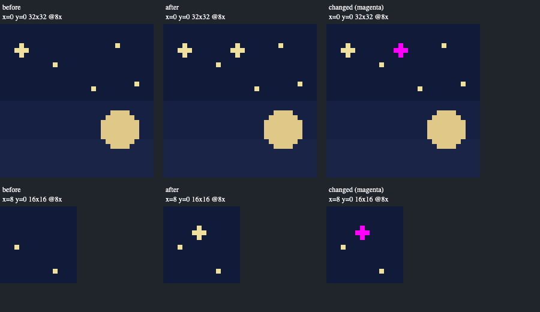

# MCP illustration production (#201)

## Scope and method

Local agent evaluation on 2026-11-04, macOS 27.0.1 arm64, Apple M4 Max,
Python 3.13.13 and Chromium 156.0.8078.4. The measured implementation was the
issue #201 working tree based on `a7721a8`, before its 0.34.0 release metadata
was prepared. The later label-layout correction does not change batch execution.
This is technical fidelity and orchestration evidence, not independent human
usability evidence, an artistic-quality assessment or external-editor parity.

The [official SDK example](../../examples/mcp/illustration_workflow.py) creates a
fresh project, imports aligned named PNG layers, prepares a nearest-neighbor copy,
converts its palette without dithering, draws literal stars/a moon and locks the
final layer in an atomic batch. It reviews the complete document plus a detail
crop, exports its artwork bundle, publishes using that exact review receipt,
reopens exact descriptor/composite/layer bytes, then archives and releases all
retained candidates. It downloads the durable archive and verifies its SHA-256.
The final run made 12 tool calls and retained zero candidate records after cleanup.
No external image editor was used for resizing, palette conversion or review
export. Layer intake, contact-sheet assembly and recovery export are native tool
operations. The client still chooses dimensions, palette budget, layer UUIDs,
drawing coordinates and whether to publish; these are deliberate authoring choices.

Agent inspection of the Chromium 900×520 capture found readable coordinates,
separate before/after/change columns, integer pixels and a complete overview plus
its overlapping detail crop. The initial new-document review explicitly labels its transparent before view.
The committed screenshot shows a subsequent unsaved five-pixel star added against
the saved baseline: only those five pixels appear magenta in the change column,
and the lower row shows the same change in an overlapping detail rectangle. Labels occupy two lines with a minimum column width so tiny crops
cannot collide with adjacent labels. The screenshot is a generated technical
fixture and does not establish illustration quality.



## Identical-edit transport and retention measurements

Run with the optional SDK interpreter:

```sh
python tests/support/measure_illustration_batch.py > /tmp/illustration-batch.json
```

The [measurement script](../../tests/support/measure_illustration_batch.py) runs
three fresh project/process repetitions for each size/route. Every case creates
layers with the same UUIDs, writes the same hidden-RGB pixel, draws the same
partially transparent rectangle, and applies the same final lock. Exact composite,
source rasters and layer metadata are asserted equal across routes. Project and
document UUIDs differ between disposable cases. Operation order is fixed rather
than randomized. These are local sequential observations, not statistical
confidence intervals or performance acceptance thresholds.

[Committed raw samples and environment](illustration-batch.json) retain the
individual observations. Bytes count actual serialized UTF-8 JSON-RPC messages
and stdio newlines, including duplicated text/structured results. Initialize,
base creation/retention, final recovery export and storage inspection are excluded.
Latency covers the four edit calls or one batch, including dispatch, validation,
processing and retention I/O. It is not a CPU, memory or renderer profile.
Retention columns show newly added sidecars; an initial compact base is excluded.

| Canvas | Route | Edit calls | Request bytes | Response bytes | Median ms | New records | New retained bytes |
| --- | --- | ---: | ---: | ---: | ---: | ---: | ---: |
| 64×64 | Full steps | 4 | 223,167 | 533,138 | 107.32 | 0 | 0 |
| 64×64 | Compact steps | 4 | 2,406 | 2,880 | 121.64 | 4 | 267,355 |
| 64×64 | Compact batch | 1 | 1,203 | 720 | 47.09 | 1 | 66,838 |
| 256×256 | Full steps | 4 | 3,499,975 | 8,397,474 | 345.74 | 0 | 0 |
| 256×256 | Compact steps | 4 | 2,406 | 2,880 | 350.02 | 4 | 4,199,523 |
| 256×256 | Compact batch | 1 | 1,203 | 720 | 182.24 | 1 | 1,049,880 |

Compact steps dramatically reduced transport while measured latency stayed near
full steps at 256×256 and increased at 64×64. That result does not support a
claim that compact envelopes alone reduce processing cost. The atomic batch cut
edit calls from four to one, intermediate retention from four records to one,
and observed latency at both sizes. It still performs native candidate validation
and layer composition at each internal edit. Broader workloads, large PNGs,
slow disks, remote clients and maximum-size documents were not benchmarked.

## Fidelity and failure boundaries

[Regression tests](../../tests/backend/adapters/test_mcp_illustration.py) cover
exact layer/composite/metadata recovery through artwork and project bundles,
saved reopen, locked layers, crop origins, explicit sheet flattening, stale
candidates/receipts, invalid atomic prefixes and bounded inputs. Lifecycle cases
exercise shared quotas, owner retention, archive write interruption, partial
release failures, restart discovery, chunk assembly and unrelated candidates.
Same-composite candidates with different hidden layer content are distinguished.
Existing layered-save recovery tests continue to exercise interrupted native
publication; the new tools use that same reviewed save implementation.

Saved geometry is never resized in place. Sheet preparation requires explicit
flattening into a new static sprite: frame slicing/timing and tile metadata are
omitted. This is a declared preparation boundary, not a lossless animation resize.
Lossless delivery uses the unchanged native candidate envelope; PNG-only intake
cannot reconstruct document identity, frame layout or saved bases. Archive files
accumulate outside the retained quota only when explicitly requested, and must
be copied separately when moving a project.

Palette conversion preserves literal alpha and transparent hidden RGB. Median
cut is bounded to 65,536 distinct nontransparent source RGB colors, 256 palette
entries and the native document/layer pixel budgets. Some low budgets cannot
preserve those requirements and reject; layered composition may also exceed a
requested budget and reject. No implicit dithering, cleanup or palette conversion
occurs. Isolated-pixel/cluster/near-color heuristics remain deferred: the contact
sheet marks literal changes, without judging whether a star/glint should exist.

The separate remaining human/platform/tool checks stay in the
[validation record](../VALIDATION.md#remaining-checks).
