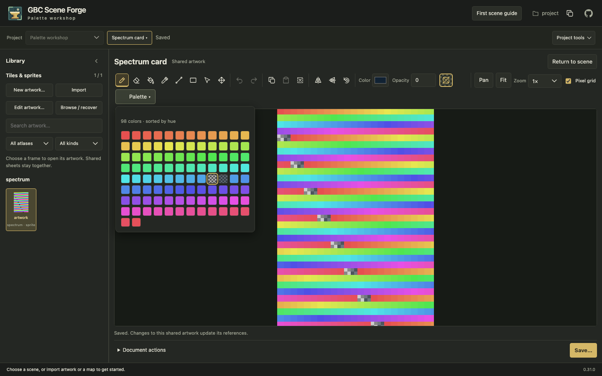
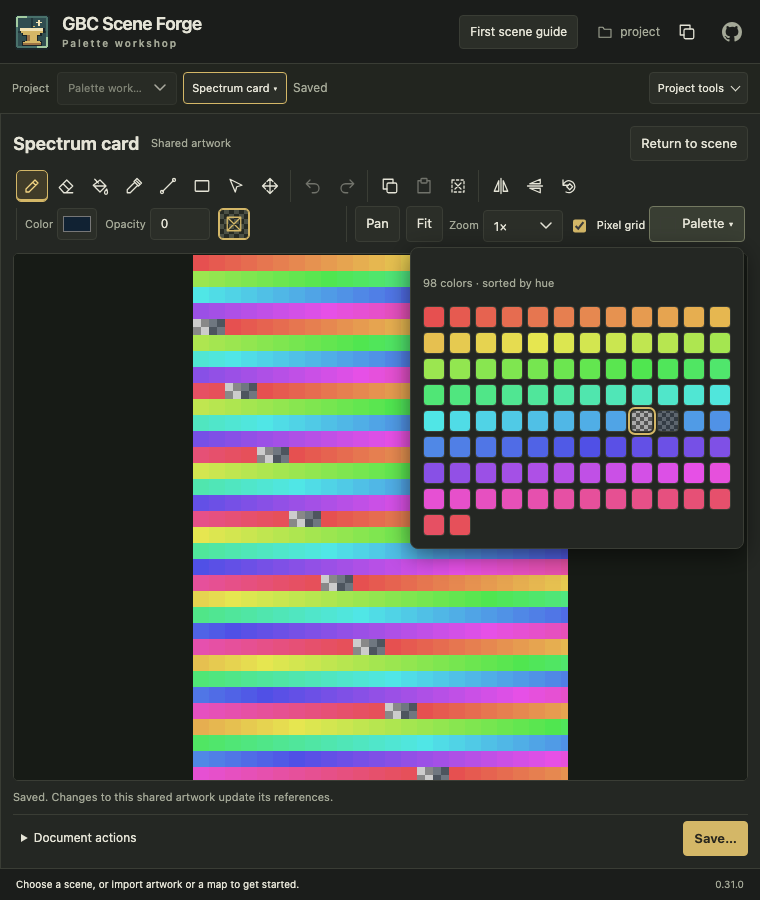

# Large native illustrations and palette (#181)

## Scope and method

Local prepared 0.31.0 working tree on `feat/181-large-artwork`, based on
`62b864c`, measured on 2026-11-03 with macOS 27.0.1 arm64 / Apple M4 Max,
Python 3.13.13, Node 24.22.1 and Playwright 1.64.1 / Chromium 156.0.8078.4.
These are synthetic service/browser observations and agent screenshot inspection,
not independent participant or physical-device usability results.

The [service benchmark](../../tests/support/measure_large_artwork.py) creates one
native static sprite, populates deterministic incompressible RGBA (seed 181),
edits one pixel including hidden RGB, writes/restores a checkpoint, reviews,
commits with the receipt, reopens and exports. Population is outside edit timing.
All four cases run sequentially in one process. The
[raw service measurements](assets/large-artwork/service-measurements.json) retain
per-phase cumulative peak RSS. They precede the final recovery-quota and automatic
Fit corrections; those changes do not alter this benchmark's single-record path.

## Service measurements

Milliseconds, one observation per operation; these are not latency guarantees.

| Pixels | Create | Edit | Checkpoint | Recover | Review | Save | Reopen | Export |
| --- | ---: | ---: | ---: | ---: | ---: | ---: | ---: | ---: |
| 375 × 525 | 9.1 | 14.2 | 17.5 | 14.8 | 53.0 | 64.9 | 15.3 | 28.6 |
| 822 × 1,122 | 40.8 | 62.8 | 69.9 | 61.8 | 102.4 | 266.4 | 59.4 | 127.5 |
| 1,500 × 2,100 | 131.0 | 217.6 | 259.1 | 206.3 | 213.6 | 887.8 | 182.9 | 405.9 |
| 2,048 × 2,048 | 181.6 | 279.2 | 322.1 | 287.2 | 474.8 | 1,167.9 | 226.2 | 528.1 |

Exact reopened pixels match the edited candidate. Incompressible project ZIPs
range from 1,582,200 to 33,584,166 bytes because native source and generated sprite
images are both included. The 40 MiB compressed import allowance covers these
single-document bundles; many maximum-size documents can still exceed it.
MCP resources retain their independent 16 MiB artifact / 24 MiB cache budgets;
use browser downloads for larger ZIP exports.

The area limit bounds one raw raster to 16 MiB, not total process memory.
This multi-case process reached **1,337,049,088 bytes** peak RSS (Darwin reports
bytes). Full JSON/base64 envelopes, original/edited copies, checkpoint records,
PNG buffers and allocator retention remain significant. An
[isolated maximum-area run](assets/large-artwork/isolated-maximum-area.json)
reached 810,172,416 bytes; it overlapped other validation and had slower review
(1,884.7 ms) and save (4,853.0 ms). Neither number is a per-image live allocation
or product memory cap. Initial multi-pass candidate serialization reached about
1.55 GB cumulative peak; single-pass canonical serialization reduced that overhead.

## Browser workflow measurements

The [archived browser timings](assets/large-artwork/browser-timings.json) come from
the production full-suite run on the same working tree, after automatic Fit was
corrected. Milliseconds include Playwright control actions, assertions, polling
and the 350 ms checkpoint debounce. Create/edit/checkpoint includes creating the
blank document, one hidden-RGB stroke and Undo/Redo. Recover/review includes
returning to Scene, recovering a copy and opening review. Reopen includes reload,
Library navigation, exact HTTP pixel verification and zoom allocation checks.
They do not measure pointer-to-present latency or dense drawing throughput.

| Pixels | Create/edit/checkpoint | Recover/review | Save | Reopen/checks |
| --- | ---: | ---: | ---: | ---: |
| 384 × 544 | 1,006 | 521 | 189 | 348 |
| 375 × 525 | 1,012 | 573 | 182 | 333 |
| 411 × 561 | 1,008 | 566 | 177 | 331 |
| 750 × 1,050 | 1,866 | 1,474 | 341 | 618 |
| 822 × 1,122 | 1,757 | 1,634 | 359 | 688 |
| 1,500 × 2,100 | 4,447 | 5,139 | 1,283 | 1,808 |

## Regression and visual evidence

The [backend checks](../../tests/backend/artwork/test_large_artwork.py) cover all
six requested card sizes, exact hidden RGB, bounded reads/detail review, receipts,
original-plus-copy recovery, stale bases, save/reopen/export, incompressible PNGs
and ZIP transfer. Dimension/area failures reject before image allocation/inflate.
[HTTP checks](../../tests/backend/adapters/test_http_routing.py) verify endpoint
request limits before body reads. The
[frontend checks](../../tests/frontend/artwork/large-artwork.ts) exercise 100 sparse
strokes on 1,500 × 2,100 artwork, all undo/redo states, cancellation, palette
ordering/overflow and compact bounded patch synchronization.

[Browser acceptance](../../tests/playwright/artwork/large-artwork.spec.ts) exercises
create, transparent drawing, undo/redo, checkpoints, recovered copies, review,
save and disk reopen at 384 × 544, 375 × 525, 411 × 561, 750 × 1,050,
822 × 1,122 and 1,500 × 2,100. At 32× display zoom, backing canvas area stays
within 4,194,304 pixels. Palette checks cover 98 exact source colors, 12-column
layout, alpha/hidden-RGB selection, arrows, Escape/focus and primary-click
light dismissal. This does not claim exhaustive browser memory/latency profiling.

Agent inspection of production captures at **1440 × 900** and **760 × 900** found
a legible hue-ordered grid within the viewport, checkerboard transparent swatches,
a visible selected color, and a fitted single illustration. The desktop Library
entry reads **Import**. The narrow layout hides Library according to its existing
responsive rule. These captures do not establish screen-reader or touch usability.

An initial largest-document browser recovery failed because two 33.6 MiB draft
records exceeded the former 64 MiB aggregate quota. Recovery storage now has a
separate 128 MiB quota; the original is retained and both-record regression checks
pass. Visual inspection also exposed automatic Fit being invoked through a
disabled button while opening artwork; direct fitting after editor layout fixes
it and browser checks assert the initial zoom. Early fixture corrections included
stale retained-session reopening and primary-click popover dismissal; they did
not justify changing retained-document or native popover behavior. The broad run
also found an older transparency test clicking a now-collapsed swatch; opening
the palette before each selection fixes the test, and its focused rerun passes.

Budgets and units are maintained in the [native contract](../EDITABLE-ARTWORK.md).
Final check results and unperformed checks belong in [Validation](../VALIDATION.md).
