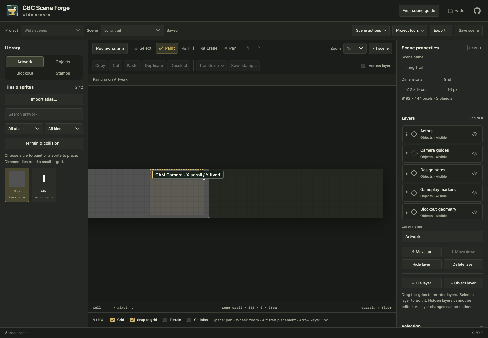

# Wide scene limits and measurements (#99)

The supported footprint is at most 65,536 cells with an 8,192px maximum on each
axis. This retains the previous 256×256 maximum cell count and the previous
maximum backing-canvas dimension (256×32px), while permitting different aspect
ratios. The maximum possible canvas area also remains 8,192² pixels (256 MiB
for one RGBA backing buffer, excluding browser overhead). Layers, undo snapshots,
input files and exported resources keep their independent existing budgets.
These limits bound allocation; they do not promise interactive frame rates for
every combination of layers and artwork.

Measured on an Apple M4 Max, macOS arm64, Node 24, Playwright 1.64.1 headless
Chromium, production 0.20.0 bundle, 1440×1000 viewport. Timings bracket synchronous
pointer dispatch, including UI and renderer work. They are local observations,
not GPU/compositor time or CI performance thresholds.

## Reproduce

```sh
FORGE_BUILD_MODE=production make frontend
npx playwright test --config tests/playwright/playwright.config.ts rendering.spec.ts wide-scenes.spec.ts
```

`rendering.spec.ts` reuses the [repainting workloads](canvas-repainting.md): three
visible tile layers (one dense, two 25% populated), one hidden tile layer, one
animated sprite, grid enabled, 1× zoom. Each hover trial dispatches 120 moves,
following warmup; painting dispatches another 120 while holding a real stroke.
The budget fixture uses 30 moves per trial/stroke to keep CI duration bounded.
The wide/tall fixtures are 480×9 and 9×480 cells at grid 8. The budget fixture is
1,023×64 cells (65,472 cells) and resizes to 1,024×64 (65,536 cells); it has a longer
test timeout because the existing renderer visits the complete scene. Tests assert
paint/image counts, absence of redundant canvas resets, unchanged hover history,
painting undo/redo, animation, resize and native save/reopen. Raw samples are
attached as `rendering-profile.json` in the Playwright report.

| Fixture | Hover trial medians (ms) | Painting median (ms) | Animation median (ms) |
| --- | --- | --- | --- |
| 16×12, grid 8 | 0.5 / 0.5 / 0.5 | 0.5 | 0.8 |
| 128×96, grid 8 | 28.2 / 27.8 / 28.1 | 27.3 | 29.35 |
| 480×9, grid 8 | 10.1 / 10.2 / 10.1 | 9.8 | 10.25 |
| 9×480, grid 8 | 10.4 / 10.4 / 10.4 | 10.2 | 6.1 |
| 1,023×64, grid 8 | 151.2 / 150.2 / 150.55 | 143.75 | 129.35 |

The near-budget workload passed the same authoring/history checks and expanded
to the exact 65,536-cell limit. Its hover p95 was 152.8–155.1ms, which confirms
that dense scenes at this budget can be visibly slow with whole-scene repainting.
Keeping the previous cell ceiling avoids expanding that worst-case workload.

`wide-scenes.spec.ts` exercises the requested **480×9 at grid 16** through actual
browser creation. It seeds one dense artwork layer, a native sprite, a gameplay
point at (7679,143) and a camera at (7504,0) through the MCP adapter's saved candidate
path. At the far edge, three 120-move trials after warmup measured medians of
**6.3 / 6.3 / 6.2 ms**, with p95 **9.5 / 9.6 / 9.4 ms**. This workload has fewer tile
layers and no drawImage proxy, so compare it separately from the table above.
The test erases a far-edge tile, checks undo/redo, restores a persisted browser
draft, expands to 512×9, saves/reopens and checks exact tile/object coordinates.



The existing whole-scene repaint cost remains visible, especially with dense
layers. Viewport culling remains separate work (#93). The new limits expand
aspect ratios without increasing the previous maximum footprint/canvas bounds.

Backend regressions cover native creation and MCP save/resize/reopen, restored
drafts, transformed far-edge tiles and sprites in portable Tiled exports, wide
and tall external Tiled intake, camera selection at the far edge, bounded
1,024px artwork overviews and explicit far-edge PNG views. Rejected requests keep
the project revision unchanged. The area and pixel caps are checked before
allocating creation/resize/native decode cell arrays. Existing byte/export
budgets remain enforced; a maximal footprint with many populated layers may hit
those budgets earlier.
