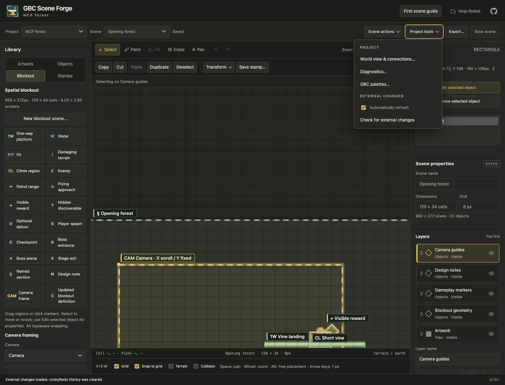

# See external saves in the browser

Scene Forge can keep an open browser editor up to date while an MCP agent,
another Forge process, or another browser saves the same project. All participants
must point at the same saved project folder.

## Normal workflow

1. Open the project and scene in the browser.
2. Save any local edits before asking an agent to make changes.
3. Leave the editor open. A clean, visible editor checks saved revisions about
   every two seconds and loads changes automatically. Returning to the tab or
   reconnecting also triggers a check when the editor is ready.

Refresh includes scene geometry and properties, camera settings, artwork and
project inventories: scenes, definitions, stamps, world connections and saved
preview preferences. Valid selections, the active layer, tool and brushes survive,
along with zoom and viewport position. Artwork brushes bind to the refreshed assets, and
preset/stamp brushes use their current project definitions. Removed or incompatible
brushes clear instead of selecting different artwork. Shrinking a scene may clamp scrolling or remove an
out-of-bounds selection. An external deletion closes the removed scene and asks
you to choose another; recovery drafts remain available.

**Undo/Redo history clears when an external snapshot is loaded.** Old editor
commands must not modify newly adopted content. Your own ordinary saves preserve
Undo/Redo. External edits never become commands in your browser's history.

## Controls without another toolbar button

Open **Project tools** to find:

- **Automatically refresh** — enabled by default. Turning it off stops automatic
  checks for this tab. The preference is remembered for this project URL in the
  browser when local storage is available.
- **Check for external changes** — checks once, including when automatic refresh
  is disabled. A manual check respects the same protections for local work.

## Discover new projects and scenes

New projects within the configured project root appear in the chooser and project
dropdown without a page reload. Registered scenes appear in the scene dropdown,
including with no scene open or with unsaved changes in the active scene. Merely
copying an unregistered map file into a folder does not register or import it.
Discovery updates navigation choices without adopting a new editor snapshot or
acknowledging a saved revision. It preserves the canvas, undo history, selections,
forms and recovery drafts. Choosing a newly discovered scene still uses the usual
unsaved-change confirmation. Existing save conflicts remain enforced.

Project manifests and changed registered maps use Forge's existing validators.
Invalid or incomplete entries are reported in the status bar and withheld from
new choices; the current selection is retained until explicit navigation or safe
snapshot adoption. Repaired files become available on a later check. Project
validation here checks the manifest, not every artwork byte; asset integrity and
scene-open validation still apply when loading and saving.

Inventory checks share the two-second refresh cycle, focus/reconnect triggers,
auto-refresh preference and manual check. They can run during unsaved edits and
text entry. Hidden tabs, dialogs/popovers, active pointers, focused dropdowns and
navigation pause discovery. Returning focus or leaving the dropdown resumes it.
An empty-root creation form retains unfinished input when projects arrive; use
**Back to projects** to see those discoveries.

## While you are editing

Full snapshot checks pause while the scene has unsaved edits; inventory checks continue. They also pause
while a dialog or popover is open, an input has focus, a gesture or layer drag is
active, movement preview is running, or the tab is hidden. A refresh already being
fetched is abandoned if you start an interaction before it can be applied.
After saving or reverting, checks resume when the editor is ready.

Since snapshot adoption pauses during unsaved edits, an external change is not necessarily
announced immediately. If another author saved first, your save still fails with
the existing revision conflict instead of overwriting their work. Keep the tab
open and retain your changes:

1. Wait for **Draft checkpoint saved** and inspect your local changes.
2. Use the existing draft recovery/download workflow to retain the stale draft;
   after reopening the page, **Recover unsaved work…** can download it even when
   restoration is blocked by a changed base revision.
3. Reconcile those changes with the latest saved scene. Use **Revert** only when
   you intend to discard local edits; refreshing will then adopt the external save.

Automatic refresh does not clear saved recovery checkpoints. Existing save-time
revision checks and conflict-aware recovery continue to protect local work.

## Cost and boundaries

An eligible visible tab checks about every two seconds, with additional checks on
focus, reconnect and completion of local work. One cycle runs at a time. In root
mode it requests the project inventory; an open project also requests compact
scene choices and, when safe, the existing revision probe. Direct-project mode
omits the root inventory request. The cycle owns no worker or extra timer. See [local cost measurements](../evaluations/inventory-discovery.md).

Unchanged project inventories scan immediate child directories and stat their
manifests, reusing validated catalog entries. Unchanged scene inventories stat the
manifest and registered maps, reusing validation results (including invalid maps).
They do not decode scenes or read artwork. Metadata includes file identity, size
and nanosecond modification/change times, so replacements and same-size edits
invalidate caches. Removed entries are evicted. Work grows with inventory size;
a changed manifest revalidates its registered scenes. The existing revision probe
still stats only the manifest and active scene and reuses bounded hashes.

A changed revision triggers a coherent snapshot and artwork fetch, followed by a
revision recheck before adoption. Rapid saves are coalesced; a snapshot overtaken
by another write is retried on a later check. A brief filesystem lock keeps probes
and snapshots outside cooperating writers' transactions. The existing loopback,
project-path and mutation-token boundaries are unchanged in both launch modes.

If a connection or load fails, a compact status message explains that the current
view is retained. Checks retry while the editor is eligible, including on focus or
reconnect. An invalid or missing scene file keeps the current view until the saved
project can be loaded safely; deleting a scene through Forge closes it normally.

This synchronizes saved files. It does not merge concurrent edits, share unsaved
forms, or provide remote collaboration. Discovery watches registered maps and project manifests;
manual artwork tampering outside Forge's import/reimport flow remains subject to
the existing asset-integrity errors rather than becoming an automatic import.
