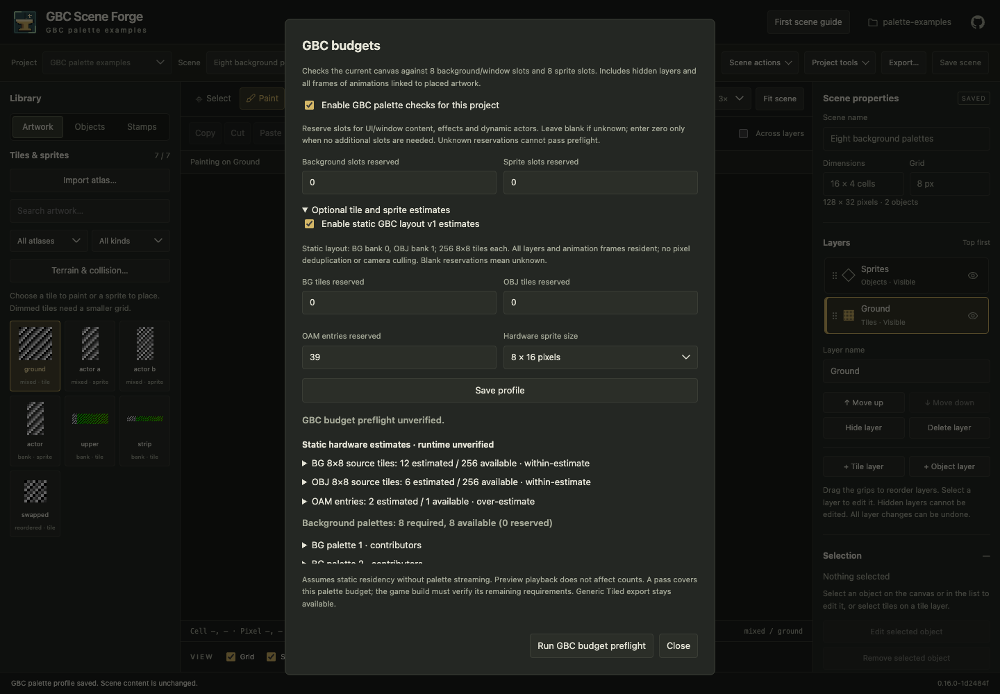

# Optional GBC budgets

Open a scene, then **Project tools → GBC budgets**. Generic PNG/Tiled authoring
works without a profile. Enable palette checks, declare BG and OBJ palette
reservations, and save the profile. Existing palette-only behavior is unchanged.
Blank reservations mean unknown; use zero only when nothing additional is needed.

Expand **Optional tile and sprite estimates**, enable **static GBC layout v1**,
choose the runtime's hardware sprite size, enter tile/OAM reservations and save.
The report includes the current unsaved canvas, hidden layers and objects, and
all transitively linked animation frames regardless of preview playback. Open
contributor lists and click an entry to locate it on the canvas. Project diagnostics
also summarize enabled budgets for each included scene. Excluding hidden layers
from movement diagnostics does not change the hardware profile's residency policy.

The [compact layout](../screenshots/gbc-budgets/compact.png) keeps report actions
accessible while the expanded settings and contributor lists scroll.

## Profile and counting rules

This initial versioned layout (`gbc-static-split-v1`) assumes unsigned BG addressing
with BG/window artwork in VRAM bank 0 and OBJ artwork in bank 1. Each pool budgets
256 8×8 source tiles. This is a deliberate, disjoint static layout, not the total
GBC VRAM capacity or a requirement imposed on your engine. Reservations subtract
from each pool and from the 40 OAM entries for UI, effects and dynamic actors.
Choose a different allocation in your game only after independently checking it;
Forge does not currently model alternative bank layouts or streaming schedules.

A source tile is identified by atlas ID and its 8×8 coordinate. Repeated uses and
horizontal/vertical flips share a source identity; different coordinates/atlases
are counted separately even when their pixels match. Each scene-grid tile
contributes its contained 8×8 cells at the corresponding offset in each linked
frame. Sprite artwork contributes every source cell across those frames. There
is no pixel-level 2bpp deduplication or transparent-cell omission.

For OAM, a rectangular sprite uses width/8 × height/hardware-height entries.
For animated sprites, each placement contributes the largest frame's count;
frames are not summed for OAM. All placements are assumed simultaneous. Maps are
not camera culled. Source-tile counts include all frames for static residency.
Repeated sprite placements reuse source tiles but each consumes OAM entries.

`within-estimate` means the counted source cells or entries fit the declared
layout after reservations. `over-estimate` means they exceed that estimate:
reduce artwork/actors/reservations, or verify runtime deduplication, streaming or
culling independently. It does not prove that an optimized game cannot display
that scene. Blank reservations, missing artwork, incompatible animation offsets
or non-aligned hardware dimensions produce `unverified` with contributor locations.
Counts in an incomplete report cover only successfully analyzed contributors.
Analysis stops accumulating source cells after one million cell visits and marks
remaining estimates unverified rather than doing unbounded work under a project lock.

## What remains unverified

The overall hardware result is always **unverified**, including when every
estimate fits. Existing palette failures still fail preflight. A version-2
preflight cannot issue a successful hardware certificate (the CLI returns nonzero).
Palette contributors require usable gbc-atlas v1 RGB5 metadata; generic PNGs
remain editable and report missing palette information explicitly.

The consuming build must verify actual tile indices and bank allocation, 8×16
even/odd tile pairing, diagonal tile transforms, camera transforms and dynamic
actors, the ten-object scanline limit and OAM ordering, ROM bank layout, tilemap
allocation, transfers and frame timing. No camera or scanline simulation is
performed. A scene is not a runtime allocation plan.

## Persistence and portability

Saving the profile uses the existing guarded, durable project transaction. It
stores `gbc_palette_profile` version 2 with the hardware layout, sprite height,
and reservations in `forge.project.json`. Existing palette-only profiles remain
version 1 and are not silently upgraded. Enabling the extension requires Forge
0.16.0 or later to reopen the project. Disabling only the hardware estimates and
saving returns to profile version 1; disabling all checks removes the profile.
Scene files and portable Tiled properties do not acquire GBC constraints. A whole
Forge project export retains its optional profile, just like existing preferences.
Reports never mutate scenes, artwork, exports or profile settings.

## Hardware references

The implementation follows the maintained [Pan Docs tile-data reference](https://gbdev.io/pandocs/Tile_Data.html)
for source-cell size and addressing, [OAM reference](https://gbdev.io/pandocs/OAM.html)
for entry limits, sprite sizes and pairing, and [palette reference](https://gbdev.io/pandocs/Palettes.html)
for separate BG/OBJ palette pools. These hardware limits are distinct from Forge's
chosen static allocation policy. Source versions are also available in the
[Pan Docs repository](https://github.com/gbdev/pandocs/tree/master/src).
