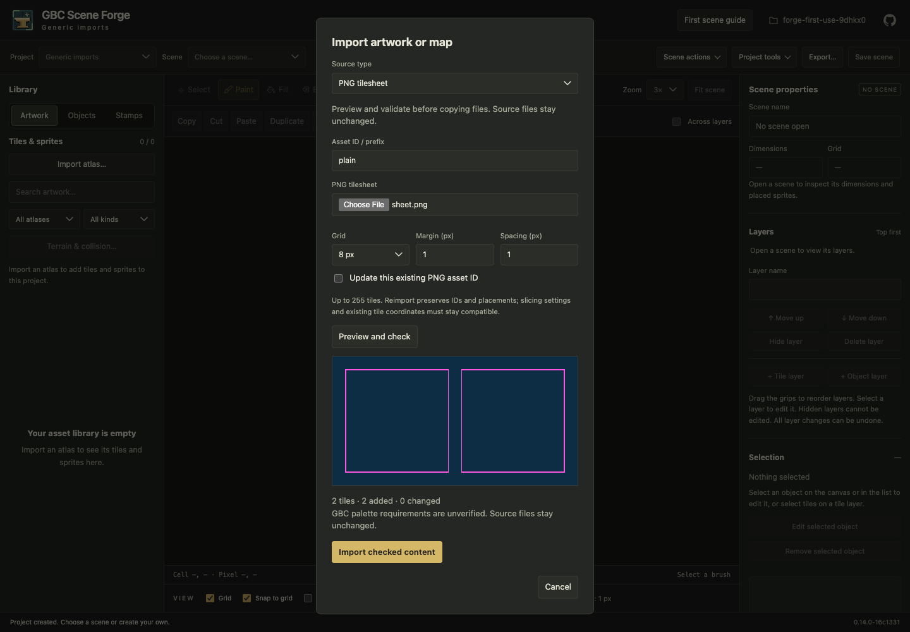
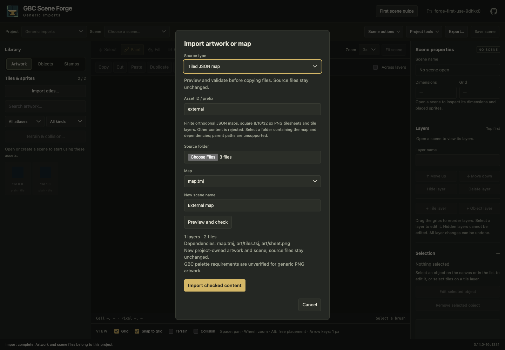
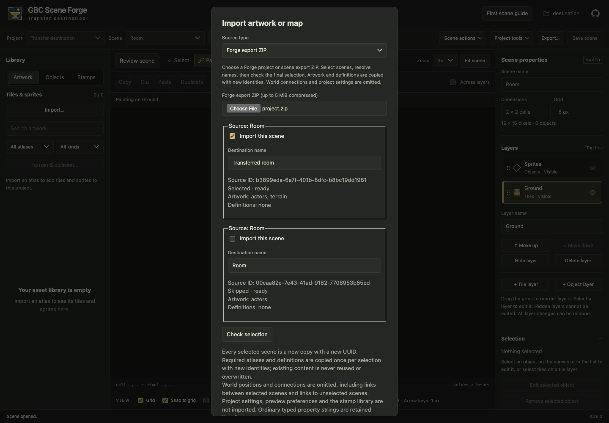
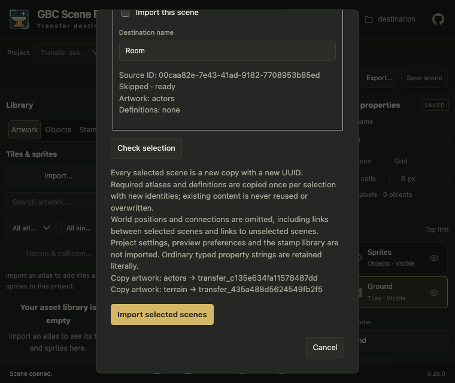

# Import artwork, Tiled maps and Forge scenes

Open **Library → Import**, then choose **PNG tilesheet** or **Tiled JSON
map** in Source type. The existing gbc-atlas bundle workflow remains available.
These generic inputs need no gbc-atlas installation, manifest or GBC palette setup.

## PNG tilesheets

1. Choose a PNG and give it a project asset ID, such as `forest` (lowercase letters,
   digits and underscores, starting with a letter).
2. Set the square tile grid to **8, 16 or 32 px**. Margin is the border on all four
   sides; spacing is the gap between tiles. Both are whole pixels.
3. Click **Preview and check**. Magenta rectangles show exactly which pixels become
   tiles. The sheet must slice exactly; partial tiles or leftover borders are
   rejected. Fix settings and preview again if needed.
4. Click **Import checked content**. Forge copies the PNG and creates portable
   tile images/tilesets inside the project. Existing saved placements stay intact.
   Create or open a scene with the matching grid and paint from the Library.

PNG inputs may be 1–2048 pixels on each side, at most 4 MiB, and contain up to
255 tiles. Non-interlaced 8-bit RGB/RGBA and 1/2/4/8-bit indexed PNGs are supported.
Colors and transparency are preserved; no quantization or palette assignment is
performed. Smaller supported scene grids can subdivide imported tiles.

To replace artwork, select the updated PNG, use the **same asset ID and slicing
settings**, check **Update this existing PNG asset ID**, and preview again. The
report lists added/changed regions and artwork changes. Existing tile coordinates
retain their identities even when columns or rows are appended. Removing or
resizing existing tiles, changing slicing settings, changing input format, or
accidentally reusing an ID without explicit update is rejected. Forge-authored
terrain/collision metadata and saved placements survive compatible updates.

Generic artwork has no RGB5/index metadata. If GBC palette checks are enabled,
placed generic tiles produce **unverified** requirements rather than a claim of
hardware compatibility. Ordinary editing/export remains available.

A successful **Preview and check** replaces prior check errors in the dialog and
footer with confirmation guidance. Changing checked inputs disables import until
you check again. Replies for changed inputs or a closed dialog are ignored.

## Tiled JSON maps

1. In Tiled, save/export a finite orthogonal map as JSON (`.tmj` or `.json`). Use
   sheet tilesets embedded in the map or external JSON tilesets (`.tsj`/`.json`).
2. Arrange the map, tilesets and PNGs in one source folder. Dependencies must be
   children of their referring file's folder; absolute paths and `..` references
   are rejected. Move/copy and update paths in Tiled before importing if needed.
3. Choose **Tiled JSON map**, select that source folder, select the map, enter a
   new scene name and an asset ID prefix, such as `forest_map`.
4. Click **Preview and check**. Review the layer/tile counts and the complete list
   of declared map/tileset/image dependencies. An incompatible map reports the
   unsupported setting or missing dependency; nothing has been copied yet.
5. Click **Import checked content**. Forge saves the new scene and all artwork in
   one guarded transaction and opens the imported scene. Asset IDs use the prefix
   plus tileset position (`forest_map_1`, `forest_map_2`, …). Existing IDs are never
   overwritten. For a second independent import, choose a new prefix.
   To update an imported sheet later, use PNG tilesheet import with its generated
   asset ID (for example, `forest_map_1`), original grid/margin/spacing and explicit
   update enabled. Map intake creates a new scene; it does not merge changes into
   an existing scene.

### Supported subset

- Finite, orthogonal, right-down maps, at most 65,536 cells and 8,192 pixels per axis, square 8/16/32 px grid.
- 1–128 full-size tile layers; names, IDs, order and visibility are retained.
- JSON-array tile data, empty cells, horizontal/vertical/diagonal tile transforms.
- 1–16 PNG sheet tilesets with matching grid, margins and spacing. Each sheet has
  the same PNG and 255-tile limits described above.
- Persisted scenes must fit 4 MiB and the resulting project manifest 8 MiB.
  Preflight checks these serialized output limits as well as the source sizes.
- Up to 65 selected PNG/JSON/map/tileset files, with at most 7 MiB of encoded file
  content (the entire HTTP request must fit the existing 8 MiB limit).

Object/image/group layers, infinite chunks, compressed/base64 layer data, custom
properties/classes, background colors, offsets, parallax, opacity, tint, locked
layers, image collections, tile animations/collision/Wang data, transparent-color
keys and unknown fields are rejected. Empty/default values documented by the
importer may be accepted. Source editor version/name bookkeeping is normalized
into Forge-owned files. No unsupported authored content is silently discarded.
This is an external sheet-map importer; it is not a general Tiled project importer
or the intake path for Forge's exported image-collection tilesets. Use
**Forge export ZIP** below to transfer Forge scenes into an existing project.

The source folder remains unchanged and is not needed afterward. Move the whole
Forge project to keep dependencies portable. A project ZIP export can be extracted
and reopened in Forge; its maps/tilesets can also be opened in Tiled. Preflight
confirmation is bound to the selected input and project revision: if another
session changes the project, preview again before importing.

The supported JSON fields and tile IDs follow the official
[Tiled JSON format reference](https://doc.mapeditor.org/en/stable/reference/json-map-format/).

## Forge export ZIPs

1. In the source project, choose **Export…** and download either **Whole project**
   or **Open scene**. Canvas exports include the chosen canvas snapshot.
2. In the destination project, open **Library → Import**,
   choose **Forge export ZIP**, select the ZIP, then click **Check selection**.
   Intake accepts ZIP files directly; extracted folders use the separate project
   reopening workflow.
3. Review every source scene, its destination name, required artwork/definition IDs
   and validation status. Uncheck scenes to skip them. Rename incoming scenes when
   their names match existing scenes or each other (ignoring case and surrounding
   whitespace). Scene UUID differences do not resolve a name conflict.
4. Click **Check selection** again after any change. Review the final selected
   names and copy decisions. Blocking errors disable **Import selected scenes**;
   a changed input invalidates confirmation. No project content is written yet.
5. Click **Import selected scenes** to confirm. If the open scene has unsaved edits,
   cancel the discard prompt to retain them or explicitly discard to proceed.
   Forge commits new scenes and dependencies together and opens the first copy.

Each selected scene receives a new UUID. Required atlases and scene-referenced
object definitions are copied once per selection with new identities, even if the
destination already contains identical artwork. The preflight lists source and
resulting IDs. Map-declared tilesets are dependencies even when unpainted. Atlas copies retain
their full sheet, all supported grids, sprites,
animation authoring metadata and terrain/collision metadata. Only selected scenes
are created. Existing scenes, their files and definition libraries remain intact;
new referenced definitions are appended. Layers, tile transforms, objects, sprite
origins and typed property values are retained. The next check/import validates
inputs again against the destination revision; reopen and check again after a
concurrent project change.

World positions and **all connections** are omitted, including connections between
selected scenes and to unselected scenes. Project settings, preview preferences
and unplaced stamps are not copied. Placed stamp content is ordinary scene data
and is retained. Ordinary string properties are copied literally: Forge does not
interpret them as scene links or rewrite user-defined strings.

ZIP intake is bounded to **40 MiB compressed, 256 MiB expanded and 8,192 regular
files**; PNGs are at most 17 MiB, maps/tilesets at most 4 MiB each, and manifests
at most 8 MiB.
Absolute/traversing paths, symlinks, duplicate members, unsupported compression,
unexpected members, checksum mismatches, missing dependencies and unsupported maps/tilesets are
rejected before commit. No ZIP members are extracted to disk. Saved output must
fit the existing 4 MiB scene and 8 MiB project-manifest limits. These checks cover
archive integrity as a whole; selecting fewer scenes does not bypass a corrupt
archive. Modified image-collection files must agree with their Forge authoring
sheets and metadata; arbitrary external Tiled modifications remain unsupported.

Whole-project ZIPs from earlier Forge versions can use their project manifest.
For native projects predating sprite placement, undeclared sprite tilesets are
rebuilt from the validated authoring sheet. Files declared in the asset inventory
or referenced by a map must still be present.
Scene-only ZIPs need the authoring metadata added in **0.26.0**; older scene-only
ZIPs report an actionable re-export error. New scene exports include managed
artwork sheets and a transfer manifest as well as their Tiled dependencies.
Source ZIPs/files remain unchanged and are not needed after import.

## Preview examples

[Library import entry at 760 × 640](../screenshots/library-usability/entry-760.png)
and [corrected PNG check feedback](../screenshots/library-usability/corrected-760.png).

