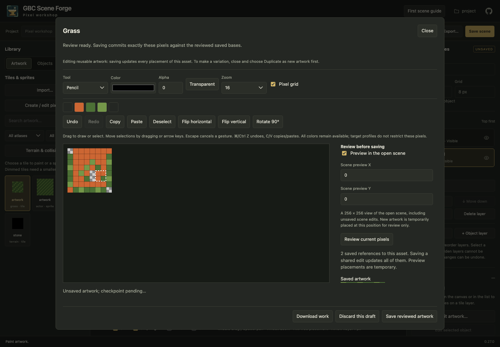
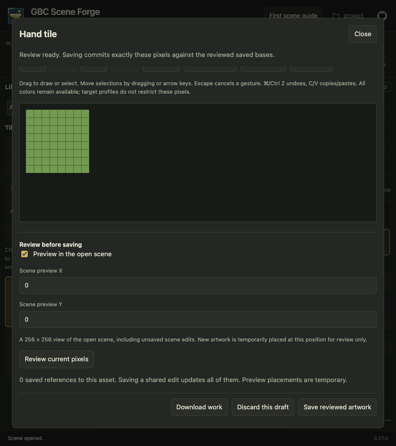

# Create and edit pixel artwork

The Library puts search and thumbnail cards first. **New…** and **Import** are
compact entry points; **Source…** groups Edit artwork, shared editing/copies,
source update, terrain/collision and deletion for the selected asset.
**Filters & recovery** reveals atlas/kind filters and the browser for recoverable
drafts and agent drafts. Filters persist when collapsed; the result count
shows matching assets. Long names wrap to two lines and keep their full identifier
in the tooltip.

Opening Library artwork shows the selected asset in a loading surface. Cancel
opening to return to your retained document, or select another Library asset.
Failed reads offer Retry opening; saved-base or checkpoint conflicts preserve
your local work and history. Use the Library source actions or Browse when you
want the explicit open/copy chooser.

**New…** opens **New artwork**, even when agent drafts are available. Name the
artwork, choose its type and dimensions, then **Create artwork** to draw before
saving. **More options** contains asset identity, full limits and multi-frame
sheet setup. **Existing artwork** retains shared editing, independent copies and
selected-placement variations; **Recoverable artwork** remains available below
setup when checkpoints exist. **From agent** has a count when unpublished drafts
are available. Left/Right and Home/End navigate these tabs. Undo/Redo, clipboard
and transform commands appear only once an editable document is open; setup
shortcuts cannot modify a suspended artwork document.

Before confirming a save, check whether you are adding **new independent artwork**,
editing a **shared original**, or replacing **selected placements**. New artwork is
added to the Library and must be placed separately. Shared edits affect every saved
reference. Review's **Saved source references** disclosure names affected scenes and
shows exact reference identities; a partial location page is explicitly labeled.
A selected variation changes only its captured placements, even when the source has
more references. Imported originals require an editable copy before drawing.

For agent handoffs, see the [browser/MCP outcome matrix](../AUTHORING-OUTCOMES.md).

Routine feedback appears in dismissible cards at the top-right of the canvas.
For example, drawing on a locked layer shows “Layer is locked. Unlock it to edit.”
The warning disappears after five seconds or when you unlock the layer; repeated
attempts refresh the same card. Hovering or focusing a card pauses its timer.
Save and recovery failures stay visible until dismissed or resolved. Closing a
card only acknowledges the message: protect your local work and resolve the
reported problem before leaving the document.
Artwork review and save retries share their feedback across keyboard shortcuts
and buttons: repeated failures keep one card, and a successful retry clears it.

## Drawing space, shortcuts and PNG downloads

The frame dock starts collapsed for drawing. The frame selector and **Sheet / Frame**
drawing scope stay above the canvas. Choose **Edit animation…** to expand frame and
timing controls, then collapse **Frames & animation** to return to drawing.
Deliberate dock/timeline and Library/Inspector visibility choices last for this
mounted editor, across scene/artwork and retained-document transitions; reloading
resets them. They do not enter Undo history. Review explicitly reveals the Inspector.
Closing the dock or animation disclosure stops playback.

**Keyboard help** above the workbench lists commands and pane controls.
With canvas focus, **P** selects Paint/Pencil, **E** Erase, **F** Fill,
**S** Select and **H** Pan in either domain. Artwork also supports **I** Eyedropper,
**L** Line, **R** Rectangle and **M** Move selection. Native tool-radio arrows,
text fields, dialogs and popovers retain their own keys; movement preview owns
its input while active. Tooltips show the letters.

Open **Download PNG…** beside the drawing tools, choose **PNG scope → Whole
artwork / sheet** or **Selected frame**, then **Download PNG**. The frame option requires a native
sheet frame selection; a single image offers whole artwork only. This downloads
current composited RGBA, including unsaved edits and visible native layers, at
native dimensions with transparency. It excludes viewport decorations, grids,
onion skins and selection outlines. Filenames use the asset identity plus
`sheet` or the frame identity. This is a static PNG, not animation or layered
interchange. Downloading leaves pixels, history, review, saved revisions and
recovery state intact.

**Document actions → Download work JSON** retains editable descriptors and pixels
for inspection/reconciliation. **Project tools → Export → Whole project** downloads
saved portable project files as ZIP. Neither is required for PNG download.
Routine open/save acknowledgments appear in the status area below the editor;
warnings and persistent errors keep their prominent notification controls.

## Shared editor workspace

Artwork opens in the same central workbench as scenes. Its name appears in the
document bar. The Library and collapsible Inspector remain in their usual places;
Layers, frame Properties and Save's exact-change review use the Inspector.
Collapse either side pane with its header arrow to make more room for drawing.
Save opens the Inspector for review if it was collapsed. Choosing the scene in Documents restores
scene canvas focus and the scene Inspector; scene edits and Undo remain retained
for ordinary shared artwork edits. Selected-placement variations retain their
separate atomic save and scene-history behavior described below.

The document bar has one Save location for either document. The shared command
strip above the contextual drawing tools contains history, clipboard, deselection
and transforms. The bounded frame/animation dock sits below the canvas. Collapse
**Frames & animation** to reclaim drawing space; reopen it for thumbnails and
animation controls. The frame selector, Sheet/Frame scope, onion skin and current
drawing boundary stay beside the tools even when the dock is collapsed. The dock scrolls
independently in short windows. **Properties** shows document dimensions and, for
sheets, frame names, geometry and representations. **Layers** remains independently
collapsible in the same Inspector. These pane changes do not enter Undo history.

Use **Library → Source… → Shared editing / copies…** for the selected source's shared-edit and
copy choices. **Edit artwork…** opens native artwork directly; clicking a named
pose while editing artwork opens that sheet with the requested frame selected.
Scene Library clicks keep their placement behavior. Source actions lets you name
an independent whole-sheet or region copy; selected-placement variations require
1–256 matching placements in a saved, unmodified scene on one active layer.
Review explains affected saved references before publishing shared edits, and a
variation commits its new source and replacements together. Imported sources need
an explicit editable copy. A deleted source remains unavailable in copy setup;
your entered name and identity are retained until you explicitly choose another.

## Layers, agent exchange and navigation

Open **Layers** in the Inspector to add a layer, choose the
active layer, rename, reorder, hide, set opacity (0..255) or lock it. First **Add
layer** retains flat artwork as **Base** and adds a transparent layer. Draw tools
edit the selected source; the canvas and scenes show the visible composite.
The Colors panel starts with the visible **Composition**. Choose **Selected
layer** to inspect the active source's colors; switching layers updates that view
without adding an Undo step or changing the document.
**Visible** and **Locked** apply immediately and each change has its own Undo step.
Locked layers disable visibility and other editing controls; uncheck **Locked**
to enable them. Name and opacity use **Apply name / opacity**; applying trims the
name and rejects an empty name before changing the document.
Toggling visibility or locking keeps pending name and opacity entries without
applying them; use **Apply name / opacity** when those entries are ready.
Unlock a layer before changing its pixels or structure. Layer changes and pixels
share this document's Undo/Redo; checkpoints retain exact source pixels but do not
contain the local Undo stack. Save → review → Confirm save publishes all sources
and their derived composite together. Whole-sheet copies retain layers; individual
region/cell copies use visible flattened pixels. The [native contract](../EDITABLE-ARTWORK.md#named-raster-layer-extension-version-1)
defines limits and older-version rejection. Hidden source RGB is preserved even
when it cannot appear in the composite.

**From agent** shows unpublished MCP drafts as thumbnail cards with names,
dimensions and artwork kinds. **Refresh** updates the list/count without changing
the selected setup tab. Thumbnails load when visible; thumbnail exports use at most
two concurrent full snapshots and retain small canvases rather than envelopes.
Select a card to preview a revision without downloading or saving. **Download
PNG** exports flattened pixels; **Draft details → Download snapshot JSON** retains
the native layered envelope and remains available if a preview fails. Failed
reads offer retry; stale drafts remain previewable/downloadable.

**Edit a copy** checks artwork and selected-scene bases and opens separately
owned local work with a new Undo history. Other open documents retain their
histories/checkpoints. The preview explains whether a later reviewed save adds
new artwork, updates an existing shared source, or replaces selected placements.
Cancelling or closing the preview has no adoption or save effect.
Adopted edits to saved artwork remain **Modified** against the actual saved
original until saved. Choosing the scene in Documents retains their recovery checkpoint.
**Document actions → Return candidate to agent** checkpoints and downloads an immutable handle that
the agent can list/export and edit against its actual saved base. It does not
publish. A later browser/MCP save still needs fresh review and guards. Stale work
can be inspected/downloaded but must be reconciled explicitly before adoption or
save. Candidate copies persist until explicit export/release; closing a local
draft does not remove another owner's candidate. Recovery survives restart;
in-memory Undo does not.

With **Auto-refresh** enabled, the Library and source choices discover MCP saves
and deletion while Artwork remains open. This updates discovery, preserving the
open document's pixels, saved base, selection, view and Undo. Real modal dialogs,
active gestures, pending writes, editing a form or hidden windows pause discovery.
Interrupted discovery retries once the editor is idle, including source choices.
Source controls become available when the first saved artwork arrives and disable
when no sources remain; discovery keeps the copy name and asset ID you entered.
Use **Project tools → Check for external changes** when automatic refresh is off.
To adopt another saved revision of an already-open document, retain/download its
local work, explicitly close it and reopen the saved artwork; discovery never
silently rebases that document.

Ordinary wheel input over the drawing viewport zooms in (up) or out (down), keeping
the artwork point under the pointer stable where scrolling permits. Surrounding
viewport space uses the same canvas-relative anchor. Small trackpad deltas
accumulate to a bounded zoom step; a large event still changes one preset. Wheel
input at limits stays in the viewport without scrolling the page. Other panels
retain ordinary scrolling. Ctrl/Meta-wheel and pinch retain browser page zoom.
Wheel navigation pauses during drawing/panning and never paints or adds history.
Pan-tool dragging, Space-drag and middle-button panning remain available.
Saved artwork appears in both interfaces; an unpublished agent candidate is separate
from browser local documents and recovery checkpoints.

Choose **New…** in the Artwork Library to create a tile or sprite.
To edit existing artwork, select it and choose **Edit artwork…**, or double-click
its thumbnail. With no scene open, a thumbnail opens artwork directly. A scene
placement's **Edit artwork…** action opens its selected source and variation
options. Scene undo and unsaved scene edits remain intact.

## Start a tile or sprite

The **New artwork** flow asks for a name, Tile or Sprite, and dimensions, followed
by **Create artwork**. Asset IDs follow the name: **Player’s Sprite** becomes
`players_sprite`. Punctuation is dropped, spaces become underscores and
accents are simplified. An ID beginning with a digit gets an `art_` prefix; an
empty normalized name uses `artwork`. Expand **Asset identity** to supply a unique
ID yourself; that override stays intact when the name changes. Single tiles are
square 8, 16 or 32 pixels. Static
sprites also serve as general illustrations: use any positive integer dimensions
up to 4,096 pixels on either axis and 4,194,304 pixels total, with origin 0, 0.
For example, one 375 × 525 or 1,500 × 2,100 card stays in one document. Check **Create a
sheet with multiple frames** for a tile or character sheet; the layout summary
shows its rows, columns and frame count.

**Filters & recovery → Browse / recover / candidates… → Existing artwork** opens source-specific options.
Native artwork offers **Edit shared artwork**: saving changes every placement
that refers to that asset. **Create editable sheet copy** makes an independent
copy of the complete source. Imported artwork must be copied before pixel editing.
Name the copy beneath its source; the original remains intact. Expand **Copy a
region or replace selected placements** for a single-cell/sprite copy. Tile source
column/row are zero-based within its region, using the chosen tile size. Copies
keep supported metadata and sprite origins. Saved copies appear in the Library
for separate placement.

## Make a variation for selected placements

Save the scene, switch to Select, and select matching tile cells or sprite objects
on one active layer with **Across layers** off. Open **Edit artwork…**, choose the matching source cell/sprite,
name the copy, expand **Copy a region or replace selected placements**, and choose
**Create variation for selected placements**. Asset identity is optional advanced setup.
Every selected placement must use that source; tiles must use the chosen source
grid. Select at most 256 placements. Expand **Placements this variation will replace**
to inspect the captured scene/layer/cell or object locations.

Draw the variation, then review. The before image shows the original pixels;
the scene comparison shows the selected replacements without adding a temporary
placement. The reference count describes the original asset, and the replacement
count describes the selection. Other placements, reusable stamps and object
definitions keep the original. Saving commits the new artwork and selected
references together, preserving tile transforms, sprite origins and properties.
The saved scene reloads with fresh scene history so later saves retain replacements.

Unsaved scene work must be saved or reconciled before replacement. If another
writer changes a selected scene, review/save and recovery reject its stale base;
pixels and checkpoints remain available for download. Forge never applies a
variation to a different or newer selection automatically. Browser selections
come from the open saved scene; MCP may explicitly select locations across scenes.

## Draw and revise

The toolbar exposes Pencil, Eraser, Flood fill, Eyedropper, Line, Rectangle
outline, Select rectangle and Move selection directly as icons. Hover for names;
Tab reaches the selected tool and arrow keys choose adjacent tools. A pointer
choice returns focus to the canvas. History, clipboard and transforms use the
same icon style as scene commands; gold marks the selected drawing tool.

The shared strip holds history, clipboard and transforms. The contextual toolbar
groups drawing tools, Color/Opacity and Pan/Fit/Zoom beside the canvas. Groups wrap
together at smaller widths; the **Colors ▾**
button in the Inspector opens a scrollable 12-column swatch grid. The Inspector identifies shared
artwork, new artwork and selected-placement variations; the document bar shows
local Saved/Modified/New state. Save stays in the document bar. **Document actions**
contains download, close/discard and **Drawing & keyboard help**. **Fit** chooses
the largest available zoom that fits the current sheet or frame and centers it.

A light/dark outlined pixel shows the exact target before drawing, filling or
sampling with Eyedropper. Select rectangle uses a dashed target; Move selection
uses a move cursor rather than suggesting a single-pixel write. Targets respect
zoom, scroll, panning and the selected frame's offset, and disappear outside the
artwork, during gestures/review requests and when you leave the viewport.

Pan with a **middle-button drag**, or focus the canvas and hold **Space while
dragging**. The **Pan** button also enables drag navigation; arrow keys then pan
by 32 screen pixels. Its grab/grabbing cursor distinguishes navigation from
painting. Choose any drawing tool or press Escape on the canvas to leave Pan.
Releasing Space, pointer cancellation or window blur ends a temporary pan.
Space in form controls keeps its normal behavior. Surrounding space lets even
small artwork move away from the center. Zoom preserves the viewed center;
**Fit** and changing between Sheet/Frame or selecting another frame in Frame view
center the new view. Panning never changes pixels, selection, history or dirty
state. Each document retains its viewport and Pan choice when you switch away.

Drag a rectangular selection, then move it with the Move selection tool or arrow keys
while the canvas has focus. Copy/Paste uses the artwork's own clipboard and pastes
at the selection's top-left (or 0, 0 without a selection). Flip and clockwise
quarter-turn rotation affect the selection, or the whole artwork when deselected.
A rotated rectangle must fit without resizing the document; otherwise select a
smaller area or move it inside the bounds first.

Opacity supports exact alpha values from 0 (transparent) to 255 (opaque), including
partial transparency for PNG compositing. **Transparent** toggles alpha to zero
and changes its accessible name to **Resume color**; click again to restore the previous nonzero
opacity. Choosing a color also resumes painting at that opacity. Eraser writes
transparent black. Open **Colors ▾** to inspect **Composition** or **Selected layer**.
Both follow the drawing scope: **Current frame**, **Entire sheet**, or **Entire
image** for a static document. Composition shows exact visible RGBA after layer
visibility, opacity and source-over blending; fully transparent pixels, the
checkerboard, grid and onion-skin overlays do not contribute colors. Partially
transparent colors retain their straight RGB and alpha, displayed over a
checkerboard. **Selected layer** shows exact source RGBA, including hidden RGB
beneath transparency, without applying that layer's visibility or opacity.

Sort neutral colors first then by hue, lightness and saturation, or choose
**Most used** to sort by pixel frequency with hue order breaking ties. Alpha
variants remain separate. Use Left/Right on the scope tabs; arrow keys navigate
the swatch grid, Enter selects, and Escape closes the panel and restores focus.
Choosing a swatch sets both Color and Opacity, keeps the active editing layer/tool,
and does not recolor pixels or add Undo history. The drawing-color preview shows
its exact RGBA. The palette updates after edits, Undo/Redo and view/layer changes.

The palette shows the first 1,024 distinct colors encountered in row order within
the scope. If more exist, an explicit notice appears; ordering, including usage,
applies only to shown colors. The eyedropper can select other source colors.
Inspection never quantizes artwork or imposes a GBC profile. Collection runs only
when the panel needs it, without scanning again during drawing pointer movement.
Zoom uses nearest-neighbor pixels; toggle the pixel grid as needed.

Large artwork uses a bounded whole-image review overview. Expand **Artwork detail
view**, select **Review detail region**, and enter a rectangle up to 1,024 pixels
per axis to inspect native pixels. Review additional regions as needed. **Fit**
includes fractional zoom down to ¹⁄₃₂× for large artwork in short windows; drawing
coordinates continue to use source pixels.
Newly opened artwork starts with whole-image review and a detail rectangle that
fits its dimensions. Switching between open documents restores their detail settings.

Each stroke, fill, paste, move or transform is one undo operation. Artwork keeps up
to 100 operations within a 64 MiB history budget using changed pixel blocks, independently of scene history.
Use the shared Undo/Redo buttons or ⌘/Ctrl Z and Shift Z (Ctrl Y also redoes).
⌘/Ctrl C/X/V copies, cuts and pastes pixels in the active artwork selection, or the
current frame/sheet when there is no selection. Cut clears that area and retains
its exact RGBA values in the artwork clipboard. Scene and artwork clipboards and
histories remain independent. **Duplicate** (⌘/Ctrl D) is a scene command; it is
disabled for artwork. Open **Transform selection** for flips and 90° rotation.
Pointer commands return focus to the active canvas; keyboard button activation
keeps its focus. Shortcuts work from shared controls as well as the canvas.
Text fields retain
native editing/clipboard shortcuts, and modal dialogs retain keyboard focus.
Undo/Redo keeps the active frame. If a restored selection extends outside that
frame, it is cleared so clipboard and transform commands use the active frame.
Selections within the frame, or anywhere in Sheet view, remain selected.
Escape during a stroke, pointer cancellation, lost capture or window blur cancels
that gesture. Escape otherwise returns to Scene after checkpointing unsaved work.
Keyboard shortcuts in text/color/number inputs retain their native behavior.

## Review, save and recover

**Save artwork…** in the document bar opens a focused change review. It compares the saved and proposed artwork and reports the
number of affected saved references across scenes, stamps and definitions. With
**Preview in the open scene** checked, the preview includes local unsaved scene
edits, within a 256 × 256 view. Expand **Scene preview position** to set pixel X/Y. Existing placements retain
their transforms and origins. New artwork is temporarily placed at that position;
a tile spanning several scene cells is reviewed in full when its size divides
into the scene grid. Temporary placement never changes the scene. Uncheck scene
preview for isolated review, including artwork incompatible with the open grid.

**Confirm save** commits the exact reviewed pixels against the project,
artwork and scene bases. Further pixel edits invalidate the review. Save adds or
updates artwork and reloads the Library/images without adding a scene undo item.
The document stays open after saving, with its selected frame, tool, zoom and
Undo/Redo retained. Saved, Modified and New identify its actual state. Undo after
a save compares with that new saved base. Saved frame identities and geometry
remain present through Undo. Saving a new representation removes history states
that become no-ops or exceed document limits after retaining the saved frames.
Other pixel, name and animation history remains undoable, including valid states
before and after a removed state.
Choose the scene in **Documents** to place new artwork
from the Library separately. **Close review** returns space to drawing; **Update
review** regenerates the comparison after adjustments. A failed scene preview
leaves its options available so you can switch to isolated review.
If isolated artwork review finds that another writer changed the open scene,
the artwork can still save, but local scene edits retain their original conflict
guard. Reconcile the scene before saving it; artwork saves do not authorize
overwriting newer scene content.

Completed edits checkpoint after a short debounce into the project's
`.forge/artwork-drafts/` directory, separately from scene checkpoints. Checkpoints
capture completed edits; unfinished or canceled gestures are excluded. Switching or
Keep draft and close waits for the current checkpoint; a failed checkpoint keeps the document open and offers
**Download work**. Leaving before a checkpoint finishes prompts the browser's
unsaved-work warning, including after Undo returns to the saved pixels while an
older checkpoint still needs updating. Disposing an editor preserves completed checkpoints.
If a checkpoint response is lost, the warning remains active until Forge checks
the owned checkpoint's stored revision and pixels. A later checkpoint or explicit
discard performs that check before writing or deleting; failed checks retain local work.

Choose **Filters & recovery → Browse / recover / candidates…** in the Library,
or **Browse / recover artwork…** in the document switcher, to see recoverable records. **Recover copy** checks the
original saved base and opens unsaved pixels under a fresh draft identity; it
retains the original record. **Delete checkpoint** explicitly removes a listed
record. **Close document** (or **Document actions → Close artwork**) closes a saved
document. Modified work offers Save, Keep draft and close, Discard and close, or
Cancel. Discard removes the current working checkpoint. Save and discard
of a recovered copy leave its original record available until explicitly deleted.
Recovery restores pixels and bases, without claiming a durable undo stack.

If another browser or MCP writer saves first, review/save or restoration rejects
the stale base. Local pixels and existing checkpoints remain available. Download
the work, inspect the latest saved asset, and reconcile explicitly; Forge never
rebases stale pixels or overwrites another writer automatically. Downloaded JSON
is an inspection/reconciliation record, not an automatic import format. **Download
work** captures the live layout as `current_descriptor` and exact pixels as
`current_rgba`, plus the original base and last synchronized candidate. It works
even when layout synchronization fails. Artwork
drafts are bounded to 64 records, 49 MiB each and 128 MiB total per project, and are
excluded from portable exports.

Historical pre-unification captures:

For pixel/service limits and revision semantics, see the
[editable artwork contract](../EDITABLE-ARTWORK.md). The
[MCP authoring loop](../MCP.md#native-artwork-authoring) uses the same candidate and
save services. See the [mixed workflow evaluation](../evaluations/artwork-workflows.md)
for the exercised tasks, evidence and limits.

## Sheets, animations and the shared workbench

Scenes and artwork share a **Documents** button in the context bar. It shows
the active name and **Scene** or **Artwork** kind; the adjacent **Saved**, **Modified** or
**New** label describes local work. **Saved base changed externally** is a separate
warning when discovery or a manual scene check detects a different saved revision.
Undoing to your own saved base does not remove that warning or adopt external edits.
Automatic scene adoption remains paused while the scene is dirty.

The button opens **Open documents**, including the active scene, an **Open another
scene** selector and retained artwork. Enter/Space opens it from keyboard focus.
Close, Escape or the backdrop dismisses it and restores focus to the button.
The background stays inactive while it is open. Long names wrap and the chooser
scrolls within compact viewport bounds. It remains available during artwork setup
and when no artwork documents are retained.

Choosing a retained document keeps independent history, selection, active layer,
tools, color, frame/sequence, zoom and viewport. Outgoing playback stops. Switching
away from artwork waits for its checkpoint; failure keeps that document open.
Returning restores canvas focus. Opening/dismissing the chooser alone creates no
checkpoint. Opening **another scene** replaces the single active scene after its
existing unsaved-work confirmation; changing projects checkpoints artwork and
retains scene Save/Discard/Keep editing choices. Reload recovery restores checkpoints,
not the in-memory Undo stack. Up to 16 artwork documents can remain open at once.

Saving normally retains an artwork document. **Close document**, beside Save,
closes the active Scene or Artwork without deleting its saved asset. Clean documents
close directly; modified work offers Save, Keep draft and close, Discard and close,
or Cancel. Artwork Save and close opens the existing review: **Confirm save and close** commits
and closes; Cancel closing or dismissing the review keeps editing open. Failed save/checkpoint operations
leave the document open. A closed artwork leaves the retained-document chooser;
Keep draft preserves a recoverable record, without retaining its in-memory history.
The last retained artwork becomes active, otherwise the open scene or an empty
scene workspace receives focus. Documents and Library entry points remain available.
Switching does not close or discard work. Returning clears comparison images, reference summaries and animation
reviews; Save requires a fresh review. New/Browse remain available in the chooser
when the Library is collapsed.

For a sheet, set overall Width/Height, enable multiple frames, then choose Frame
width/height and optional sprite origin. Frame dimensions must divide the sheet
exactly; use at most 128 frames in a raster up to 256 × 256. **Create editable
sheet copy** migrates existing artwork without resampling: complete source pixels,
frames, origins and sequence timing are copied. Unsupported dimensions/layouts
reject the copy rather than changing artwork.

The frame strip sits below the canvas. Opening a named Library pose in a fresh
artwork document selects that pose and starts in **Frame** scope. Reopening an
already retained sheet selects the requested pose while preserving its drawing
scope, tools and zoom. The tools explicitly show **Editing frame: Pose 1** or
**Editing entire sheet**, separate from shared-source or independent-copy save
scope. Selecting a frame in Sheet scope highlights it without limiting drawing. **Sheet** shows
the collection with frame boundaries and origin crosses; **Frame** constrains
drawing to the selected rectangle. **Properties** contains frame names, geometry,
origin and tile repetition preview. Rename poses there. Switch back to Sheet to
work across the collection. Short windows retain the frame selector beside the
tools and thumbnails inside the bounded dock. Scroll the dock to reach animation/timing controls, or
collapse **Frames & animation** to restore drawing height. The dock scrolls
independently of drawing and Save.

Expand **Animation** below the frame controls. Name sequences such as Idle, Walk,
Jump and Duck using **New animation**. Choose a source frame and **Append frame**,
adjust durations in milliseconds, reorder with Up/Down, and set Loop. Sequence
entries can repeat artwork frames; they must share dimensions, kind and origin.
Play resumes a paused preview in place or restarts a completed non-looping
sequence from its first frame, in both Artwork and Scene. Step advances one frame.
Onion skin overlays the preceding
sheet pose in Frame mode. **Generate animation review** produces a self-contained
timed APNG. Save still opens explicit shared-change review before confirmation.
Layout and pixel edits share Undo/Redo; changes require another review.
Layouts must fit the 64 KiB document descriptor limit, including frame names and
animation timing entries. An edit that exceeds this limit is rejected with a
message; the previous layout, pixels and Undo/Redo history remain available.
Undo/Redo stops artwork playback at the first frame of the restored sequence;
press Play to preview it again.

Saving a new sheet adds every frame to the Library. Paint tile frames onto tile
layers or place sprite frames on object layers. Existing scene animation preview
can select the saved sequences. The complete portable project retains all named
sequences; plain Tiled's one-loop-per-starting-tile limitation is reported during
export. Non-looping sequences retain their Forge definition without being changed
into looping Tiled animations. Scene preview returns to **Play** when a
non-looping sequence finishes, including a one-frame pose
([completed preview](../images/non-looping-preview-complete.png)).

Shared commands: [artwork review](../screenshots/document-commands/artwork-review.png),
[compact review](../screenshots/document-commands/artwork-compact-review.png) and
[scene Save](../screenshots/document-commands/scene-saved.png).

Earlier document navigation: [shared artwork workspace](../screenshots/document-navigation/artwork.png),
[Documents chooser](../screenshots/document-navigation/documents.png) and
[compact chooser](../screenshots/document-navigation/documents-compact.png).

Earlier artwork layout captures: [compact toolbar](../screenshots/artwork-polish/desktop.png),
[pixel target](../screenshots/artwork-polish/target-light.png),
[Documents chooser](../screenshots/artwork-polish/documents.png),
[800×640 review](../screenshots/artwork-polish/compact-review.png) and
[short-window animation](../screenshots/artwork-polish/short-animation.png).

Earlier workflow captures, before the compact toolbar and modal chooser:
[name-derived identity](../images/artwork-name-identity.png),
[new artwork](../images/artwork-workspace-new.png),
[sheet overview](../images/artwork-workspace-sheet.png),
[animation editing](../images/artwork-workspace-animation.png),
[800×640 layout](../images/artwork-workspace-compact.png) and
[save review](../images/artwork-workspace-review.png).

Earlier milestone workspace captures (before the human-workflow redesign): [sheet overview](../images/unified-player-sheet.png),
[frame editing and timeline](../images/unified-player-frame.png), and
[800×640 layout](../images/unified-player-compact.png). The small stick-figure
fixture demonstrates poses and timing, not production artwork quality.
[Open its generated walk review](../images/native-player-walk.apng) in an
APNG-capable viewer; this sequence plays once with 180 ms and 120 ms frames.

## Change sprites into tile scenery

For the same pixels to serve both purposes, choose a sprite frame, open **Properties → Representations**, and choose
**Add tile representation**. Both rectangles share pixels in that document;
editing either updates both. A copied sheet has independent pixels from its source.
The generated name ends in “tiles”; long source names are shortened to keep it
within the 100-character limit. The source frame name is unchanged.
Review and save the tile representation first.

Save the scene and select sprite objects on one object layer. Choose **Convert
selected sprites to tiles…**, select the matching saved tile region, explicitly
acknowledge static scenery, then **Review mapping**. Inspect the origin-adjusted
cell locations and before/after images. Views center on the selected sprites,
including their origins. Distant selections and artwork larger than one
256 × 256 view receive additional numbered views; inspect each pair. A failed
view keeps confirmation disabled until a complete review succeeds.
**Replace reviewed placements** updates
only that selection atomically, retaining unselected references, source artwork
and source animation sequences. Intervening object drawing order is preserved.

Target pixels and dimensions must match exactly, and origin-adjusted bounds must
align to the scene grid and fit inside it. Gameplay class/properties or definition
instances are rejected rather than discarded. This converts the selected pose to
static scenery; it does not silently convert animation timing into tile playback.
Stale scenes/assets reject review or commit without partial changes.

[Reviewed placement conversion](../images/sprite-tile-conversion.png) shows the
before/after scene and the explicit tile coordinates to replace.
[Distant selections](../images/conversion-selected-views.png) shows separate
review views for sprites far apart in the scene.
