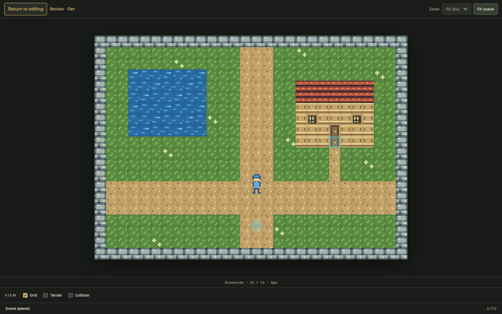

# Review a scene

Open a scene and choose **Review scene** in the canvas toolbar. Forge hides the
library, inspectors and authoring controls so the scene has more room. The scene
name and status remain visible below the canvas.

Drag to pan without holding Space. Pan is the only pointer tool in this mode.
Use the mouse wheel or **Zoom** menu for detail, or **Fit scene** to fit the entire
scene into the available space. Fit adjusts when the window changes size, including
at narrow widths. **Grid**, **Terrain** and **Collision** remain available for
inspection; **Snap to grid** is hidden because placement is disabled.

Choose **Return to editing**, or press Escape while the canvas or return button
has focus. The button is keyboard accessible with Tab and Enter/Space. Your prior
editing tool, brush, active layer and selection remain available when you return.
Review mode retains a usable camera position when switching layouts; at viewport
edges, scrolling is limited to the available scene area.

Entering, navigating and leaving review mode does not save or change scene data
and does not create undo steps. Existing unsaved work stays unsaved, and editing
shortcuts (including delete, paste, undo and save) are inactive until you return to
editing. Review mode starts off when opening a fresh browser session. It is
separate from sprite animation and movement preview; existing playback can continue
while you inspect the scene, but movement keyboard input is inactive.

If the open scene is removed externally while reviewing, Forge returns to the
normal workspace so you can choose another scene.
