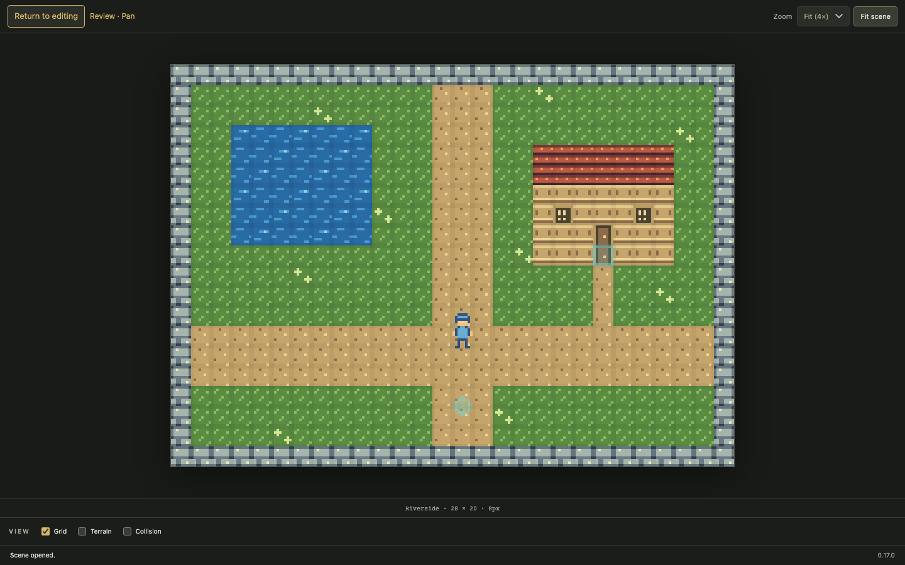
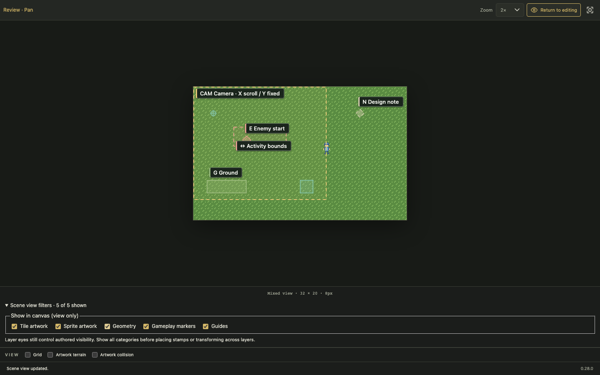

# Review a scene

Open a scene and choose **Review scene** in the canvas toolbar. Forge hides the
library, inspectors and authoring controls so the scene has more room. The scene
name and status remain visible below the canvas.

Drag with the left or middle mouse button to pan without holding Space. Release
the button to stop. Pan is the only pointer tool in this mode.
Use the mouse wheel or **Zoom** menu for detail, or **Fit scene** to fit the entire
scene into the available space. Fit adjusts when the window changes size, including
at narrow widths. **Grid**, **Artwork terrain** and **Artwork collision** remain available for
inspection; **Snap to grid** is hidden because placement is disabled.

Choose **Return to editing**, or press Escape while the canvas or return button
has focus. The button is keyboard accessible with Tab and Enter/Space. Your prior
editing tool, brush, active layer and selection remain available when you return.
Review mode retains a usable camera position when switching layouts; at viewport
edges, scrolling is limited to the available scene area.

Entering, navigating and leaving review mode does not save or change scene data
and does not create undo steps. Existing unsaved work stays unsaved, and editing
shortcuts (including delete, paste, undo and save) are inactive until you return to
editing. Review mode starts off when opening a fresh browser session. It is
separate from sprite animation and movement preview; existing playback can continue
while you inspect the scene, but movement keyboard input is inactive.

If the open scene is removed externally while reviewing, Forge returns to the
normal workspace so you can choose another scene.

## Inspect one mixed scene

Keep tile artwork, sprite artwork, geometry, gameplay placements and guides in
one scene. Open **Scene view filters** below the canvas in editing or Review scene.
Every checkbox starts on; changes last for this mounted editor, including scene
switches, and reset on reload. These controls affect canvas display only.

| Filter | Objects shown |
| --- | --- |
| Tile artwork | Tile layers, including artwork metadata overlays |
| Sprite artwork | Sprite objects, including sprites carrying gameplay properties |
| Geometry | Non-art rectangles by default, including ground, water, pits and climbs |
| Gameplay markers | Non-art points by default, plus patrol, approach, arena and detour bounds |
| Guides | Camera frames, notes and named sections |

For artwork alone, keep tile/sprite artwork on and turn off the other three.
For blockout alone, turn off both artwork filters. For a combined view, show
artwork, geometry and gameplay markers; guides can be toggled independently.
Enemy markers and authored activity bounds remain ordinary scene objects.

[Artwork-only editing](../screenshots/scene-views/artwork-only.png) and
[narrow Review scene](../screenshots/scene-views/narrow.png) show the same mixed scene.

Classification reads resolved typed properties, including definition defaults
and instance overrides, never layer names. A string property `forge_view` with
value `geometry`, `gameplay` or `guides` explicitly classifies any non-art object.
Otherwise `blockout_role` supplies the guide/activity conventions above, then
shape supplies the default. Unknown/invalid categories fall back to those rules.
Sprites always count as sprite artwork. A single object layer can contain every
category. Use **Edit selected object** or definition fields to author the generic
property; no engine-specific configuration is needed.

Layer eyes control authored visibility. A view checkbox never reveals an authored
hidden layer. Hiding a category clears its current selection and excludes it from
hit testing and captions. Show the category before placing it, and show tile
artwork before painting/erasing tiles. Copy, cut, paste, duplicate, transforms and
stamp creation/placement and rectangular selection deletion/movement require all
categories on because compositions may span several layers. Filter changes are disabled during an edit gesture.

Filters do not change scene content, dirty state, Undo/Redo, recovery checkpoints,
saves, exports, diagnostics or gameplay inclusion. Saving while filtered retains
all objects and authored layer visibility. Consumers independently decide runtime
meaning from the authored portable data. **Artwork terrain** and **Artwork
collision** still inspect imported artwork metadata; they do not toggle blockout
rectangles or gameplay markers. These metadata overlays follow the artwork filters.

The read-only MCP `review_scene` tool provides camera and bounded overview SVGs
with embedded native-scale artwork and planning overlays/captions. It uses the
same classification and authored-visibility rules. See [MCP review](../MCP.md#combined-scene-review).
