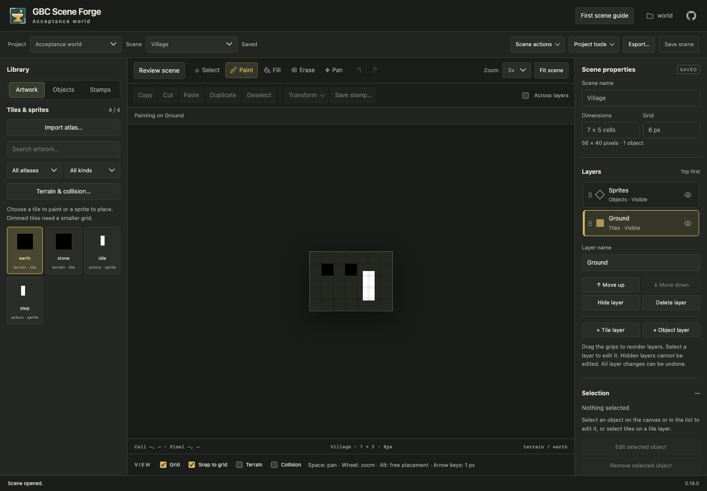

# Open a scene from a link

Opening a scene adds its stable scene ID to the address bar:

- Project root launcher: `/projects/<project>/scenes/<scene-id>`.
- Direct project server: `/scenes/<scene-id>`.

Copy or bookmark this address to reopen the current saved scene in the same
running server. Reloading or opening the address in another tab loads the saved
scene and offers applicable draft recovery. The address does not contain unsaved
edits, a historical revision, zoom, selection or other transient editor state.
Renaming a scene preserves its link. Deleting it makes the link unavailable;
choose another scene from the scene list when the editor reports a missing ID.
These local links require the same server address and project to remain available.

Back and Forward revisit opened scenes and the project scene chooser. Leaving
unsaved edits through history asks whether to keep editing or discard and open.
Canceling keeps the active scene and its address. Normal scene switching retains
its Save and open / Discard and open / Keep editing choices. Busy operations,
active gestures and open dialogs prevent history from replacing the editor.
A project address without a scene continues to open the scene chooser.

The browser acceptance fixture reopened from its scene URL:

