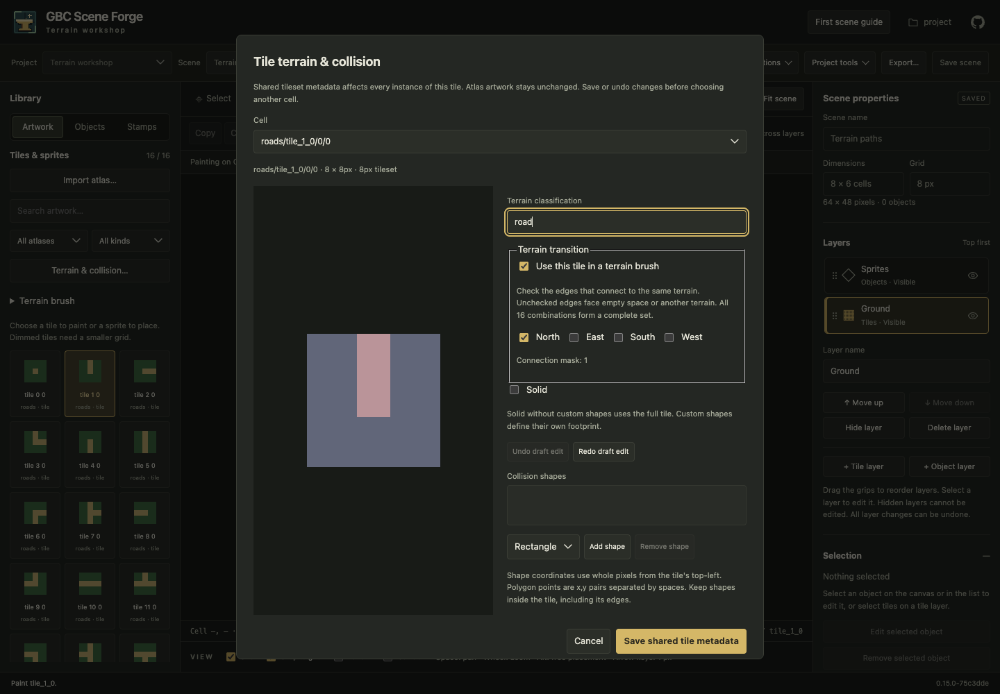
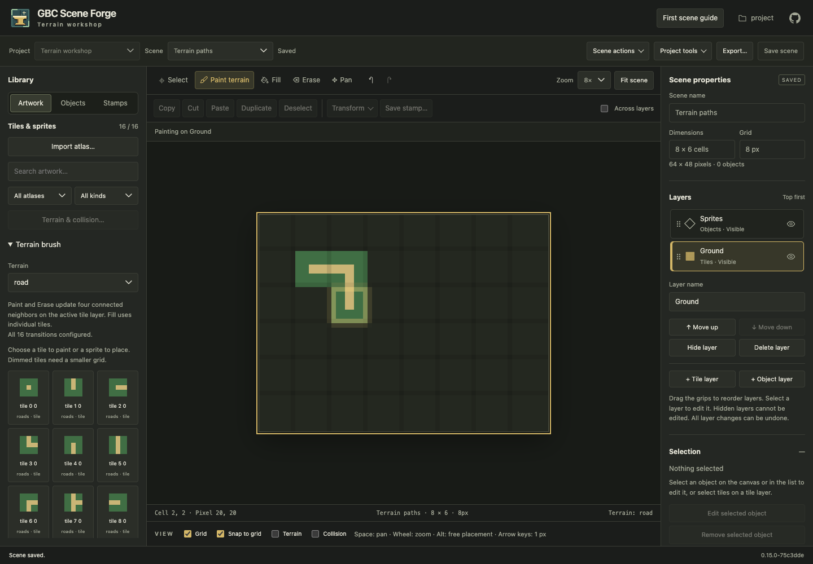

# Terrain brushes

Terrain brushes choose road, wall or shoreline tiles from their four immediate
neighbors. Start with imported artwork and an open scene with a visible tile
layer. PNG sheets and gbc-atlas artwork both work.

## Configure the transitions

1. Choose a tile in **Library → Artwork**, then **Terrain & collision…**.
   For a region containing several cells, choose the cell at the top of the dialog.
2. Enter a **Terrain classification**, such as `road`. Names are case sensitive;
   use the same name for every variant of that terrain.
3. Enable **Use this tile in a terrain brush**. Check the edges that connect to
   the same terrain: **North**, **East**, **South**, **West**. For example, a road
   corner connecting north and east has those two edges checked.
4. Save shared tile metadata. Repeat for the other variants. Each scene grid has
   its own tile metadata; configure the grid you intend to paint.

No edges checked means an isolated tile. All four checked means an interior tile.
Sixteen combinations cover the complete four-neighbor model. You can start with
fewer: the brush explicitly reports missing masks. Draft Undo/Redo in the dialog
changes the rule draft; Save writes shared metadata with the existing revision guard.

The collision controls remain independent. Rule setup never edits Solid or collision
shapes. Give automatic variants consistent collision metadata. A brush with variants
that differ is rejected when painting; an existing neighbor with incompatible
collision geometry is retained with a warning. This conservative check also applies
to transformed placements. Editing shared collision metadata intentionally remains
possible through the existing controls.

## Paint and erase

1. Expand **Terrain brush** below **Terrain & collision…** in the Artwork library.
   This section appears once the current grid has at least one transition rule.
2. Choose a terrain. This selects **Paint** and clears individual tile, sprite,
   object and stamp brushes. Paint on a visible tile layer.
3. Draw the terrain. Forge updates the painted cell and its immediate neighbors
   on that layer. A drag is one undoable stroke, including its neighbor changes.
4. Choose **Erase** to remove cells and repair their neighbors. Scene borders,
   empty cells and other terrain names count as disconnected edges.
5. **Save scene** persists the resulting ordinary tile placements. Reopening the
   project retains the rules and the saved result.

Choosing ordinary artwork, an object, definition or stamp leaves terrain painting.
Choose **Paint individual tiles** to clear the terrain brush. Terrain brushes use
Paint and Erase; Fill remains an individual-tile operation. Select/copy/paste and
transforms preserve ordinary tile placements and do not automatically retile them.

## Missing and duplicate rules

The library reports missing connection masks and duplicate rules. The mask is the
sum of connected edges: north **1**, east **2**, south **4**, west **8**. North +
east is mask **3**; an interior tile is **15**. The status bar identifies unmatched
cells encountered while painting.

If a pattern is missing, existing terrain cells keep their tile. A newly painted
cell uses the first configured asset by ID as a visible fallback, so its terrain
membership remains available for later neighbor updates. Add the missing rule and
paint that cell again to resolve it. Duplicate rules choose the first asset by ID;
there is no random variation. Remove duplicates to choose the artwork explicitly.

Tiles classified with the same name participate in adjacency even without their
own rule. Terrain names connect only to themselves. Diagonal neighbors are ignored:
this first model does not distinguish inner diagonal corners, blend two terrain
names, synthesize rotated rules, or implement arbitrary automapping.

## Persistence, reimport and Tiled

Rules are project-owned metadata attached to stable tile identities, separate from
imported source artwork. Compatible reimport preserves them. Atlas deletion removes
its rules; scenes/stamps using the atlas still prevent deletion through existing
checks. Changing shared rules does not automatically rewrite saved scenes.

The optional `terrain_mask` integer (0–15) accompanies the existing `terrain` field
in the manifest's per-atlas, per-grid metadata. Sprites cannot define transition
rules. Projects without masks retain ordinary classification behavior and need no
migration. Older Forge versions that reject the new optional field should not be
used to edit projects after rules are saved.

Portable Tiled exports contain resolved tile GIDs and normal tilesets. Tile
properties include `forge:terrain` and optional integer `forge:terrain_mask`, using
[Tiled custom properties](https://doc.mapeditor.org/en/stable/manual/custom-properties/).
The rules are Forge conventions, not Tiled Wang sets or automapping rules: Tiled
can display the map but does not perform Forge's automatic neighbor updates. Use
whole-project export/reopen to retain the native Forge authoring data; the bounded
external Tiled importer does not import these custom rule properties.
